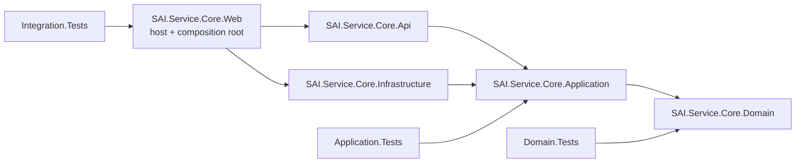
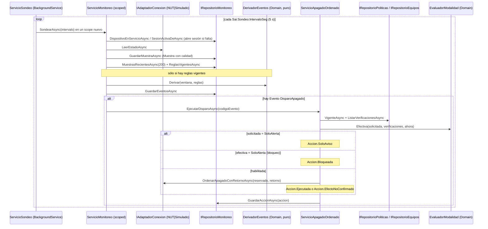

# 01 — Arquitectura

> **Propósito:** mapa de la arquitectura de SAI.Service.Core: las cinco capas (assemblies), quién referencia a quién, cómo se compone el proceso en `Program.cs`, el recorrido de punta a punta sondeo → evento → decisión de apagado y el catálogo completo de las 29 ADR, cada una con su decisión en una línea.
> **Fuente primaria:** `SAI.Service.Core.sln`, `Directory.Build.props`, `src/SAI.Service.Core/*/*.csproj`, `src/SAI.Service.Core/SAI.Service.Core.Web/Program.cs`, `src/SAI.Service.Core/SAI.Service.Core.Infrastructure/DependencyInjection.cs` y `SDD/Docs/05-Arquitectura-Tecnica/` (incluida `Adrs/`).
> Todas las rutas son relativas a la raíz del repo `SAI.Service.Core`. Se tomó como verdad el código de `main` (último commit `6fd23d5`, 2026-08-04); donde la documentación de 05 no coincide con el código, se marca **Divergencia**.

**Fuera de este índice** (se citan, no se desarrollan): entidades e invariantes → `02_Dominio-Y-Reglas.md`; esquema, migraciones y append-only → `03_Modelo-De-Datos.md`; detalle de cada servicio de Application → `04_Aplicacion-Y-Casos-De-Uso.md`; páginas Blazor, endpoints y contrato REST → `05_Interfaces-Panel-Y-Api.md`; adaptador NUT/simulado y protocolo → `06_Infraestructura-Y-Adaptador-Sai.md`; pruebas → `07_Calidad-Y-Pruebas.md`; contenedor, TLS y ambientes en operación → `08_Devops-Despliegue-Y-Operacion.md`; resto del árbol SDD → `09_Documentacion-Sdd.md`.

---

## 1. Estilo en una tabla

| Aspecto | Valor | Fuente |
| --- | --- | --- |
| Estilo | Clean Architecture en cinco assemblies, dependencias hacia el dominio | `SDD/Docs/05-Arquitectura-Tecnica/Adrs/ADR-15-Clean-Architecture-En-Cinco-Assemblies-v1.0.md` |
| Tipo de solución | `web-monolith`, «caso degenerado» de un único proyecto: un proceso, un contenedor, un archivo SQLite | `SDD/Docs/05-Arquitectura-Tecnica/README.md`, `SDD/Docs/05-Arquitectura-Tecnica/Arquitectura-Solucion-v1.0.md` §2 |
| Alternativas descartadas | Capas con acceso a datos desde la UI; event-driven con event store + CQRS (E-09) | `SDD/Docs/05-Arquitectura-Tecnica/Arquitectura-Solucion-v1.0.md` §2 |
| Marco | `net10.0`, `Nullable` y `ImplicitUsings` activos, `LangVersion latest` | `Directory.Build.props` |
| Rigor de compilación | `TreatWarningsAsErrors=true`, `EnforceCodeStyleInBuild=true`, `AnalysisLevel=latest-recommended`, `EnableNETAnalyzers=true` (STAGE-01/02 del pipeline) | `Directory.Build.props` |
| Globalización | `InvariantGlobalization=true` | `Directory.Build.props` |
| Versión de referencia | `0.1.0-alpha.1` (en el pipeline la calcularía MinVer, §17.P.7) | `Directory.Build.props`, `src/SAI.Service.Core/SAI.Service.Core.Web/appsettings.json` (`Sello`) |
| Único proyecto que arranca | `SAI.Service.Core.Web` (composition root y host) | `src/SAI.Service.Core/SAI.Service.Core.Web/SAI.Service.Core.Web.csproj` |
| Concurrencia de escritura | Un solo hilo escritor de la historia (T-01) | `SDD/Docs/05-Arquitectura-Tecnica/Arquitectura-Solucion-v1.0.md` §4 |

---

## 2. Solución y proyectos

`SAI.Service.Core.sln` agrupa ocho proyectos en dos carpetas de solución (`src`, `tests`).

```
SAI.Service.Core.sln
├── src/SAI.Service.Core/
│   ├── SAI.Service.Core.Domain           (núcleo, framework-free)
│   ├── SAI.Service.Core.Application      (casos de uso + puertos)
│   ├── SAI.Service.Core.Infrastructure   (EF Core/SQLite, adaptadores, hosted services, DI)
│   ├── SAI.Service.Core.Api              (endpoints /health y /api/v1)
│   └── SAI.Service.Core.Web              (host + panel Blazor + composition root)
└── tests/
    ├── SAI.Service.Core.Domain.Tests
    ├── SAI.Service.Core.Application.Tests
    └── SAI.Service.Core.Integration.Tests
```

### 2.1 Las cinco capas

| Assembly | Responsabilidad (según el código) | SDK | Referencias de proyecto | Paquetes NuGet | Fuente |
| --- | --- | --- | --- | --- | --- |
| `SAI.Service.Core.Domain` | Entidades, objetos de valor, invariantes, derivación de eventos, evaluador de modalidad, resolutor temporal. Sin EF Core, ASP.NET, Blazor ni NUT | `Microsoft.NET.Sdk` | — | — | `src/SAI.Service.Core/SAI.Service.Core.Domain/SAI.Service.Core.Domain.csproj`, `.../Domain/DominioMarcador.cs` |
| `SAI.Service.Core.Application` | Casos de uso (`Servicio*`), puertos (`IAdaptadorConexion`, `IDescubridorSai`, `IRepositorio*`), opciones y DTO de resultado | `Microsoft.NET.Sdk` | Domain | — | `src/SAI.Service.Core/SAI.Service.Core.Application/SAI.Service.Core.Application.csproj` |
| `SAI.Service.Core.Infrastructure` | `SaiDbContext` + repositorios + migraciones, adaptadores NUT/simulado, hosted services (`ServicioSondeo`, `ServicioRearmePruebas`), `AddInfrastructure` | `Microsoft.NET.Sdk` | Application | `Microsoft.EntityFrameworkCore.Sqlite` 10.0.0; `Microsoft.Extensions.Hosting.Abstractions` 10.0.0; `Microsoft.AspNetCore.Identity.EntityFrameworkCore` 10.0.0; `Microsoft.EntityFrameworkCore.Design` 10.0.0 (`PrivateAssets=all`); pines de seguridad `SQLitePCLRaw.bundle_e_sqlite3` 2.1.12 y `System.Security.Cryptography.Xml` 10.0.10 | `src/SAI.Service.Core/SAI.Service.Core.Infrastructure/SAI.Service.Core.Infrastructure.csproj` |
| `SAI.Service.Core.Api` | `/health` (anónimo) y grupo `/api/v1` (incluye `POST /api/v1/intervenciones`); `AddApi`/`MapApi` | `Microsoft.NET.Sdk` + `FrameworkReference Microsoft.AspNetCore.App` | Application | — | `src/SAI.Service.Core/SAI.Service.Core.Api/SAI.Service.Core.Api.csproj`, `.../Api/DependencyInjection.cs`, `.../Api/Endpoints/EndpointsSalud.cs`, `.../Api/Endpoints/EndpointsApiV1.cs` |
| `SAI.Service.Core.Web` | Host del proceso, panel Blazor interactive server con MudBlazor, Identity, JWT, endpoints de acceso (`/api/v1/token`, `/cuenta/cerrar-sesion`), semillas de arranque | `Microsoft.NET.Sdk.Web` (`UserSecretsId=sai-service-core-web`) | Api, Infrastructure | `MudBlazor` 8.5.0; `Microsoft.AspNetCore.Authentication.JwtBearer` 10.0.0 | `src/SAI.Service.Core/SAI.Service.Core.Web/SAI.Service.Core.Web.csproj` |

### 2.2 Proyectos de prueba (sólo su posición en el grafo; el detalle va en `07_Calidad-Y-Pruebas.md`)

| Proyecto | Referencia a | Paquetes que marcan su nivel | Fuente |
| --- | --- | --- | --- |
| `SAI.Service.Core.Domain.Tests` | Domain | xunit 2.9.2, FluentAssertions 6.12.2, coverlet 6.0.2 | `tests/SAI.Service.Core.Domain.Tests/SAI.Service.Core.Domain.Tests.csproj` |
| `SAI.Service.Core.Application.Tests` | Application | ídem | `tests/SAI.Service.Core.Application.Tests/SAI.Service.Core.Application.Tests.csproj` |
| `SAI.Service.Core.Integration.Tests` | Web (composition root) | + `Microsoft.AspNetCore.Mvc.Testing` 10.0.0, `Microsoft.EntityFrameworkCore.Sqlite` 10.0.0 | `tests/SAI.Service.Core.Integration.Tests/SAI.Service.Core.Integration.Tests.csproj` |

---

## 3. Grafo de dependencias real (`ProjectReference`)



| Desde | Hacia (directo) | Hacia (transitivo) | Fuente |
| --- | --- | --- | --- |
| Web | Api, Infrastructure | Application, Domain | `.../Web/SAI.Service.Core.Web.csproj` |
| Api | Application | Domain | `.../Api/SAI.Service.Core.Api.csproj` |
| Infrastructure | Application | Domain | `.../Infrastructure/SAI.Service.Core.Infrastructure.csproj` |
| Application | Domain | — | `.../Application/SAI.Service.Core.Application.csproj` |
| Domain | — | — | `.../Domain/SAI.Service.Core.Domain.csproj` |

- **Api e Infrastructure son hermanas**: ninguna referencia a la otra; sólo el host (Web) las une (comentario de `.../Api/SAI.Service.Core.Api.csproj`).
- **Web usa tipos de Infrastructure directamente**: `SaiDbContext`, `AdministradorUser` (`.../Web/Program.cs` L14-15, L46-58; `.../Web/Components/_Imports.razor` importa `SAI.Service.Core.Infrastructure.Persistencia`) y los servicios de Application que registra Infrastructure.
- **Divergencia (cadena lineal):** ADR-15 §2 y `Arquitectura-Solucion-v1.0.md` §2-§3 describen `Web → Api → Infrastructure → Application → Domain` (Api dependiendo de Infrastructure). El código implementa el grafo en diamante de arriba. Los propios `.csproj` documentan la forma vigente.
- **Divergencia (prueba de arquitectura):** `Arquitectura-Solucion-v1.0.md` §3 dice que la regla de dependencia está «verificada como test de arquitectura». En `tests/` sólo hay una prueba de andamiaje que referencia `DominioMarcador` (`tests/SAI.Service.Core.Domain.Tests/AndamiajeDominioTests.cs`); no se encontró ninguna prueba que inspeccione referencias entre assemblies. La regla se sostiene por el grafo de `.csproj` (no verificado como prueba).

---

## 4. Composición del proceso (`Program.cs` + `AddInfrastructure`)

### 4.1 Orden de registro de servicios

| # | Registro | Qué cablea | Decisión | Fuente |
| --- | --- | --- | --- | --- |
| 1 | `Configure<SelloVersion>("Sello")` | Sello de versión de la barra superior | — | `.../Web/Program.cs` L29, `.../Web/SelloVersion.cs` |
| 2 | `AddRazorComponents().AddInteractiveServerComponents()` + `AddMudServices()` | Panel Blazor Server + MudBlazor | §17.P.1 | `.../Web/Program.cs` L32-34 |
| 3 | `AddApi()` | Sólo `AddEndpointsApiExplorer` | ADR-15 | `.../Web/Program.cs` L37, `.../Api/DependencyInjection.cs` |
| 4 | `AddProblemDetails()` | Errores problem+json (RFC 7807) | ADR-17 | `.../Web/Program.cs` L39 |
| 5 | `AddInfrastructure(config)` | Persistencia, adaptador, repositorios, casos de uso, hosted services (ver 4.2) | ADR-02/04/18/27 | `.../Web/Program.cs` L40, `.../Infrastructure/DependencyInjection.cs` |
| 6 | `AddIdentity<AdministradorUser, IdentityRole>` sobre `SaiDbContext` | Administrador único; contraseña ≥ 12, con dígito y minúscula | ADR-16 | `.../Web/Program.cs` L45-59 |
| 7 | `AddDataProtection().SetApplicationName("SAI.Service.Core")` + `PersistKeysToFileSystem` si hay `DataProtection:RutaLlaves` | Keyring persistente (cookie + antiforgery) | ADR-29 | `.../Web/Program.cs` L69-76 |
| 8 | `ConfigureApplicationCookie` | Cookie `sai.auth`, login en `/acceso`, expiración deslizante | ADR-16 | `.../Web/Program.cs` L79-85 |
| 9 | `Configure<OpcionesJwt>("Jwt")` + chequeo `ClaveFirma` ≥ 32 bytes (si no, el arranque falla) | Configuración JWT | ADR-28 | `.../Web/Program.cs` L90-99, `.../Web/Autenticacion/OpcionesJwt.cs` |
| 10 | `AddSingleton<GeneradorTokens>()` | Emisor de JWT (ROPC) | ADR-28 | `.../Web/Program.cs` L101, `.../Web/Autenticacion/GeneradorTokens.cs` |
| 11 | `AddAuthentication().AddJwtBearer()` + `AddOptions<JwtBearerOptions>` diferido desde `IOptions<OpcionesJwt>` | Esquema dual cookie (default) + Bearer; firma y validación comparten origen | ADR-28 | `.../Web/Program.cs` L103-129 |
| 12 | `AddAuthorizationBuilder().AddPolicy("Api")` | Policy que exige Bearer en la API | ADR-28 | `.../Web/Program.cs` L132-137 |
| 13 | `AuthenticationStateProvider` = `ProveedorEstadoAutenticacionServidor` + `AddCascadingAuthenticationState` | Estado de autenticación del panel | ADR-16 | `.../Web/Program.cs` L141-144, `.../Web/Autenticacion/ProveedorEstadoAutenticacionServidor.cs` |

### 4.2 Lo que registra `AddInfrastructure`

| Grupo | Registro y ciclo de vida | Notas | Fuente (`src/SAI.Service.Core/SAI.Service.Core.Infrastructure/DependencyInjection.cs`) |
| --- | --- | --- | --- |
| Persistencia | `AddDbContext<SaiDbContext>` (scoped) con `UseSqlite` + `InterceptorAppendOnly` | Cadena `ConnectionStrings:Sai` leída en diferido (respeta overrides de pruebas); por defecto `Data Source=sai.db` | L39-52 |
| Adaptador SAI | Si `Sai:Adaptador == "Nut"`: `IClienteNut`→`ClienteNut`, `AdaptadorConexionNut` (singleton). Si no: `AdaptadorConexionSimulado` (singleton, `Sai:Simulado:EnBateria`) | `IAdaptadorConexion` e `IDescubridorSai` resuelven a la **misma** instancia. Default del repo: `Simulado` | L58-75 |
| Equipos (CU-02/CU-10) | `IRepositorioEquipos`, `ServicioAltaEquipos`, `ServicioVerificacion`, `ServicioEjercicioGuiado` (scoped); `OpcionesVerificacion` (singleton) | — | L78-82 |
| Monitoreo (CU-04/06/07) | `OpcionesSondeo` (singleton); `IRepositorioMonitoreo`, `ServicioMonitoreo`, `ServicioPanelEnVivo`, `ServicioHistoricos`, `ServicioPruebaBateria` (scoped); `OpcionesPrueba` (singleton) | Una ronda = un alcance de DI | L86-92 |
| Apagado y políticas (CU-05/CU-03) | `OpcionesApagado` (singleton, `TiempoReservadoSeg` acotado a `Accion.TechoDuroApagadoSeg`); `IRepositorioPoliticas`, `ServicioPoliticas`, `ServicioApagadoOrdenado` (scoped) | `OpcionesApagado` es sólo semilla; la verdad es la versión de política vigente | L97-100, L166-181 |
| Intervenciones (CU-08/CU-09) | `IRepositorioIntervenciones`, `ServicioRecambioBateria`, `IRepositorioSustituciones`, `ServicioSustitucionSai` (scoped) | — | L103-108 |
| Informes (CU-12) | `IRepositorioInformes`, `ServicioInformePeriodo` (scoped) | Sólo lectura | L111-112 |
| Ingesta (CU-11) | `IRepositorioIngesta`, `ServicioIngesta` (scoped) | Idempotencia por clave | L115-116 |
| Hosted services | `ServicioSondeo` (planificador), `ServicioRearmePruebas` (rearme tras reinicio del host, ADR-25) | — | L118-121 |

- Las opciones (`OpcionesNut`, `OpcionesVerificacion`, `OpcionesSondeo`, `OpcionesApagado`, `OpcionesPrueba`) se leen **a mano**, sin el binder de configuración, porque Infrastructure no lo referencia (`DependencyInjection.cs` L126-195).
- **Divergencia (selección del adaptador):** el ejemplo de `Extensibilidad-v1.0.md` §5 usa la variable `SAI_ADAPTADOR` y tipos `AdaptadorNut`/`AdaptadorSimulado`; el código usa la clave `Sai:Adaptador` (`Nut`/`Simulado`) y los tipos `AdaptadorConexionNut`/`AdaptadorConexionSimulado`, y registra en Infrastructure, no en Web. El documento lo declara «indicativo».

### 4.3 Arranque y pipeline HTTP

```
builder.Build()
 └─ scope de arranque
     ├─ db.Database.MigrateAsync()                      (ADR-18)
     ├─ rol "administrador" si falta                    (ADR-16)
     ├─ semilla de 4 ReglaDerivacion v1 si no hay reglas (BT-19/BT-20)
     ├─ semilla VersionPolitica.Inicial desde OpcionesApagado si no hay políticas (CU-03)
     └─ semilla FuenteDatos "fd-gmao-externo" (confianza Media) si falta (CU-11)
 └─ pipeline
     UseHsts (no-Development) → UseHttpsRedirection → UseStaticFiles
     → guarda de primer arranque (redirige a /alta-inicial mientras no hay administrador)
     → UseAuthentication → UseAuthorization → UseAntiforgery (después de auth, a propósito)
     → MapApi() [/health, /api/v1] → MapEndpointsAcceso() [/api/v1/token, /cuenta/cerrar-sesion]
     → MapRazorComponents<App>().AddInteractiveServerRenderMode()
```

| Pieza | Detalle | Fuente |
| --- | --- | --- |
| Semillas de arranque | Contenido y valores de cada semilla (reglas v1, política inicial, fuente GMAO): ver `03_Modelo-De-Datos.md` §7.1 | `.../Web/Program.cs` L152-200 |
| Guarda de primer arranque y antiforgery tras autenticación | Rutas exentas, tres capas y motivo del orden: ver `05_Interfaces-Panel-Y-Api.md` §2 y §4.5 | `.../Web/Program.cs` L218-247, L264-293 |
| Kestrel | `Kestrel:Endpoints:Http` = `http://0.0.0.0:8080` en `appsettings.json`; HTTPS 8443 sólo en Development | `.../Web/appsettings.json`, `.../Web/appsettings.Development.json`, `.../Web/Program.cs` L23-26 |
| `public partial class Program` | Para `WebApplicationFactory<Program>` | `.../Web/Program.cs` L299 |

- **Divergencia (TLS):** ADR-26 (Aceptado) fija TLS autofirmado en Kestrel, pero el comentario de `Program.cs` L25-26 y la clave `_RanuraTls` de `appsettings.json` todavía la presentan como «ranura P-04 (ADR-20) PENDIENTE». Cómo se configura en el contenedor: ver `08_Devops-Despliegue-Y-Operacion.md`.

---

## 5. Recorrido de punta a punta: sondeo → evento → decisión de apagado

### 5.1 Secuencia (según el código)



| Etapa | Clase | Capa | Qué decide | Fuente |
| --- | --- | --- | --- | --- |
| Planificador | `ServicioSondeo` | Infrastructure | `PeriodicTimer` al intervalo (`Sai:Sondeo:IntervaloSeg`, mín. 1 s); se apaga si `Habilitado=false`; una ronda fallida no detiene el bucle; cuenta sondeos perdidos sólo para el log | `src/SAI.Service.Core/SAI.Service.Core.Infrastructure/Monitoreo/ServicioSondeo.cs` |
| Ronda | `ServicioMonitoreo.SondearAsync` | Application | Sin dispositivo en servicio ⇒ `SinDispositivo`; si no, muestra `mue-…` con procedencia canónica; ventana de 200 muestras; devuelve `Registrada`/`Perdida` | `src/SAI.Service.Core/SAI.Service.Core.Application/Monitoreo/ServicioMonitoreo.cs` |
| Mapeo | `MapeoLecturas.DesdeEstado` | Application | Estado del adaptador → lecturas de la muestra | `src/SAI.Service.Core/SAI.Service.Core.Application/Monitoreo/MapeoLecturas.cs` |
| Derivación | `DerivadorEventos.Derivar` | Domain | Función pura: corte/retorno/microcorte, tensión, desconexión y disparo. El disparo se emite una sola vez al cruzar `umbralObSeg` en batería o al caer `battery.voltage` bajo `batVoltMin`; nunca por LB ni `battery.charge` | `src/SAI.Service.Core/SAI.Service.Core.Domain/Monitoreo/DerivadorEventos.cs` |
| Decisión | `ServicioApagadoOrdenado.EjecutarDisparoAsync` | Application | Modalidad solicitada, tiempo reservado y de retorno desde la `VersionPolitica` vigente (o `OpcionesApagado` si no hay) | `src/SAI.Service.Core/SAI.Service.Core.Application/Acciones/ServicioApagadoOrdenado.cs` |
| Bloqueo | `EvaluadorModalidad.Efectiva` | Domain | Degrada a `SoloAlerta` salvo que haya ≥ 4 supuestos (`SupuestosRequeridos`) y todos verificados y vigentes | `src/SAI.Service.Core/SAI.Service.Core.Domain/Verificaciones/EvaluadorModalidad.cs` |
| Orden al equipo | `IAdaptadorConexion.OrdenarApagadoConRetornoAsync` | Application (puerto) / Infrastructure (impl.) | En NUT: `ups.delay.shutdown`, `ups.delay.start` e INSTCMD `shutdown.return`; nunca `shutdown.stop` | `src/SAI.Service.Core/SAI.Service.Core.Application/Abstractions/IAdaptadorConexion.cs`, `src/SAI.Service.Core/SAI.Service.Core.Infrastructure/Adaptadores/Nut/AdaptadorConexionNut.cs` |
| Registro | `Accion` (append-only) | Domain | `SoloAviso` / `Bloqueada` / `Ejecutada` / `EfectoNoConfirmado` según `ResultadoAccion.Aceptada` (efecto observado) | `src/SAI.Service.Core/SAI.Service.Core.Domain/Acciones/Accion.cs` |

### 5.2 Pipelines diseñados en 05 frente al código

`SDD/Docs/05-Arquitectura-Tecnica/Flujo-Ejecucion-v1.0.md` define tres pipelines: **A** ronda de sondeo (A1-A7), **B** temporizador de disparo + decisión con degradación (B1-B5), **C** ejecución por efecto observado (C1-C4).

| Aspecto | Diseño (05) | Código | Estado |
| --- | --- | --- | --- |
| Temporizador de disparo | Temporizador con token de cancelación armado en OL→OB (B1-B2) | No hay temporizador: el disparo es una `ReglaDerivacion` evaluada sobre la ventana de muestras (`umbralObSeg`) | Divergencia de mecanismo; mismo efecto (no actuar ante microcortes) |
| Disparo por tensión | No figura en B | `batVoltMin` dispara independiente del tiempo | Agregado en código (BT-20) |
| Ubicación del planificador | «hosted service en `Application`» (ADR-15 §7, `Arquitectura-Solucion-v1.0.md` §3) | `ServicioSondeo` vive en Infrastructure; `IPlanificador` en Application es un marcador de Sprint 0 sin implementación | Divergencia |
| Apagado del SO del host (C1) | Invocación de `shutdown` del SO | `ServicioApagadoOrdenado` sólo ordena al SAI por el adaptador; no se encontró invocación al SO | no verificado |
| Empuje al panel (A5) | En cada ronda | El panel consulta servicios por `IServiceScopeFactory` (10 páginas lo inyectan); mecanismo de refresco: ver `05_Interfaces-Panel-Y-Api.md` | — |
| 1 Hz en prueba de batería (N-08) | Elevación de cadencia del planificador | `OpcionesPrueba.IntervaloMuestraMs` dentro de `ServicioPruebaBateria`, no en el planificador | Ver `04_Aplicacion-Y-Casos-De-Uso.md` |
| Rearme tras reinicio | — | `ServicioRearmePruebas` corre una vez al arrancar y llama `ServicioVerificacion.RearmarPruebasPendientesAsync` | Sólo en código (Etapa 4·E, ADR-25) |

---

## 6. Vistas de la arquitectura de solución (resumen de `Arquitectura-Solucion-v1.0.md`)

| § | Vista | Lo esencial | Detalle en |
| --- | --- | --- | --- |
| 2 | Estilo | Clean Architecture 5 assemblies vs. 2 alternativas, tabla de criterios | este índice §1 |
| 3 | Lógica | 5 assemblies + 2 componentes transversales (puerto del adaptador, planificador) | este índice §2-§3 |
| 4 | Procesos | Un proceso, un escritor; ronda < 1 s; circuito Blazor por WebSocket; 3 sondeos perdidos ⇒ `DesconexionUsb` | este índice §5 |
| 5 | Despliegue | Contenedor `linux/amd64` en `<host de producción>` + Dev Container; USB por ruta física; dos ambientes | `08_Devops-Despliegue-Y-Operacion.md` |
| 6 | Datos | SQLite + migraciones; 4 capas del modelo; retención Muestra 30 d / Agregado 10 a / Evento indefinido | `03_Modelo-De-Datos.md` |
| 7 | Cross-cutting | Logging local estructurado; problem+json; config por entorno; secretos fuera del repo; arranque en `SoloAlerta` | — |
| 8 | NFR | 25 NFR (N-01…N-25); camino crítico ≤ 540 s, grace Docker 150 s, decisión < 1 s, sondeo 5 s; cobertura 80/70 global y 90/85 en Domain; PENDIENTE N-03, N-20, N-25 | `07_Calidad-Y-Pruebas.md` |
| 9 | Riesgos | 14 riesgos R-01…R-14; principal R-12 (apagar un servidor sin backups) | `11_Estado-Y-Pendientes.md` |
| 10 | Trazabilidad | CU-01…CU-12 → RN → ADR → tests | `02_Dominio-Y-Reglas.md` |

Otros artefactos de la carpeta 05:

| Archivo | Contenido | Índice que lo desarrolla |
| --- | --- | --- |
| `SDD/Docs/05-Arquitectura-Tecnica/README.md` | Índice navegable de la categoría 05 | este índice |
| `SDD/Docs/05-Arquitectura-Tecnica/Decisiones-Arquitectura-v1.0.md` (v1.5) | Índice de ADR con estado, fecha y trazabilidad de origen (PA-01…PA-15, obligatorios, Sprint 0, Fase F, Etapa 1) | este índice §7 |
| `SDD/Docs/05-Arquitectura-Tecnica/Flujo-Ejecucion-v1.0.md` | Pipelines A/B/C del camino crítico | este índice §5 |
| `SDD/Docs/05-Arquitectura-Tecnica/Extensibilidad-v1.0.md` | Único punto de extensión: puerto del adaptador, 3 implementaciones, add-ons de dialecto diseñados | `06_Infraestructura-Y-Adaptador-Sai.md` |
| `SDD/Docs/05-Arquitectura-Tecnica/Contratos-REST-v1.0.md` | `POST /api/v1/intervenciones`, problem+json, 201/200/409/422 | `05_Interfaces-Panel-Y-Api.md` |
| `SDD/Docs/05-Arquitectura-Tecnica/Modelo-Datos-Logico-v1.0.md` | Modelo lógico con tipos físicos e índices | `03_Modelo-De-Datos.md` |

---

## 7. Catálogo de ADR (`SDD/Docs/05-Arquitectura-Tecnica/Adrs/`)

29 ADR: 24 Aceptado (01–18, 24–29), 1 Propuesto (ADR-21) y 4 Superado (ADR-19/20/22 por ADR-25/26/27; ADR-23 por el reajuste SDD v3.0), según el campo `Estado` de cada archivo y la tabla de `Decisiones-Arquitectura-v1.0.md` v1.5. El control de cambios v1.5 de ese mismo documento dice «25 Aceptado» porque todavía cuenta ADR-23 como aceptada (ver §8, divergencia 5). Los ADR son **inmutables**: una decisión que cambia genera una ADR nueva y la anterior pasa a `Superado por ADR-YY` (`Decisiones-Arquitectura-v1.0.md`, notas).

| ADR | Categoría | Estado | Decisión en una línea | Archivo (`Adrs/…`) |
| --- | --- | --- | --- | --- |
| 01 | Comunicación | Aceptado | Acceder al SAI sólo por NUT (`nutdrv_qx` + `upsd`), sin traductor de protocolo propio | `ADR-01-Adopcion-De-Nut-Como-Acceso-Al-Sai-v1.0.md` |
| 02 | Extensibilidad | Aceptado | Adaptador de conexión: puerto en Application, implementaciones en Infrastructure (NUT, directo diseñado, simulado) | `ADR-02-Adaptador-De-Conexion-Con-Tres-Implementaciones-v1.0.md` |
| 03 | Despliegue | Aceptado | Anclar el USB por ruta física de puerto (`ID_PATH=…-usb-0:3`) con regla `udev`, no por serial ni `/dev/bus/usb` entero | `ADR-03-Anclaje-Del-Usb-Por-Ruta-Fisica-De-Puerto-v1.0.md` |
| 04 | Persistencia | Aceptado | Tablas de hechos append-only como disciplina; sin event store ni CQRS | `ADR-04-Historia-Append-Only-Sin-Event-Store-v1.0.md` |
| 05 | Persistencia | Aceptado | Vigencia como entidad con intervalo (`MontajeBateria`, `CoberturaHost`) resuelta por `ResolutorTemporal` | `ADR-05-Vigencia-Como-Entidad-Con-Intervalo-v1.0.md` |
| 06 | Persistencia | Aceptado | Todo valor lleva `Origen` (`Valor<T>`: medido, derivado, estimadoPorDriver, declarado, imputado, noCalculable) | `ADR-06-Procedencia-Obligatoria-En-Todo-Valor-v1.0.md` |
| 07 | Persistencia | Aceptado | Cuatro capas separadas: catálogo, inventario (baja lógica), vínculos temporales, historia | `ADR-07-Separacion-De-Catalogo-Inventario-E-Historia-v1.0.md` |
| 08 | Persistencia | Aceptado | `Agregado` no hereda de `Muestra`; declara cobertura y, para `input.voltage`, guarda mín./máx. | `ADR-08-Agregado-No-Hereda-De-Muestra-v1.0.md` |
| 09 | Seguridad | Aceptado | `CicloForzado`: iniciado el apagado, el corte del SAI no se cancela; nunca `shutdown.stop` | `ADR-09-Modalidad-Ciclo-Forzado-De-Apagado-v1.0.md` |
| 10 | Seguridad | Aceptado | Arranque forzado en `SoloAlerta`; con un supuesto no verificado/vencido/refutado, la `Accion` queda `BloqueadaPorVerificacion` | `ADR-10-Arranque-Seguro-Y-Bloqueo-Por-Verificacion-v1.0.md` |
| 11 | Observabilidad | Aceptado | Toda acción se valida por efecto observado; 3 sondeos perdidos ⇒ `DesconexionUsb` + alerta | `ADR-11-Validacion-Por-Efecto-Observado-v1.0.md` |
| 12 | Comunicación | Aceptado | El disparo se decide por tiempo en `OB` + `battery.voltage`; nunca por `LB`, `battery.runtime` ni `battery.charge` | `ADR-12-Disparo-Sin-Dependencia-Del-Flag-Lb-v1.0.md` |
| 13 | Observabilidad | Aceptado | Salud = tendencia relativa de la caída de tensión en el autotest, a carga igualada, con confianza explícita (arranca `baja`) | `ADR-13-Metodo-De-Salud-Por-Caida-De-Tension-v1.0.md` |
| 14 | Seguridad | Aceptado | El autoencendido de BIOS se verifica por comportamiento (CU-10) y se renueva por evidencia contra `wtmp` | `ADR-14-Verificacion-De-Bios-Por-Comportamiento-v1.0.md` |
| 15 | Estilo | Aceptado | Clean Architecture en cinco assemblies hacia el dominio; dominio sin frameworks; un solo desplegable | `ADR-15-Clean-Architecture-En-Cinco-Assemblies-v1.0.md` |
| 16 | Seguridad | Aceptado | ASP.NET Core Identity, un rol `administrador`, PBKDF2, cookie; alta inicial sólo sin administrador; `/health` anónimo | `ADR-16-Autenticacion-De-Administrador-Unico-v1.0.md` |
| 17 | Comunicación | Aceptado | API de ingesta con problem+json, cabeceras `X-Idempotency-Key`/`X-Fuente-Datos` y caminos 201/200/409/422 | `ADR-17-Manejo-De-Errores-De-La-Api-De-Ingesta-v1.0.md` |
| 18 | Persistencia | Aceptado | SQLite con EF Core y migraciones versionadas aplicadas al arranque; un archivo, un escritor | `ADR-18-Motor-Sqlite-Con-Ef-Core-Y-Migraciones-v1.0.md` |
| 19 | Despliegue | Superado por ADR-25 | Pendiente P-03: NUT en contenedor o en host (sólo opciones) | `ADR-19-Ubicacion-De-Nut-Contenedor-O-Host-v1.0.md` |
| 20 | Seguridad | Superado por ADR-26 | Pendiente P-04: opciones de TLS del panel y la API en la LAN | `ADR-20-Tls-Del-Panel-Y-La-Api-En-La-Lan-v1.0.md` |
| 21 | Comunicación | Propuesto | Pendiente P-05: contrato del endpoint de rectificación del 409 (diferido a la Etapa 5) | `ADR-21-Contrato-Del-Endpoint-De-Rectificacion-v1.0.md` |
| 22 | Extensibilidad | Superado por ADR-27 | Pendiente P-06: forma de la firma del puerto del adaptador | `ADR-22-Contrato-Del-Adaptador-De-Conexion-v1.0.md` |
| 23 | Estilo | Superado (reajuste SDD v3.0, 2026-07-26) | No generar categoría 10-Developer-Guide; el onboarding iba al README raíz | `ADR-23-Omision-De-Developer-Guide-Dedicada-v1.0.md` |
| 24 | Despliegue | Aceptado | Dos ambientes, DEV (Dev Container) y PROD (`<host de producción>`), sin QA ni staging | `ADR-24-Modelo-De-Ambientes-Dev-Prod-Sin-Staging-v1.0.md` |
| 25 | Despliegue | Aceptado | NUT (`nutdrv_qx` + `upsd`) dentro del contenedor del servicio, único consumidor del USB | `ADR-25-Nut-En-El-Contenedor-v1.0.md` |
| 26 | Seguridad | Aceptado | TLS terminado en Kestrel con certificado autofirmado, sin reverse proxy | `ADR-26-Tls-Autofirmado-En-Kestrel-v1.0.md` |
| 27 | Extensibilidad | Aceptado | Puerto `IAdaptadorConexion` en `Application.Abstractions` con 4 operaciones async cancelables y resultados por efecto observado | `ADR-27-Contrato-Del-Puerto-Del-Adaptador-De-Conexion-v1.0.md` |
| 28 | Seguridad | Aceptado | API con Bearer JWT HS256 obtenido por ROPC en `POST /api/v1/token`; esquema dual cookie (panel) + Bearer (policy `Api`) | `ADR-28-Autenticacion-De-La-Api-Con-Bearer-Jwt-Via-Ropc-v1.0.md` |
| 29 | Seguridad | Aceptado | Keyring de DataProtection persistido en volumen (`DataProtection:RutaLlaves`) con `SetApplicationName` estable | `ADR-29-Persistencia-Del-Keyring-De-Dataprotection-v1.0.md` |

### 7.1 Cadenas de reemplazo y dependencias entre ADR

```
ADR-19 (P-03) ──superado por──> ADR-25  NUT en el contenedor   (apoya ADR-03)
ADR-20 (P-04) ──superado por──> ADR-26  TLS autofirmado        (apoya ADR-16)
ADR-22 (P-06) ──superado por──> ADR-27  contrato del puerto    (cierra ADR-02, materializa ADR-11)
ADR-16 ──complementado por──> ADR-28 (API Bearer)  y  ADR-29 (keyring)
ADR-21 (P-05) ── sigue Propuesto (Etapa 5, depende de la ingesta, ADR-17)
```

Fuente: `SDD/Docs/05-Arquitectura-Tecnica/Decisiones-Arquitectura-v1.0.md` (índice y trazabilidad de origen).

### 7.2 Dónde se ve cada ADR en el código

| ADR | Punto de implementación | Fuente |
| --- | --- | --- |
| 02 / 27 | `IAdaptadorConexion`, `IDescubridorSai`; selección por `Sai:Adaptador` | `.../Application/Abstractions/IAdaptadorConexion.cs`, `.../Infrastructure/DependencyInjection.cs` L58-75 |
| 04 | `InterceptorAppendOnly` agregado al `DbContext` | `.../Infrastructure/Persistencia/InterceptorAppendOnly.cs`, `.../Infrastructure/DependencyInjection.cs` L51 |
| 09 | `shutdown.return`, nunca `shutdown.stop` | `.../Infrastructure/Adaptadores/Nut/AdaptadorConexionNut.cs` L162-173 |
| 10 | `EvaluadorModalidad.Efectiva` + `Accion.Bloqueada` | `.../Domain/Verificaciones/EvaluadorModalidad.cs`, `.../Application/Acciones/ServicioApagadoOrdenado.cs` |
| 11 | `Accion.Ejecutada` sólo si `ResultadoAccion.Aceptada` | `.../Application/Acciones/ServicioApagadoOrdenado.cs` L110-115 |
| 12 | `DerivarDisparo` filtra por estado en batería y tensión | `.../Domain/Monitoreo/DerivadorEventos.cs` L158-203 |
| 15 | Grafo de `.csproj` (§3) | `src/SAI.Service.Core/*/*.csproj` |
| 16 | `AddIdentity`, cookie `sai.auth`, guarda de primer arranque | `.../Web/Program.cs` L45-85, L218-236 |
| 17 | `AddProblemDetails` | `.../Web/Program.cs` L39 |
| 18 | `UseSqlite` + `MigrateAsync` al arranque | `.../Infrastructure/DependencyInjection.cs` L49-51, `.../Web/Program.cs` L152 |
| 25 | `ServicioRearmePruebas` (el reinicio del contenedor señala el del host) | `.../Infrastructure/Monitoreo/ServicioRearmePruebas.cs` |
| 28 | `GeneradorTokens`, `AddJwtBearer`, policy `Api`, `POST /api/v1/token` | `.../Web/Program.cs` L90-137, `.../Web/Endpoints/EndpointsAcceso.cs` |
| 29 | `AddDataProtection` + `PersistKeysToFileSystem` | `.../Web/Program.cs` L69-76 |

- **Divergencia (firma de ADR-27):** el ADR publica `OrdenarApagadoConRetornoAsync(TimeSpan retardo, CancellationToken ct)`; el código agrega `TimeSpan retardoRetorno` (`.../Application/Abstractions/IAdaptadorConexion.cs` L37), que llegó con la política de tiempo de retorno (migración `20260727130117_PoliticaTiempoRetorno`). El ADR, por ser inmutable, no se actualizó.

---

## 8. Divergencias y notas de vigencia (resumen)

| # | Tema | Documentación | Código / evidencia | Fuente |
| --- | --- | --- | --- | --- |
| 1 | Grafo de capas | Cadena lineal `Web → Api → Infrastructure → Application → Domain` | Diamante: Web → {Api, Infrastructure} → Application → Domain | ADR-15 §2; `src/SAI.Service.Core/*/*.csproj` |
| 2 | Ubicación del planificador | Hosted service en Application | `ServicioSondeo` en Infrastructure; `IPlanificador` sin implementar | ADR-15 §7; `.../Infrastructure/Monitoreo/ServicioSondeo.cs`, `.../Application/Abstractions/IPlanificador.cs` |
| 3 | Temporizador de disparo | Token de cancelación (Pipeline B) | Regla `regla-disparo` sobre la ventana de muestras | `Flujo-Ejecucion-v1.0.md` §3; `.../Domain/Monitoreo/DerivadorEventos.cs` |
| 4 | Prueba de arquitectura | «verificada como test de arquitectura» | Sólo `AndamiajeDominioTests` (no verificado como prueba de dependencias) | `Arquitectura-Solucion-v1.0.md` §3; `tests/SAI.Service.Core.Domain.Tests/AndamiajeDominioTests.cs` |
| 5 | Cantidad de ADR | Conteos desfasados en el README de 05, `Arquitectura-Solucion` y el control de cambios de `Decisiones-Arquitectura` | 29 ADR (24/1/4) según el `Estado` de cada archivo; detalle de cada desfasaje en `11_Estado-Y-Pendientes.md` §7 | `SDD/Docs/05-Arquitectura-Tecnica/Adrs/*.md` |
| 6 | Firma del puerto | ADR-27 con un `TimeSpan` | Dos `TimeSpan` (retardo y retorno) | `ADR-27-…`, `.../Application/Abstractions/IAdaptadorConexion.cs` |
| 7 | TLS | ADR-26 Aceptado | Comentarios de `Program.cs`, `_RanuraTls` de `appsettings.json` y el mensaje de error de `Jwt:ClaveFirma` (L96-98) siguen citando ADR-20 / «PENDIENTE» | `.../Web/Program.cs` L23-26 y L93-99, `.../Web/appsettings.json` |
| 8 | Comentarios de andamiaje | `.csproj` de Domain, `DominioMarcador` y `IPlanificador` dicen «Sprint 0, sin entidades / sin lógica»; el doc-comment de `IAdaptadorConexion` dice «ADR-22 pendiente» y que la única implementación es el simulado | Domain ya tiene 53 archivos `.cs` (Acciones, Catalogo, Historia, Intervenciones, Inventario, Monitoreo, Politicas, Valores, Verificaciones, Vinculos); la firma la cerró ADR-27 y existe `AdaptadorConexionNut` | `.../Domain/SAI.Service.Core.Domain.csproj`; `git ls-files src/SAI.Service.Core/SAI.Service.Core.Domain`; `.../Application/Abstractions/IAdaptadorConexion.cs` L3-16 |
| 9 | Selección del adaptador | `SAI_ADAPTADOR` en el composition root | `Sai:Adaptador` dentro de `AddInfrastructure` | `Extensibilidad-v1.0.md` §5; `.../Infrastructure/DependencyInjection.cs` |
| 10 | Apagado del SO (Pipeline C1) | El servicio invoca `shutdown` del host | Sin invocación encontrada en Application/Infrastructure (no verificado) | `Flujo-Ejecucion-v1.0.md` §4 |

Fechas: los documentos de 05 son del 2026-07-20/21 y su última modificación en git es `4f5c6bf` (2026-07-26, reajuste SDD v3.0); el código siguió evolucionando hasta `6fd23d5` (2026-08-04). Para lo pendiente de corregir, ver `11_Estado-Y-Pendientes.md`.
