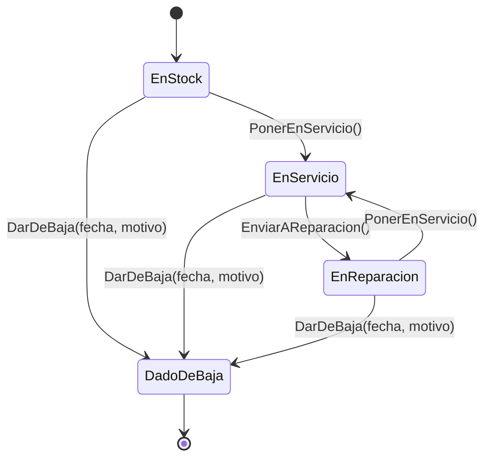
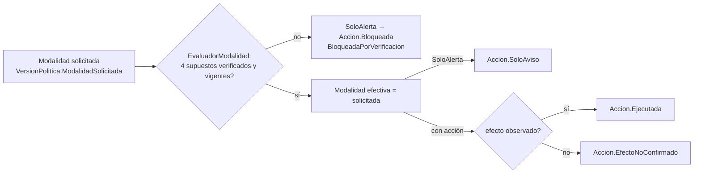

# 02 — Dominio y reglas de negocio

> **Propósito:** mapa del assembly `SAI.Service.Core.Domain` (entidades, value objects, enums, servicios de dominio puros e invariantes) y del catálogo de reglas de negocio RN-01…RN-13, cada una atada a dónde se implementa.
> **Fuentes primarias:** `src/SAI.Service.Core/SAI.Service.Core.Domain/` (53 archivos `.cs` + `.csproj`) y `SDD/Docs/02-Especificacion-Funcional/Reglas-De-Negocio/` (13 RN). Lista de invariantes I-1…I-21: `SDD/Intake/SOLUTION-INTAKE-Sai-Service-Core-v1.0.md` (tabla en ~L1999-2019).
> **Corte:** HEAD `6fd23d5` (2026-08-04). Todas las rutas son relativas a la raíz del repo `SAI.Service.Core`.
> **No cubre:** mapeo EF/tablas/CHECKs/migraciones → `03_Modelo-De-Datos.md`; servicios de aplicación y CU → `04_Aplicacion-Y-Casos-De-Uso.md`; adaptador NUT → `06_Infraestructura-Y-Adaptador-Sai.md`; pruebas → `07_Calidad-Y-Pruebas.md`; términos → `10_Glosario.md`; ubicación de la capa en Clean Architecture → `01_Arquitectura.md`.

Abreviatura en este índice: **`Domain/`** = `src/SAI.Service.Core/SAI.Service.Core.Domain/`.

---

## 1. Principios del dominio (transversales)

| Principio | Cómo se materializa en código | Fuente |
|---|---|---|
| Framework-free (sin EF, ASP.NET, Blazor, NUT) | `.csproj` sin referencias; constructores privados "de materialización" sin atributos de EF | `Domain/SAI.Service.Core.Domain.csproj`, `Domain/DominioMarcador.cs`, ADR-15 |
| Historia append-only | Interfaz marcador `IEntidadHistoria`; la hace cumplir un interceptor de `SaveChanges` en Infraestructura (BT-09) que rechaza `Modified`/`Deleted` | `Domain/Historia/IEntidadHistoria.cs`, `SDD/Docs/05-Arquitectura-Tecnica/Adrs/ADR-04-Historia-Append-Only-Sin-Event-Store-v1.0.md` |
| Catálogo ("qué es") ≠ Inventario ("cuál es") ≠ Historia | Tres subcarpetas `Catalogo/`, `Inventario/`, y entidades `IEntidadHistoria` | ADR-07 (`...Adrs/ADR-07-Separacion-De-Catalogo-Inventario-E-Historia-v1.0.md`) |
| Vigencia como entidad con intervalo semiabierto `[Desde, Hasta)` | `Vigencia` + `IVinculoTemporal` + `Vigencias` + `ResolutorTemporal` | ADR-05 |
| Procedencia en todo valor | `Valor<T>` + `Origen`; mapa variable→origen por `SesionSondeo` | ADR-06, RN-05 |
| Enums arrancan en 1 | El `default` (0) nunca es válido; los 13 enums arrancan en 1 (el comentario lo explicita en 11; no en `Supuesto` ni `EstadoSesionEjercicio`) | cada enum (ver §3) |
| Identidad por código de negocio | Toda entidad expone `Codigo` (string) validado con `ThrowIfNullOrWhiteSpace`; referencias entre entidades por `XxxCodigo`, no por navegación | todas las entidades |
| Fábricas estáticas con nombre | `Accion.Bloqueada/SoloAviso/Ejecutada/EfectoNoConfirmado`, `VersionPolitica.Inicial/Siguiente`, `Muestra.Registrar`, `PruebaBateria.Registrar`, `FichaVidaUtil.Proyectar`, `Verificacion.Sembrar`, `SesionEjercicio.Iniciar` | archivos respectivos |

---

## 2. Inventario del assembly por subcarpeta

```
Domain/
├── DominioMarcador.cs            marcador del assembly (Capa = "Domain")
├── SAI.Service.Core.Domain.csproj
├── Acciones/        acción de apagado + su estado
├── Catalogo/        fabricante, modelos de SAI y de batería
├── Historia/        marcador append-only
├── Intervenciones/  recambio, sustitución de SAI, ingesta, costos, ficha de vida útil
├── Inventario/      UnidadFisica (máquina de estados) y sus subtipos Host/Dispositivo/Bateria
├── Monitoreo/       sondeo, muestras, eventos, agregados, salud de batería
├── Politicas/       versión inmutable de política de apagado
├── Valores/         value objects Valor<T>, Origen, Dinero
├── Verificaciones/  los 4 supuestos, verificación, modalidad, ejercicio guiado
└── Vinculos/        vigencias, montajes, coberturas, resolución temporal
```

| Archivo (`Domain/…`) | Tipo | Historia (`IEntidadHistoria`) | RN / invariantes citados |
|---|---|:-:|---|
| `DominioMarcador.cs` | static class | — | ADR-15 |
| `Acciones/Accion.cs` | entidad sealed | sí | RN-01, RN-02, RN-03, RN-04, I-10 |
| `Acciones/EstadoAccion.cs` | enum | — | RN-01, RN-02, RN-03, I-11 |
| `Catalogo/Fabricante.cs` | entidad | — | ADR-07 |
| `Catalogo/ModeloBateria.cs` | entidad | — | RN-13, I-21 |
| `Catalogo/ModeloDispositivo.cs` | entidad | — | I-7 (potencia con `Valor<double>`) |
| `Historia/IEntidadHistoria.cs` | interfaz marcador | — | ADR-04 |
| `Intervenciones/Costos.cs` | `readonly record struct` | — | RN-07, RN-08 |
| `Intervenciones/DisposicionFinal.cs` | `readonly record struct` | — | CU-08 §4.6 |
| `Intervenciones/FichaVidaUtil.cs` | entidad | sí | RN-07, ADR-06 |
| `Intervenciones/Intervencion.cs` | entidad | sí | RN-08 |
| `Intervenciones/IntervencionIngerida.cs` | entidad | sí | RN-08, ADR-17 (RN-09 vía clave) |
| `Intervenciones/SustitucionSai.cs` | entidad | sí | RN-07 |
| `Intervenciones/TipoIntervencionSai.cs` | enum | — | CU-09 |
| `Inventario/UnidadFisica.cs` | clase abstracta | — | RC-08, I-5, I-6 (RN-12) |
| `Inventario/Host.cs` | entidad | — | ADR-07 |
| `Inventario/Dispositivo.cs` | entidad | — | ADR-07 |
| `Inventario/Bateria.cs` | entidad | — | ADR-07 |
| `Inventario/EstadoUnidad.cs` | enum | — | RC-08, I-6 |
| `Monitoreo/Agregado.cs` | entidad | sí | RN-10, I-20, ADR-08 |
| `Monitoreo/CalculadorAgregado.cs` | servicio puro | — | I-20 |
| `Monitoreo/CalculadorSaludBateria.cs` | servicio puro + record `ResultadoSalud` | — | RN-06, I-16, ADR-13, R-09 |
| `Monitoreo/CalidadMuestra.cs` | enum | — | CL-12 |
| `Monitoreo/ConfianzaFuente.cs` | enum | — | — |
| `Monitoreo/ConfianzaVeredicto.cs` | enum | — | ADR-13 |
| `Monitoreo/DerivadorEventos.cs` | servicio puro | — | RC-09, ADR-12 |
| `Monitoreo/Evento.cs` | entidad | sí | RC-09, I-14 |
| `Monitoreo/FuenteDatos.cs` | entidad | sí | — |
| `Monitoreo/Muestra.cs` | entidad | sí | RC-07 |
| `Monitoreo/PruebaBateria.cs` | entidad | sí | RN-06, I-15, I-16 |
| `Monitoreo/ReglaDerivacion.cs` | entidad versionada | sí | RC-09 |
| `Monitoreo/SesionSondeo.cs` | entidad | sí | US-10 |
| `Monitoreo/TipoEvento.cs` | enum | — | RC-09 |
| `Monitoreo/Variables.cs` | static (constantes + mapa) | — | RN-05, DM-02/03/05 |
| `Monitoreo/VeredictoSalud.cs` | enum | — | ADR-13 |
| `Politicas/VersionPolitica.cs` | entidad versionada | sí | RN-04, RN-11, I-10 |
| `Valores/Dinero.cs` | `readonly record struct` | — | RN-07, I-18 |
| `Valores/Origen.cs` | enum | — | RN-05, ADR-06 |
| `Valores/Valor.cs` | `readonly record struct Valor<T>` | — | RN-05, I-7 |
| `Verificaciones/EstadoVerificacion.cs` | enum | — | ADR-10, RN-02 |
| `Verificaciones/EvaluadorModalidad.cs` | servicio puro | — | RN-01, RN-02 |
| `Verificaciones/Modalidad.cs` | enum | — | RN-01, RN-02, ADR-09 |
| `Verificaciones/SecuenciaFisica.cs` | static | — | — |
| `Verificaciones/SesionEjercicio.cs` | entidad + enum `EstadoSesionEjercicio` | no | ADR-11 |
| `Verificaciones/Supuesto.cs` | enum | — | ADR-10 |
| `Verificaciones/Verificacion.cs` | entidad de estado actual | **no** | RN-02, ADR-10 |
| `Verificaciones/VigenciasSupuesto.cs` | static | — | ADR-14, R-01 |
| `Vinculos/CoberturaHost.cs` | vínculo temporal | no | I-4, RC-02 |
| `Vinculos/IVinculoTemporal.cs` | interfaz | — | I-1, I-2, I-4 |
| `Vinculos/MontajeBateria.cs` | vínculo temporal | no | I-1, I-2, RC-02 |
| `Vinculos/ResolutorTemporal.cs` | servicio puro | — | RC-07, I-15 |
| `Vinculos/Vigencia.cs` | `readonly record struct` | — | RC-02, RC-03, RC-07 |
| `Vinculos/Vigencias.cs` | servicio puro | — | I-1, I-2, I-4 |

---

## 3. Enums (todos arrancan en 1)

| Enum | Valores | Archivo |
|---|---|---|
| `EstadoAccion` | `BloqueadaPorVerificacion`=1, `SoloAviso`=2, `Ejecutada`=3, `EfectoNoConfirmado`=4 | `Domain/Acciones/EstadoAccion.cs` |
| `EstadoUnidad` | `EnStock`=1, `EnServicio`=2, `EnReparacion`=3, `DadoDeBaja`=4 (terminal) | `Domain/Inventario/EstadoUnidad.cs` |
| `TipoIntervencionSai` | `Reparacion`=1 (→ EnReparacion), `Reemplazo`=2 (→ DadoDeBaja) | `Domain/Intervenciones/TipoIntervencionSai.cs` |
| `CalidadMuestra` | `Completa`=1, `Parcial`=2, `Perdida`=3 | `Domain/Monitoreo/CalidadMuestra.cs` |
| `ConfianzaFuente` | `Alta`=1, `Media`=2, `Baja`=3 | `Domain/Monitoreo/ConfianzaFuente.cs` |
| `ConfianzaVeredicto` | `Baja`=1, `Media`=2, `Alta`=3 (orden inverso a `ConfianzaFuente`) | `Domain/Monitoreo/ConfianzaVeredicto.cs` |
| `TipoEvento` | `CorteSuministro`=1, `RetornoRed`=2, `Microcorte`=3, `DesconexionUsb`=4, `TensionFueraDeRango`=5, `DisparoApagado`=6 | `Domain/Monitoreo/TipoEvento.cs` |
| `VeredictoSalud` | `SinDegradacionDetectable`=1, `Degradada`=2, `DegradacionSevera`=3 | `Domain/Monitoreo/VeredictoSalud.cs` |
| `Origen` | `Medido`=1, `Derivado`=2, `Declarado`=3, `Imputado`=4, `EstimadoPorDriver`=5, `NoCalculable`=6 | `Domain/Valores/Origen.cs` |
| `EstadoVerificacion` | `NuncaVerificado`=1 (persistido "sinVerificar"), `Verificado`=2, `Vencido`=3, `Refutado`=4, `PorVencer`=5 (solo efectivo, nunca persistido) | `Domain/Verificaciones/EstadoVerificacion.cs` |
| `Modalidad` | `SoloAlerta`=1, `ApagarHostConRetorno`=2, `ApagarHostLuegoUpsConRetorno`=3, `CicloForzado`=4 | `Domain/Verificaciones/Modalidad.cs` |
| `Supuesto` | `PresupuestoDeApagado`=1, `SenalEnBateria`=2, `ReencendidoPorPlaca`=3, `CorteConRetorno`=4 (orden histórico ≠ físico) | `Domain/Verificaciones/Supuesto.cs` |
| `EstadoSesionEjercicio` | `EnCurso`=1, `Completada`=2, `Abandonada`=3 | `Domain/Verificaciones/SesionEjercicio.cs` |

> Observación: `VeredictoSalud.DegradacionSevera` existe y el panel lo rotula (`src/SAI.Service.Core/SAI.Service.Core.Web/Components/Pages/PruebaDeBateria.razor`), pero `CalculadorSaludBateria.Evaluar` solo produce `SinDegradacionDetectable` o `Degradada`.

---

## 4. Subdominios

### 4.1 Valores (`Domain/Valores/`)

| Concepto | Invariante en el constructor |
|---|---|
| `Valor<T>(Contenido, Origen)` | Rechaza `Origen` no definido (`Enum.IsDefined`), p. ej. `default` → I-7. No hay sobrecarga sin origen. |
| `Dinero(Monto, Moneda, Fecha: DateOnly)` | Rechaza moneda nula/en blanco → I-18 / RN-07. La fecha es `DateOnly` no nulable (siempre presente por tipo). |
| `Origen` | Seis procedencias canónicas (ADR-06). `NoCalculable` = valor nulo con procedencia declarada ("nunca un número inventado"). |

### 4.2 Catálogo (`Domain/Catalogo/`) — "qué es"

| Entidad | Campos clave | Regla |
|---|---|---|
| `Fabricante` | `Codigo`, `Nombre`, `Identificado` (false = genérico "sin identificar") | requeridos no vacíos |
| `ModeloDispositivo` | `FabricanteCodigo`, `LineaTopologia?`, `TensionNominalV?`, `PotenciaVaNominal: Valor<double>?` | potencia con procedencia (dato de ficha, no medido) |
| `ModeloBateria` | `Tecnologia?`, `CapacidadAh?`, `TensionNominalV?`, `VidaFlotacionAniosMin/Max?`, `TemperaturaReferenciaC?` | **I-21 / RN-13**: declarar vida de flotación sin temperatura → `ArgumentException` |

### 4.3 Inventario (`Domain/Inventario/`) — "cuál es"

```
UnidadFisica (abstracta: Codigo, Estado, FechaBaja?, MotivoBaja?)
 ├── Host        Criticidad?, EnServicioDesde?
 ├── Dispositivo ModeloDispositivoCodigo, NumeroSerie? (anulable a propósito)
 └── Bateria     ModeloBateriaCodigo, FechaFabricacion? (base de la edad), FechaCompra?
```

Máquina de estados (`UnidadFisica.TransicionesValidas`, I-6; transición inválida → `InvalidOperationException`):



| Operación | Regla |
|---|---|
| `DarDeBaja(fecha, motivo)` | motivo obligatorio; quedar en baja implica fecha+motivo (RC-08). Nunca borrado físico (I-5). |
| `AdmiteOperacionEn(instante)` | `false` si está en baja y `instante > FechaBaja` → base de la coherencia temporal de RN-12. |

### 4.4 Vínculos temporales (`Domain/Vinculos/`)

| Concepto | Semántica |
|---|---|
| `Vigencia` | `[Desde, Hasta)`; `Hasta == null` ⇒ **vigente** (no "desconocido"). Rechaza `Hasta < Desde`. `Contiene` semiabierto; `Solapa` (tocarse en el borde no es solape → sucesión sin hueco, RC-03); `CerrarEn` (falla si ya cerrada); `Intersecar` y `DiasEnPeriodo` para informes (CU-12). |
| `IVinculoTemporal` | `Vigencia` + `ClaveExclusividad` |
| `MontajeBateria` | `BateriaCodigo` en `(DispositivoCodigo, Posicion)`; clave `$"{DispositivoCodigo}\0{Posicion}"` (separador NUL) → I-1, I-2; `Cerrar(hasta)` |
| `CoberturaHost` | SAI que protege a un host; clave `HostCodigo` → I-4. Hueco intencional permitido (días sin protección); solape prohibido. |
| `Vigencias.AdmiteNuevo<T>` | Regla única de exclusividad: ningún existente con misma clave solapa al nuevo (implica "a lo sumo uno vigente"). |
| `ResolutorTemporal` | `ResolverMontaje` / `ResolverCobertura`: función pura; `SingleOrDefault` → si hay dos que contienen el instante lanza (solape que I-1/I-4 debía impedir). Corregir la fecha de un recambio reatribuye sin migrar (ADR-05 §5.2). |

Uso fuera del dominio (`AdmiteNuevo`): `src/SAI.Service.Core/SAI.Service.Core.Application/Equipos/ServicioAltaEquipos.cs`, `.../Intervenciones/ServicioRecambioBateria.cs`, `.../Intervenciones/ServicioSustitucionSai.cs`.

### 4.5 Monitoreo (`Domain/Monitoreo/`)

```
FuenteDatos ──< SesionSondeo (driver, dialecto, intervaloSeg>0, Vigencia, MapaVariableOrigen)
                    └──< Muestra (Instante, Calidad, Lecturas: variable→double?)
ReglaDerivacion (Codigo+Version = identidad, Parametros) ──< Evento (Tipo, DuracionSeg?, IncertidumbreDuracionSeg?)
valores double? (uno por muestra) ──CalculadorAgregado──> Agregado (min/max/promedio, Cobertura 0..1 validada en ctor, Advertencia?)
Muestra* ──CalculadorSaludBateria──> ResultadoSalud ──> PruebaBateria (MontajeBateriaCodigo congelado)
```

**Variables sensadas y procedencia canónica** (`Variables.ProcedenciaCanonica`):

| Constante | Variable NUT | Origen | Nota |
|---|---|---|---|
| `TensionEntrada` | `input.voltage` | Medido | regla de tensión |
| `TensionSalida` | `output.voltage` | Medido | |
| `CargaSalida` | `ups.load` | Medido | |
| `CargaBateria` | `battery.charge` | **Derivado** | interpolación del driver; nunca para disparo ni salud |
| `EstadoUps` | `ups.status` | Medido | codificado `0` = OL (`CodigoEnLinea`), `1` = OB (`CodigoEnBateria`) |
| `TensionBateria` | `battery.voltage` | Medido | base del disparo (BT-20) y de la salud |

**Calidad de muestra** (`Muestra.Registrar`): no alcanzable → `Perdida` (sin lecturas); todas las esperadas con valor → `Completa`; si no → `Parcial`. `Muestra.Valor(v)` devuelve `null` si falta (I-17: perdida no rompe derivados).

**Reglas de derivación** (`DerivadorEventos`, función pura; ventana con la muestra actual en índice 0):

| Código de regla | Parámetros | Evento(s) | Condición |
|---|---|---|---|
| `regla-corte` | `microcorteMaxSeg` | `CorteSuministro`, `RetornoRed` (+`Microcorte`) | OL→OB / OB→OL; microcorte si duración < `microcorteMaxSeg`, con incertidumbre ≈ intervalo entre muestras (CL-10) |
| `regla-tension` | `min`, `max`, `sostenidoSeg` | `TensionFueraDeRango` | `input.voltage` fuera de rango sostenido; emite una vez al cruzar |
| `regla-desconexion` | `sondeosPerdidos` (def. 3) | `DesconexionUsb` | n perdidas seguidas, una vez al cruzar la racha |
| `regla-disparo` | `umbralObSeg`, `batVoltMin` | `DisparoApagado` | solo en OB; cruce de tiempo en batería **o** `battery.voltage < batVoltMin`; nunca por flag LB ni `battery.charge` (ADR-12) |

Cada `Evento` guarda `ReglaDerivacionCodigo` + `ReglaVersion` (I-14, RC-09). Cambiar un umbral = nueva fila de `ReglaDerivacion` con versión siguiente (versión > 0).

**Agregado** (`CalculadorAgregado`): ventana estándar `PT1H`; `Cobertura` = muestras con dato / total; si `< 0.95` lleva `Advertencia` ("cobertura baja: …"). Tipo distinto de `Muestra` (no hereda: ADR-08/RC-04). El conteo de microcortes sale de eventos, nunca del agregado.

**Salud de batería** (`CalculadorSaludBateria.Evaluar`):

| Constante | Valor | Rol |
|---|---|---|
| `MuestrasMinimas` | 3 | menos → caída `Origen.NoCalculable`, sin veredicto |
| `UmbralDegradacion` | 1.2 | `|caída| > |caída base| × 1.2` ⇒ `Degradada` |
| `ComparablesParaSubirConfianza` | 4 | confianza `Media` solo con ≥ 4 comparables; si no `Baja` |
| `ReservaTemperatura` | "sin corrección por temperatura (sin sensor)" | acompaña todo veredicto (R-09) |

Caída = mín − reposo (primera muestra válida), `Origen.Derivado`; ignora `Perdida`, no interpola (CL-13). Comparable si no hay línea base (esta la establece) o, con carga concurrente conocida, `|carga − cargaBase| ≤ toleranciaCargaPct` (I-16); carga desconocida con línea base ⇒ no comparable. Veredicto = tendencia relativa, nunca SoH%/Ah/autonomía (ADR-13). `PruebaBateria.Registrar` congela `MontajeBateriaCodigo` (I-15) y deja `Confianza = null` si no hay veredicto.

### 4.6 Verificaciones y modalidad (`Domain/Verificaciones/`)

| Concepto | Regla |
|---|---|
| `Supuesto` (4) | Deben estar verificados **y vigentes** para habilitar una modalidad con acción (ADR-10). |
| `SecuenciaFisica.Orden` | Orden físico: `SenalEnBateria` → `PresupuestoDeApagado` → `CorteConRetorno` → `ReencendidoPorPlaca`. `PrimeroPendiente` deriva el paso del ejercicio guiado (no se persiste). |
| `VigenciasSupuesto.DiasVigencia` | Presupuesto 180 d; Señal 365 d; Reencendido 365 d; Corte con retorno **sin caducidad** (R-01, ADR-14). |
| `Verificacion` (estado actual, no append-only) | `Sembrar` → `NuncaVerificado`; `Verificar` (prohibido si `Refutado`); `Refutar` (bloqueo permanente, limpia prueba en curso); `Reiniciar` (vuelve a `NuncaVerificado` incluso desde `Refutado`: sustitución por otro modelo, CU-09 FA-2); `IniciarPrueba`/`RearmarPorReinicio` manejan `PruebaEnCursoDesde` (`EsperandoReinicio`, ortogonal al estado); `MedicionSegundos` solo para el presupuesto. |
| `CuentaComoVerificada(ahora)` | `Estado == Verificado` y (`VigenciaHasta` nula o `≥ ahora`). |
| `EstadoEfectivo(ahora, diasPreaviso)` | Vencimiento **perezoso**: `Verificado` vencido se ve `Vencido`; dentro del preaviso, `PorVencer`; el estado persistido no cambia (I-12). |
| `EvaluadorModalidad.Efectiva` | Devuelve la solicitada solo si hay ≥ `SupuestosRequeridos` (4) verificaciones y todas cuentan como verificadas; si no `SoloAlerta`. `Verificados(...)` cuenta las vigentes. Sobrecargas sin `ahora` usan `DateTimeOffset.UtcNow`. |
| `SesionEjercicio` | Solo intención y momento (`IniciadaEn`, `FinalizadaEn?`, `Estado`); no guarda progreso; `Completar`/`Abandonar` fallan si ya cerrada. Se persiste para sobrevivir al reinicio del host. |



### 4.7 Políticas y acciones (`Domain/Politicas/`, `Domain/Acciones/`)

| Entidad | Invariantes |
|---|---|
| `VersionPolitica` | `Numero ≥ 1` (vigente = mayor número); `UmbralDisparoSegundos > 0`; `0 ≤ TiempoReservadoApagadoSeg ≤ 540`; `TiempoRetornoSeg > 0` (`ups.delay.start`, ADR-09). `Inicial(...)` crea v1 con código `pol-v1-{guid}`; `Siguiente(...)` crea `Numero+1` sin tocar la actual. |
| `Accion` | `TechoDuroApagadoSeg = 540`; `0 ≤ TiempoReservadoSeg ≤ 540`; `Detalle` obligatorio; guarda `ModalidadSolicitada`, `ModalidadEfectiva`, `Estado`, `EventoDisparoCodigo?`. Fábricas: `Bloqueada` (efectiva `SoloAlerta`, tiempo 0), `SoloAviso` (tiempo 0), `Ejecutada`, `EfectoNoConfirmado`. |

### 4.8 Intervenciones (`Domain/Intervenciones/`)

| Entidad / VO | Qué registra | Invariantes |
|---|---|---|
| `Costos` (VO) | `Repuestos`, `ManoDeObra`, `Total` (`Dinero`) | `Cuadra()`: misma moneda en los tres (case-insensitive) y `Total == Repuestos + ManoDeObra` (RN-08). El constructor **no** exige cuadre: lo valida el servicio para devolver `COSTOS_NO_CUADRAN`. |
| `DisposicionFinal` (VO) | `Destino`, `Receptor` | ambos obligatorios |
| `Intervencion` | recambio de batería (CU-08): posición, batería saliente/entrante, `InstanteOcurrido` vs `InstanteRegistrado` (carga diferida FA-1), proveedor, ejecutor, costos, hallazgos, disposición | campos obligatorios; costos ya validados por el servicio |
| `IntervencionIngerida` | hecho empujado por GMAO (CU-11): `ClaveIdempotencia` (única), `HuellaCuerpo` (sha256), `FuenteDatosCodigo`, `Confianza` (media por origen externo), `Baterias[]`, `TiempoValido`/`TiempoRegistrado` (bitemporal); `TipoIntervencion` es `string` (no enum) | **el constructor lanza si `!costos.Cuadra()`**; la propia historia es el almacén de idempotencia (ADR-17) |
| `SustitucionSai` | reparación/reemplazo del SAI con suplente (CU-09): `HostCodigo`, saliente, `DispositivoEntranteCodigo?` (null = host sin protección), `Tipo`, `FirmwareReiniciado` (FA-2), costo y disposición opcionales como columnas nullable | `Costo` solo si hay moneda+fecha (monto nulo → 0); `Disposicion` "solo aplica en baja" es intención documentada, el ctor no lo impone |
| `FichaVidaUtil` | `Proyectar(...)`: días en servicio (redondeo), `VidaEsperadaDias`, `CumplioExpectativa = dias ≥ esperada`, `DesvioDias`, costo/año en moneda original y en USD (derivado) + `FuenteCotizacion` | `tasaAUsd > 0`; fuente obligatoria; año = 365,25 d; mínimo 1 día para no dividir por cero; redondeo a 2 decimales |

---

## 5. Invariantes I-1…I-21 → implementación

Enunciados en `SDD/Intake/SOLUTION-INTAKE-Sai-Service-Core-v1.0.md` (tabla de invariantes). "Dominio" = dónde lo defiende el assembly; otras capas, solo referenciadas.

| Inv. | Enunciado (resumido) | Defensa en `Domain/` | Fuera del dominio |
|---|---|---|---|
| I-1 / I-2 | Montajes por `(dispositivo, posición)` sin solape; ≤ 1 vigente | `Vigencia.Solapa`, `Vigencias.AdmiteNuevo`, `MontajeBateria.ClaveExclusividad` | servicios de alta/recambio; índices → `03_Modelo-De-Datos.md` |
| I-3 | Cerrar y abrir en el mismo instante sin hueco | semiabierto en `Vigencia.Contiene/Solapa`, `CerrarEn` | — |
| I-4 | Ídem por host en `CoberturaHost` | `CoberturaHost.ClaveExclusividad` + `AdmiteNuevo` | `ServicioSustitucionSai` |
| I-5 | Baja sigue consultable | `UnidadFisica` sin borrado; `DadoDeBaja` terminal | informes (RN-12) |
| I-6 | Transiciones no saltan pasos | `UnidadFisica.TransicionesValidas` | — |
| I-7 | Todo valor con origen | `Valor<T>` | adaptador NUT, `EstadoSai` (ver RN-05) |
| I-8 | Derivado declara variables de origen | **(no hallado en `Domain/`)**: `Valor<T>` no tiene lista "de" | (no verificado) |
| I-9 | Tendencia rechaza derivado/estimado | `CalculadorSaludBateria` lee solo `battery.voltage` (medido) | — |
| I-10 | Tiempo reservado ≤ 540 s | `Accion` y `VersionPolitica` | CHECK `CK_VersionPolitica_TechoApagado` → `03_Modelo-De-Datos.md` |
| I-11 | Verificación sin cumplir ⇒ `SoloAlerta` + `BloqueadaPorVerificacion` | `EvaluadorModalidad`, `Accion.Bloqueada` | `ServicioApagadoOrdenado` |
| I-12 | Vencida pasa a `Vencido` sola | `Verificacion.EstadoEfectivo` (perezoso) | — |
| I-13 | Acción referencia versión de política | **no**: `Accion` no tiene campo de versión de política (ver §6, RN-11) | — |
| I-14 | Evento referencia regla **y** versión | `Evento(…, ReglaDerivacion regla)` copia `Codigo`+`Version` | — |
| I-15 | Prueba congela montaje | `PruebaBateria.MontajeBateriaCodigo` + `ResolutorTemporal` | servicio de prueba de batería |
| I-16 | Prueba fuera de tolerancia ⇒ no comparable | `CalculadorSaludBateria` (`Comparable`, sin veredicto) | — |
| I-17 | Muestra perdida no rompe derivados | `Muestra.Registrar` (lecturas vacías), filtros en calculadores | — |
| I-18 | Todo `Dinero` con moneda y fecha | `Dinero` | — |
| I-19 | Reenvío de clave ⇒ registro existente | `IntervencionIngerida.ClaveIdempotencia/HuellaCuerpo` (datos) | `ServicioIngesta` (lógica) |
| I-20 | Agregado con cobertura y advertencia | `Agregado`, `CalculadorAgregado` | `ServicioHistoricos`, informes |
| I-21 | Vida de flotación sin temperatura inválida | `ModeloBateria` ctor | — |

---

## 6. Catálogo RN-01…RN-13 → implementación

Fuente de cada fila: `SDD/Docs/02-Especificacion-Funcional/Reglas-De-Negocio/RN-NN-…-v1.0.md` (todas Estado *Borrador*, 2026-07-20; v1.0 salvo RN-01 y RN-13 en v1.1). Abreviaturas: **App/** = `src/SAI.Service.Core/SAI.Service.Core.Application/`, **Infra/** = `src/SAI.Service.Core/SAI.Service.Core.Infrastructure/`, **Web/** = `src/SAI.Service.Core/SAI.Service.Core.Web/`.

| RN | Archivo | Enunciado destilado | Origen (inv./intake) | CU | Dominio | Otras capas (referencias en código) |
|---|---|---|---|---|---|---|
| RN-01 | `RN-01-Arranque-Seguro-En-Solo-Alerta-v1.0.md` | Se arranca y permanece en solo aviso hasta que verificaciones habiliten otra modalidad | §17 P.5, PA-10 | CU-02, CU-05, CU-10 (CU-01) | `Modalidad.SoloAlerta`, `Verificacion.Sembrar`, `EvaluadorModalidad`, `Accion.SoloAviso` | App/`Acciones/OpcionesApagado.cs`, App/`Acciones/ServicioApagadoOrdenado.cs`, App/`Politicas/DescriptorPoliticas.cs`, Web/`Components/Pages/PanelDeApagado.razor` |
| RN-02 | `RN-02-Bloqueo-Por-Verificacion-v1.0.md` | Supuesto sin verificar/vencido/refutado ⇒ acción bloqueada y modalidad efectiva solo aviso; refutado bloquea duro | I-11, §17 P.5 | CU-05, CU-03, CU-10, CU-04 | `EvaluadorModalidad`, `Verificacion.CuentaComoVerificada`, `EstadoVerificacion`, `Accion.Bloqueada` | App/`Acciones/{ServicioApagadoOrdenado,OpcionesApagado}.cs`, App/`Equipos/ServicioAltaEquipos.cs`, App/`Equipos/EstadoPuestaEnMarcha.cs`, App/`Monitoreo/ServicioMonitoreo.cs`, App/`Politicas/ServicioPoliticas.cs`, App/`Abstractions/ResultadoAccion.cs`, Web/`Components/Pages/{PanelDeApagado,ConfiguracionDePoliticas}.razor` |
| RN-03 | `RN-03-Validacion-Por-Efecto-Observado-v1.0.md` | Nada se da por ejecutado por ausencia de error; solo por efecto observado | CL-07, PA-11, §17 P.5 | CU-05, CU-10, CU-07 | `EstadoAccion.Ejecutada/EfectoNoConfirmado`, fábricas de `Accion` | App/`Acciones/ServicioApagadoOrdenado.cs`, App/`Equipos/ServicioVerificacion.cs`, Infra/`Adaptadores/Nut/AdaptadorConexionNut.cs` |
| RN-04 | `RN-04-Techo-Duro-Del-Tiempo-De-Apagado-v1.0.md` | Tiempo reservado de apagado ≤ 540 s (techo de `ups.delay.shutdown`) | I-10, §10, §17 P.10 | CU-03, CU-05 | `Accion.TechoDuroApagadoSeg`, ctor de `VersionPolitica` y `Accion` | App/`Politicas/ServicioPoliticas.cs`, App/`Acciones/OpcionesApagado.cs`, Infra/`Persistencia/Configuraciones/ModeloPoliticas.cs` (CHECK), Infra/`DependencyInjection.cs`, Web/`Components/Pages/ConfiguracionDePoliticas.razor` |
| RN-05 | `RN-05-Procedencia-Obligatoria-De-Todo-Valor-v1.0.md` | Todo valor declara origen; todo derivado declara ≥ 1 variable de origen | I-7, I-8, PA-06, R-13 | CU-04, 06, 07, 08, 12 (transversal) | `Valor<T>`, `Origen`, `Variables.ProcedenciaCanonica`, `SesionSondeo.MapaVariableOrigen` | App/`Abstractions/EstadoSai.cs`, Infra/`Adaptadores/Nut/AdaptadorConexionNut.cs`. Segunda mitad (I-8): **no hallada** |
| RN-06 | `RN-06-Aptitud-De-Datos-Para-Tendencia-De-Salud-v1.0.md` | Derivado/estimado/imputado no apto para tendencia; prueba fuera de tolerancia de carga no comparable | I-9, I-16, PA-13 | CU-07, CU-04, CU-08 | `CalculadorSaludBateria`, `PruebaBateria.Comparable` | (solo dominio y pruebas de dominio) |
| RN-07 | `RN-07-Todo-Importe-Con-Moneda-Y-Fecha-v1.0.md` | Todo importe con moneda y fecha; normalizado = derivado con fuente de cotización | I-18, §10 | CU-08, CU-11, CU-12, CU-02 | `Dinero`, `Costos`, `FichaVidaUtil` (USD + `FuenteCotizacion`), `SustitucionSai.Costo` | App/`Ingesta/EntradaIngesta.cs`, App/`Ingesta/ServicioIngesta.cs`, App/`Intervenciones/ServicioRecambioBateria.cs`, App/`Intervenciones/ServicioSustitucionSai.cs`, App/`Informes/{ComparacionMarcas,InformePeriodo,ServicioInformePeriodo}.cs`, Web/`Components/Pages/{InformeDePeriodo,RegistroDeIntervenciones}.razor` |
| RN-08 | `RN-08-Cuadre-De-Costos-De-Intervencion-v1.0.md` | Total = repuestos + mano de obra; si no, rechazo sin efectos | CL-22, §17 P.3, §20.E-8 | CU-08, CU-11 | `Costos.Cuadra()`; `IntervencionIngerida` lanza si no cuadra | App/`Intervenciones/ServicioRecambioBateria.cs`, App/`Ingesta/ServicioIngesta.cs` (paso 5), Web/`Components/Pages/RegistroDeIntervenciones.razor` |
| RN-09 | `RN-09-Idempotencia-De-La-Ingesta-v1.0.md` | Misma clave + mismo cuerpo ⇒ devuelve el existente; cuerpo distinto ⇒ conflicto con ambas huellas | I-19, CL-21, §20.E-8 | CU-11 | datos: `IntervencionIngerida.ClaveIdempotencia`, `HuellaCuerpo` | App/`Ingesta/ServicioIngesta.cs` (paso 1, `CodigoIngesta.ConflictoIdempotencia`), Infra/`Persistencia/Configuraciones/ModeloIngesta.cs` |
| RN-10 | `RN-10-Agregado-Con-Cobertura-Y-Advertencia-v1.0.md` | Toda respuesta con agregado declara cobertura y advertencia; nunca por el canal de muestras; microcortes desde eventos | I-20, PA-08, §20.E-2/E-7 | CU-06, CU-12 | `Agregado` (tipo distinto de `Muestra`), `CalculadorAgregado` | App/`Monitoreo/ServicioHistoricos.cs`, App/`Monitoreo/ResultadoHistorico.cs`, App/`Informes/{InformePeriodo,ServicioInformePeriodo}.cs`, Web/`Components/Pages/InformeDePeriodo.razor` |
| RN-11 | `RN-11-Accion-Referida-A-Version-De-Politica-v1.0.md` | Toda acción referencia una versión concreta de política (la vigente al decidir) | I-13, §20.E-4 | CU-05 (CU-03) | `VersionPolitica` (versionado inmutable). **Brecha:** `Accion` no tiene campo de versión de política | App/`Acciones/ServicioApagadoOrdenado.cs` lee `VigenteAsync` pero no la graba en la acción (verificado por lectura del dominio y grep; ver `11_Estado-Y-Pendientes.md`) |
| RN-12 | `RN-12-Baja-Logica-Y-Coherencia-Temporal-v1.0.md` | Unidad nunca se borra; baja lógica con fecha y motivo; sin intervenciones fechadas después de la baja | I-5, I-6, CL-20, §20.E-6/E-8 | CU-08, CU-09, CU-11, CU-12 | `UnidadFisica.DarDeBaja`, `AdmiteOperacionEn`, `EstadoUnidad.DadoDeBaja` | App/`Ingesta/ServicioIngesta.cs` (paso 6), App/`Ingesta/{IRepositorioIngesta,ResultadoIngesta}.cs`, App/`Intervenciones/ServicioRecambioBateria.cs`, App/`Intervenciones/ServicioSustitucionSai.cs`, App/`Informes/*` (inclusión de bajas), Infra/`Persistencia/{RepositorioInformes,RepositorioIngesta}.cs`, Infra/`Persistencia/Configuraciones/ModeloIngesta.cs` |
| RN-13 | `RN-13-Vida-De-Flotacion-Con-Temperatura-De-Referencia-v1.0.md` | Vida de flotación sin temperatura de referencia es inválida | I-21, §20.E-1 | CU-02 (CU-08, CU-12) | ctor de `ModeloBateria` | (solo dominio) |

Columna "Otras capas" obtenida con `git grep "RN-NN" -- src` (fuera de `Domain/`); RN-06, RN-11 y RN-13 no tienen menciones fuera del dominio (la fila de RN-11 sale de lectura de código). Pruebas por RN → `07_Calidad-Y-Pruebas.md`.

Relación RN ↔ reglas conceptuales del modelo (RC-01…RC-09 en `SDD/Docs/02-Especificacion-Funcional/Modelo-Datos/reglas-conceptuales-de-modelo/`): RN-05≈RC-01, RN-10≈RC-04, RN-11≈RC-05, RN-12≈RC-08 (mismos invariantes de origen). Detalle de RC → `03_Modelo-De-Datos.md`.

---

## 7. Constantes de negocio en el dominio

| Constante | Valor | Archivo |
|---|---|---|
| `Accion.TechoDuroApagadoSeg` | 540 | `Domain/Acciones/Accion.cs` |
| `EvaluadorModalidad.SupuestosRequeridos` | 4 | `Domain/Verificaciones/EvaluadorModalidad.cs` |
| `VigenciasSupuesto.DiasVigencia` | 180 / 365 / 365 / sin caducidad | `Domain/Verificaciones/VigenciasSupuesto.cs` |
| `CalculadorAgregado.VentanaHoraria` | `"PT1H"` | `Domain/Monitoreo/CalculadorAgregado.cs` |
| `CalculadorAgregado.CoberturaMinimaSinAdvertencia` | 0.95 | idem |
| `CalculadorSaludBateria.MuestrasMinimas` / `UmbralDegradacion` / `ComparablesParaSubirConfianza` | 3 / 1.2 / 4 | `Domain/Monitoreo/CalculadorSaludBateria.cs` |
| `DerivadorEventos.Regla*` | `regla-corte`, `regla-tension`, `regla-desconexion`, `regla-disparo` | `Domain/Monitoreo/DerivadorEventos.cs` |
| `sondeosPerdidos` por defecto | 3 | idem |
| `Variables.CodigoEnLinea` / `CodigoEnBateria` | 0 / 1 | `Domain/Monitoreo/Variables.cs` |
| `FichaVidaUtil.DiasPorAnio` (privada) | 365.25 | `Domain/Intervenciones/FichaVidaUtil.cs` |
| Valores de los parámetros de reglas (`min`, `max`, `umbralObSeg`, `batVoltMin`, `microcorteMaxSeg`…) | No están en el dominio: los siembra el host al arranque (reglas v1) | valores en `03_Modelo-De-Datos.md` §7.1; `src/SAI.Service.Core/SAI.Service.Core.Web/Program.cs` |

---

## 8. Brechas y observaciones (dominio vs. especificación)

| # | Observación | Evidencia |
|---|---|---|
| 1 | RN-11 / I-13: `Accion` no referencia la versión de política con la que se decidió | `Domain/Acciones/Accion.cs` (campos), `git grep` sin columna de política en el mapeo de `Accion` (`Infra/Persistencia/Configuraciones/ModeloMonitoreo.cs`) |
| 2 | RN-05 2ª parte / I-8: no hay lista de variables de origen para valores derivados | `Domain/Valores/Valor.cs` |
| 3 | `VeredictoSalud.DegradacionSevera` nunca lo produce el calculador | `Domain/Monitoreo/CalculadorSaludBateria.cs` |
| 4 | `ConfianzaVeredicto.Alta` nunca lo produce el calculador (tope `Media`) | idem |
| 5 | `Intervencion` no valida cuadre en su ctor (delegado al servicio); `IntervencionIngerida` sí | `Domain/Intervenciones/Intervencion.cs` vs `IntervencionIngerida.cs` |
| 6 | Comentarios de andamiaje "Sprint 0 vacío" quedaron desactualizados | `Domain/DominioMarcador.cs`, `Domain/SAI.Service.Core.Domain.csproj` |
| 7 | `Dinero` documenta que el equivalente normalizado "no se modela en Etapa 1", pero `FichaVidaUtil` ya lo hace (USD + fuente) | `Domain/Valores/Dinero.cs`, `Domain/Intervenciones/FichaVidaUtil.cs` |
