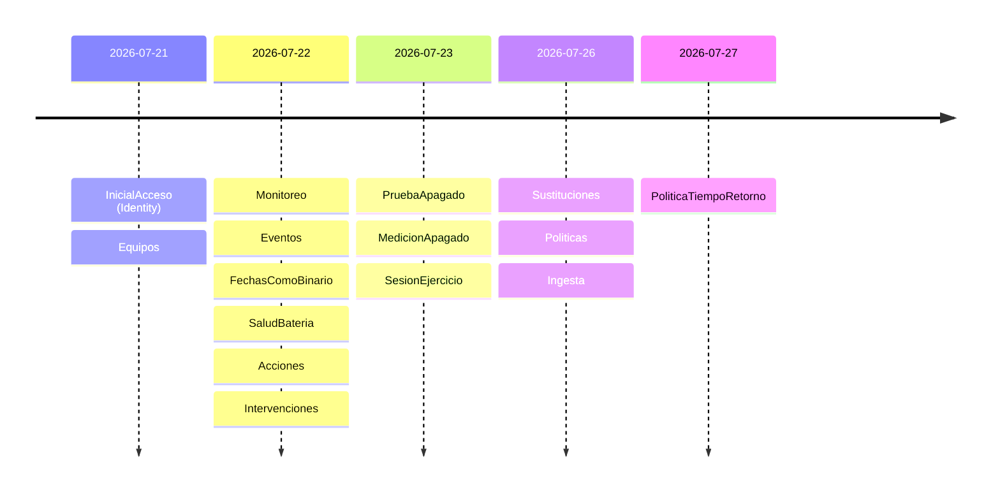

# 03 — Modelo de datos y persistencia

> **Propósito:** cargar en una sola lectura cómo persiste SAI.Service.Core: el `DbContext`, las 21 tablas de dominio más las de Identity, su mapeo EF Core (claves, conversiones, complex types, índices, checks), la línea de tiempo de las 15 migraciones, la disciplina append-only y cómo se hace cumplir, y las reglas conceptuales del SDD (RC-01…RC-09), con las divergencias entre lo especificado y lo construido.
> **Fuente primaria:** `src/SAI.Service.Core/SAI.Service.Core.Infrastructure/Persistencia/` (código: la verdad del esquema) y `SDD/Docs/02-Especificacion-Funcional/Modelo-Datos/` + `SDD/Docs/05-Arquitectura-Tecnica/Modelo-Datos-Logico-v1.0.md` (intención).
> Todas las rutas son relativas a la raíz del repo `SAI.Service.Core`. Abreviaturas: `Infra/` = `src/SAI.Service.Core/SAI.Service.Core.Infrastructure/`, `Dom/` = `src/SAI.Service.Core/SAI.Service.Core.Domain/`, `Mig/` = `Infra/Persistencia/Migraciones/`.

**Fuera de este índice:** semántica de las entidades y reglas de negocio (RN-xx) → `02_Dominio-Y-Reglas.md`; casos de uso que escriben/leen → `04_Aplicacion-Y-Casos-De-Uso.md`; adaptador NUT y servicios de sondeo → `06_Infraestructura-Y-Adaptador-Sai.md`; pruebas en detalle → `07_Calidad-Y-Pruebas.md`; volumen de la base, respaldo y keyring en despliegue → `08_Devops-Despliegue-Y-Operacion.md`.

---

## 1. Stack y cableado

| Aspecto | Valor | Fuente |
|---|---|---|
| Motor | SQLite, un archivo, un único proceso escritor | `SDD/Docs/05-Arquitectura-Tecnica/Adrs/ADR-18-Motor-Sqlite-Con-Ef-Core-Y-Migraciones-v1.0.md` |
| ORM | `Microsoft.EntityFrameworkCore.Sqlite` 10.0.0 (+ `.Design` 10.0.0) | `Infra/SAI.Service.Core.Infrastructure.csproj` |
| Identity | `Microsoft.AspNetCore.Identity.EntityFrameworkCore` 10.0.0 | ídem |
| Pin de seguridad | `SQLitePCLRaw.bundle_e_sqlite3` 2.1.12 (la 2.1.11 transitiva tiene una vulnerabilidad alta) | ídem (comentario en el csproj) |
| Cadena de conexión | `ConnectionStrings:Sai` = `Data Source=sai.db`; resolución diferida al crear el contexto, con fallback a `sai.db` | `src/SAI.Service.Core/SAI.Service.Core.Web/appsettings.json`, `Infra/DependencyInjection.cs` |
| Registro | `AddDbContext<SaiDbContext>` → `.UseSqlite(cadena).AddInterceptors(new InterceptorAppendOnly())` | `Infra/DependencyInjection.cs` |
| Esquema al arranque | `await db.Database.MigrateAsync()` en un scope al iniciar; sin `EnsureCreated` | `src/SAI.Service.Core/SAI.Service.Core.Web/Program.cs` |
| Fábrica de diseño | `SaiDbContextFactory` (`IDesignTimeDbContextFactory`) con `Data Source=sai-design.db`, solo para `dotnet ef migrations` | `Infra/Persistencia/SaiDbContextFactory.cs` |
| Multi-tenant | No aplica (un admin, un host, un SAI activo) | `SDD/Docs/05-Arquitectura-Tecnica/Modelo-Datos-Logico-v1.0.md` §6 |

Por qué la resolución diferida de la cadena: permite que las pruebas de integración con `WebApplicationFactory` aíslen una base SQLite por prueba (comentario en `Infra/DependencyInjection.cs`).

---

## 2. Inventario de archivos del dominio

### 2.1 Persistencia (código)

| Archivo | Rol |
|---|---|
| `Infra/Persistencia/SaiDbContext.cs` | Contexto; hereda `IdentityDbContext<AdministradorUser>`; 21 `DbSet`; convención global `DateTimeOffset`→`long`; delega `OnModelCreating` en seis clases `Modelo*` |
| `Infra/Persistencia/AdministradorUser.cs` | `IdentityUser` sin campos propios (administrador único, ADR-16) |
| `Infra/Persistencia/InterceptorAppendOnly.cs` | `SaveChangesInterceptor` + `EscrituraDestructivaProhibidaException` |
| `Infra/Persistencia/SaiDbContextFactory.cs` | Fábrica de tiempo de diseño |
| `Infra/Persistencia/Configuraciones/ModeloEquipos.cs` | Catálogo, inventario (TPH), vínculos, verificaciones, sesión de ejercicio |
| `Infra/Persistencia/Configuraciones/ModeloMonitoreo.cs` | FuenteDatos, SesionSondeo, Muestra, Agregado, ReglaDerivacion, Evento, PruebaBateria, Accion; convertidores JSON |
| `Infra/Persistencia/Configuraciones/ModeloIntervenciones.cs` | Intervencion, FichaVidaUtil; `MapearDinero` |
| `Infra/Persistencia/Configuraciones/ModeloSustituciones.cs` | SustitucionSai (costo/disposición nullable) |
| `Infra/Persistencia/Configuraciones/ModeloPoliticas.cs` | VersionPolitica + check del techo duro |
| `Infra/Persistencia/Configuraciones/ModeloIngesta.cs` | IntervencionIngerida + índice único de idempotencia |
| `Infra/Persistencia/Migraciones/*.cs` | 15 migraciones (+ `.Designer.cs`), `SaiDbContextModelSnapshot.cs`, `ModeloIdentityBuilder.cs` |
| `Infra/Persistencia/Migraciones/.editorconfig` | `generated_code = true`: los analizadores y `TreatWarningsAsErrors` no tratan las migraciones como código propio |
| `Infra/Persistencia/Repositorio{Equipos,Informes,Ingesta,Intervenciones,Politicas,Sustituciones}.cs`, `Infra/Monitoreo/RepositorioMonitoreo.cs` | Implementaciones de los puertos de repositorio sobre `SaiDbContext` (detalle de uso → `04_…` / `06_…`) |
| `Dom/Historia/IEntidadHistoria.cs` | Marcador append-only, framework-free |
| `Dom/Valores/{Valor,Origen,Dinero}.cs`, `Dom/Vinculos/Vigencia.cs`, `Dom/Intervenciones/{DisposicionFinal,Costos}.cs` | Value objects (`readonly record struct`) persistidos como complex types / JSON; `Costos` no se persiste (`Ignore`) |

### 2.2 Especificación (SDD)

| Archivo | Contenido |
|---|---|
| `SDD/Docs/02-Especificacion-Funcional/Modelo-Datos/Modelo-Conceptual-v1.0.md` | 27 elementos (24 entidades en capas catálogo / inventario / vínculos / historia / proyección + 2 objetos de valor + el actor administrador), atributos, cardinalidades, ER mermaid (§7), trazabilidad a CU/RN (§8). Encabezado «Versión 1.1», fecha 2026-07-20, sobre archivo `-v1.0` |
| `SDD/Docs/02-Especificacion-Funcional/Modelo-Datos/reglas-conceptuales-de-modelo/RC-01…RC-09-*.md` | Nueve reglas conceptuales (§7) |
| `SDD/Docs/05-Arquitectura-Tecnica/Modelo-Datos-Logico-v1.0.md` | Modelo físico de diseño: tipos, índices, FK, checks, migración inicial prevista (v1.0, 2026-07-20) |
| `SDD/Docs/05-Arquitectura-Tecnica/Adrs/ADR-04-Historia-Append-Only-Sin-Event-Store-v1.0.md` | Append-only como disciplina, sin event store/CQRS |
| `SDD/Docs/05-Arquitectura-Tecnica/Adrs/ADR-06-Procedencia-Obligatoria-En-Todo-Valor-v1.0.md`, `ADR-07-Separacion-De-Catalogo-Inventario-E-Historia-v1.0.md`, `ADR-08-Agregado-No-Hereda-De-Muestra-v1.0.md` | `Valor<T>`+`Origen`, capas catálogo/inventario/historia, `Muestra` y `Agregado` como tipos separados (citados por `ModeloEquipos.cs` y ADR-18 §7) |
| `SDD/Docs/05-Arquitectura-Tecnica/Adrs/ADR-05-Vigencia-Como-Entidad-Con-Intervalo-v1.0.md` | Vínculos temporales con intervalo + `ResolutorTemporal` |
| `SDD/Docs/05-Arquitectura-Tecnica/Adrs/ADR-18-Motor-Sqlite-Con-Ef-Core-Y-Migraciones-v1.0.md` | SQLite + EF Core + migraciones versionadas aplicadas al arranque |
| `SDD/Docs/05-Arquitectura-Tecnica/Adrs/ADR-29-Persistencia-Del-Keyring-De-Dataprotection-v1.0.md` | Keyring de Data Protection en volumen de archivos, **no** en la base (se descartó `PersistKeysToDbContext`) |

---

## 3. Mapa de tablas

```
SaiDbContext : IdentityDbContext<AdministradorUser>
├── Identity (ADR-16) ── AspNetUsers, AspNetRoles, AspNetUserClaims, AspNetUserLogins,
│                        AspNetUserTokens, AspNetRoleClaims, AspNetUserRoles
├── Catálogo ─────────── Fabricante, ModeloDispositivo, ModeloBateria
├── Inventario (TPH) ─── UnidadFisica  [Tipo = Host | Dispositivo | Bateria]
├── Vínculos ─────────── MontajeBateria, CoberturaHost
├── Verificaciones ───── Verificacion, SesionEjercicio
├── Monitoreo* ───────── FuenteDatos, SesionSondeo, Muestra, Agregado, ReglaDerivacion, Evento, PruebaBateria
├── Apagado* ─────────── Accion, VersionPolitica
└── Intervenciones* ──── Intervencion, FichaVidaUtil, SustitucionSai, IntervencionIngerida
                         (* = IEntidadHistoria, append-only)
```

| Tabla | `DbSet` | Clase de dominio | PK | Append-only | Configuración |
|---|---|---|---|---|---|
| Fabricante | `Fabricantes` | `Dom/Catalogo/Fabricante.cs` | `Codigo` | no | `ModeloEquipos` |
| ModeloDispositivo | `ModelosDispositivo` | `Dom/Catalogo/ModeloDispositivo.cs` | `Codigo` | no | `ModeloEquipos` |
| ModeloBateria | `ModelosBateria` | `Dom/Catalogo/ModeloBateria.cs` | `Codigo` | no | `ModeloEquipos` |
| UnidadFisica | `Unidades` | `Dom/Inventario/{UnidadFisica,Host,Dispositivo,Bateria}.cs` | `Codigo` | no (baja lógica) | `ModeloEquipos` |
| MontajeBateria | `Montajes` | `Dom/Vinculos/MontajeBateria.cs` | `Codigo` | no (se cierra `Hasta`) | `ModeloEquipos` |
| CoberturaHost | `Coberturas` | `Dom/Vinculos/CoberturaHost.cs` | `Codigo` | no (se cierra `Hasta`) | `ModeloEquipos` |
| Verificacion | `Verificaciones` | `Dom/Verificaciones/Verificacion.cs` | `Codigo` | no (estado mutable) | `ModeloEquipos` |
| SesionEjercicio | `SesionesEjercicio` | `Dom/Verificaciones/SesionEjercicio.cs` | `Codigo` | no | `ModeloEquipos` |
| FuenteDatos | `FuentesDatos` | `Dom/Monitoreo/FuenteDatos.cs` | `Codigo` | sí | `ModeloMonitoreo` |
| SesionSondeo | `SesionesSondeo` | `Dom/Monitoreo/SesionSondeo.cs` | `Codigo` | sí | `ModeloMonitoreo` |
| Muestra | `Muestras` | `Dom/Monitoreo/Muestra.cs` | `Codigo` | sí | `ModeloMonitoreo` |
| Agregado | `Agregados` | `Dom/Monitoreo/Agregado.cs` | `Codigo` | sí | `ModeloMonitoreo` |
| ReglaDerivacion | `Reglas` | `Dom/Monitoreo/ReglaDerivacion.cs` | (`Codigo`, `Version`) | sí | `ModeloMonitoreo` |
| Evento | `Eventos` | `Dom/Monitoreo/Evento.cs` | `Codigo` | sí | `ModeloMonitoreo` |
| PruebaBateria | `PruebasBateria` | `Dom/Monitoreo/PruebaBateria.cs` | `Codigo` | sí | `ModeloMonitoreo` |
| Accion | `Acciones` | `Dom/Acciones/Accion.cs` | `Codigo` | sí | `ModeloMonitoreo` |
| Intervencion | `Intervenciones` | `Dom/Intervenciones/Intervencion.cs` | `Codigo` | sí | `ModeloIntervenciones` |
| FichaVidaUtil | `FichasVidaUtil` | `Dom/Intervenciones/FichaVidaUtil.cs` | `Codigo` | sí | `ModeloIntervenciones` |
| SustitucionSai | `Sustituciones` | `Dom/Intervenciones/SustitucionSai.cs` | `Codigo` | sí | `ModeloSustituciones` |
| VersionPolitica | `Politicas` | `Dom/Politicas/VersionPolitica.cs` | `Codigo` | sí | `ModeloPoliticas` |
| IntervencionIngerida | `IntervencionesIngeridas` | `Dom/Intervenciones/IntervencionIngerida.cs` | `Codigo` | sí | `ModeloIngesta` |

"Append-only = sí" significa que la clase implementa `IEntidadHistoria` (verificado por grep en `Dom/`). Las que no lo implementan se actualizan con `Update` en los repositorios: `Infra/Persistencia/RepositorioEquipos.cs` (Verificacion, SesionEjercicio), `RepositorioIntervenciones.cs` (MontajeBateria cerrado, UnidadFisica retirada), `RepositorioSustituciones.cs` (CoberturaHost, UnidadFisica, Verificacion).

---

## 4. Convenciones de mapeo

| Convención | Detalle | Fuente |
|---|---|---|
| Clave natural | La PK de cada entidad es su `Codigo` TEXT (`ups-01`, `mnt-…`, `ses-…`). **Desvío consciente** del modelo lógico, que preveía `Id INTEGER` + `codigo` único | `ModeloEquipos.cs` (summary) vs `Modelo-Datos-Logico-v1.0.md` intro |
| Mapeo explícito | Las entidades solo tienen ctor con parámetros (o privado); EF materializa por binding de constructor sobre propiedades mapeadas explícitamente | `ModeloEquipos.cs` |
| Enums | Como texto (nombre .NET) con `HasConversion<string>()` | todas las `Configuraciones/` |
| `DateTimeOffset` / `DateTimeOffset?` | Convención global `DateTimeOffsetToBinaryConverter` → `INTEGER` (long). Motivo: SQLite no ordena ni compara `DateTimeOffset` guardado como TEXT (rompía el `ORDER BY` de muestras/eventos y la vigencia de reglas) | `SaiDbContext.ConfigureConventions`, `Mig/20260722010726_FechasComoBinario.cs` |
| `DateOnly`, `decimal` | Persisten como TEXT (convención del proveedor SQLite: `Dinero.Fecha`, `Dinero.Monto`, `Bateria.FechaFabricacion/FechaCompra`). `Agregado.VentanaDuracion` es `string` con duración ISO-8601 (`"PT1H"`) | `Mig/SaiDbContextModelSnapshot.cs`, `Dom/Monitoreo/Agregado.cs` |
| Complex types | `Vigencia` → columnas `Desde`/`Hasta`; `Valor<T>` → `<Attr>Valor` + `<Attr>Origen`; `Dinero` → `<Prefijo>Monto/Moneda/Fecha` (helper `MapearDinero`); `DisposicionFinal` → `DisposicionDestino/Receptor` | `ModeloEquipos.cs`, `ModeloMonitoreo.cs`, `ModeloIntervenciones.cs` |
| Opcionales | Complex types no admiten nulabilidad: costo/disposición opcionales se mapean como columnas nullable directas y la proyección a value object se `Ignore` | `ModeloSustituciones.cs`, `ModeloIngesta.cs` |
| Calculados no persistidos | `Intervencion.Costos`, `IntervencionIngerida.Costos`, `SustitucionSai.Costo/Disposicion`, `IntervencionIngerida.Disposicion` → `Ignore` | ídem |
| JSON en columna | Diccionarios/listas con `ValueConverter` + `ValueComparer` (System.Text.Json; `ModeloMonitoreo` usa `JsonStringEnumConverter`, `ModeloIngesta` opciones por defecto) | `ModeloMonitoreo.cs`, `ModeloIngesta.cs` |
| Herencia | TPH en `UnidadFisica`, discriminador `Tipo` (`Host`/`Dispositivo`/`Bateria`) | `ModeloEquipos.cs` |
| FK | Todas `OnDelete(DeleteBehavior.Restrict)`; sin navegaciones (`HasOne<T>().WithMany()`) y principal por `Codigo` | todas |

Columnas JSON:

| Tabla.Columna | Tipo .NET | Contenido |
|---|---|---|
| `Muestra.Valores` | `IReadOnlyDictionary<string,double?>` (`Lecturas`) | variable → lectura (null = sin dato) |
| `SesionSondeo.MapaVariableOrigen` | `IReadOnlyDictionary<string,Origen>` | procedencia declarada una vez por sesión, no por fila |
| `ReglaDerivacion.Parametros` | `IReadOnlyDictionary<string,double>` | umbrales de la versión de la regla |
| `IntervencionIngerida.Baterias` | `IReadOnlyList<string>` | códigos de baterías afectadas |

`Origen` (`Dom/Valores/Origen.cs`): `Medido`, `Derivado`, `Declarado`, `Imputado`, `EstimadoPorDriver`, `NoCalculable`.

---

## 5. Detalle por tabla (columnas de dominio)

| Tabla | Columnas relevantes (nulables con `?`) | FK (todas Restrict) |
|---|---|---|
| Fabricante | `Codigo`, `Nombre`, `Identificado` (bool) | — |
| ModeloDispositivo | `FabricanteCodigo`, `Nombre`, `LineaTopologia?`, `TensionNominalV?`, `PotenciaVaNominalValor?`/`Origen?` | → Fabricante |
| ModeloBateria | `FabricanteCodigo`, `Nombre`, `Tecnologia?`, `CapacidadAh?`, `TensionNominalV?`, `VidaFlotacionAniosMin?/Max?`, `TemperaturaReferenciaC?` | → Fabricante |
| UnidadFisica | `Tipo`, `Estado` (`EnStock`/`EnServicio`/`EnReparacion`/`DadoDeBaja`), `FechaBaja?`, `MotivoBaja?`; Host: `Criticidad?`, `EnServicioDesde?`; Dispositivo: `ModeloDispositivoCodigo`, `NumeroSerie?`; Bateria: `ModeloBateriaCodigo`, `FechaFabricacion?`, `FechaCompra?` (DateOnly). Por TPH, las columnas de especialización son nullable en la base | → ModeloDispositivo, → ModeloBateria |
| MontajeBateria | `BateriaCodigo`, `DispositivoCodigo`, `Posicion` (TEXT), `Desde`, `Hasta?` | → UnidadFisica ×2 |
| CoberturaHost | `DispositivoCodigo`, `HostCodigo`, `Desde`, `Hasta?` | → UnidadFisica ×2 |
| Verificacion | `Supuesto`, `Estado`, `Metodo?`, `Evidencia?`, `VigenciaHasta?`, `ActualizadoEn`, `PruebaEnCursoDesde?`, `MedicionSegundos?` | — |
| SesionEjercicio | `IniciadaEn`, `FinalizadaEn?`, `Estado` | — |
| FuenteDatos | `ConfianzaBase`, `Descripcion?` | — |
| SesionSondeo | `DispositivoCodigo`, `FuenteDatosCodigo`, `Driver`, `DriverVersion?`, `Dialecto?`, `IntervaloSeg`, `MapaVariableOrigen` (JSON), `Desde`, `Hasta?` | → UnidadFisica, → FuenteDatos |
| Muestra | `DispositivoCodigo`, `SesionSondeoCodigo`, `Instante`, `Calidad`, `Valores` (JSON) | → UnidadFisica, → SesionSondeo |
| Agregado | `DispositivoCodigo`, `Variable`, `VentanaInicio`, `VentanaDuracion`, `NMuestras`, `Cobertura`, `Advertencia?`, `Promedio?`, `Minimo?`, `Maximo?` | → UnidadFisica |
| ReglaDerivacion | `Codigo`+`Version` (PK), `Descripcion?`, `VigenteDesde`, `Parametros` (JSON) | — |
| Evento | `DispositivoCodigo`, `Tipo`, `Instante`, `DuracionSeg?`, `IncertidumbreDuracionSeg?`, `ReglaDerivacionCodigo`, `ReglaVersion` | → UnidadFisica, → ReglaDerivacion (FK compuesta) |
| PruebaBateria | `DispositivoCodigo`, `MontajeBateriaCodigo` (congelado), `Instante`, `CargaPorcentaje?`, `Comparable`, `Veredicto?`, `Confianza?`, `CaidaTensionValor?`/`CaidaTensionOrigen` | → UnidadFisica, → MontajeBateria |
| Accion | `DispositivoCodigo`, `Instante`, `ModalidadSolicitada`, `ModalidadEfectiva`, `Estado`, `TiempoReservadoSeg`, `Detalle`, `EventoDisparoCodigo?` | → UnidadFisica |
| Intervencion | `DispositivoCodigo`, `Posicion`, `BateriaSalienteCodigo`, `BateriaEntranteCodigo`, `InstanteOcurrido`, `InstanteRegistrado`, `Proveedor`, `Ejecutor`, `Hallazgos`, `Repuestos*`/`ManoObra*`/`Total*` (Dinero), `DisposicionDestino`/`Receptor` | → UnidadFisica |
| FichaVidaUtil | `IntervencionCodigo`, `DispositivoCodigo`, `BateriaCodigo`, `DiasEnServicio`, `VidaEsperadaDias`, `CumplioExpectativa`, `DesvioDias`, `FuenteCotizacion`, `CostoAnio*`, `CostoAnioUsd*` (Dinero) | → Intervencion |
| SustitucionSai | `HostCodigo`, `DispositivoSalienteCodigo`, `DispositivoEntranteCodigo?`, `Tipo`, `InstanteOcurrido`, `InstanteRegistrado`, `Proveedor`, `Ejecutor`, `Hallazgos`, `FirmwareReiniciado`, `CostoMonto?/Moneda?/Fecha?`, `DisposicionDestino?/Receptor?` | → UnidadFisica (saliente) |
| VersionPolitica | `Numero`, `ModalidadSolicitada`, `UmbralDisparoSegundos`, `TiempoReservadoApagadoSeg`, `TiempoRetornoSeg`, `VigenteDesde` | — |
| IntervencionIngerida | `ClaveIdempotencia`, `HuellaCuerpo`, `FuenteDatosCodigo`, `Confianza`, `TipoIntervencion`, `DispositivoCodigo`, `Baterias` (JSON), `Proveedor?`, `Hallazgos?`, `TiempoValido`, `TiempoRegistrado`, `Repuestos*`/`ManoObra*`/`Total*`, `DisposicionDestino?/Receptor?` | **ninguna, a propósito** |

`IntervencionIngerida` no tiene FK a `UnidadFisica` porque registra un hecho externo de confianza media que puede citar un dispositivo aún no dado de alta; la coherencia temporal (RN-12) se valida en el servicio (`ModeloIngesta.cs`, comentario).

---

## 6. Índices y restricciones

### 6.1 Índices

| Índice | Tabla | Columnas | Tipo | Regla |
|---|---|---|---|---|
| `IX_MontajeBateria_DispositivoCodigo_Posicion` | MontajeBateria | (DispositivoCodigo, Posicion) `WHERE "Hasta" IS NULL` | único parcial | ≤1 montaje vigente (I-2, RC-02) |
| `IX_CoberturaHost_HostCodigo` | CoberturaHost | (HostCodigo) `WHERE "Hasta" IS NULL` | único parcial | ≤1 cobertura vigente por host (I-4, RC-02) |
| `IX_Agregado_DispositivoCodigo_Variable_VentanaInicio` | Agregado | (Dispositivo, Variable, VentanaInicio) | único | un agregado por ventana (RC-04) |
| `IX_VersionPolitica_Numero` | VersionPolitica | (Numero) | único | la vigente es la de mayor número |
| `IX_IntervencionIngerida_ClaveIdempotencia` | IntervencionIngerida | (ClaveIdempotencia) | único | almacén de idempotencia (I-19, RN-09, ADR-17) |
| `IX_UnidadFisica_Tipo_Estado` | UnidadFisica | (Tipo, Estado) | compuesto | listado por especialización y estado |
| `IX_Muestra_DispositivoCodigo_Instante` | Muestra | (Dispositivo, Instante) | compuesto | históricos por rango |
| `IX_Muestra_SesionSondeoCodigo` | Muestra | (SesionSondeoCodigo) | simple | — |
| `IX_SesionSondeo_DispositivoCodigo` / `_FuenteDatosCodigo` | SesionSondeo | — | simple | — |
| `IX_Evento_DispositivoCodigo_Instante` | Evento | (Dispositivo, Instante) | compuesto | línea de tiempo |
| `IX_Evento_ReglaDerivacionCodigo_ReglaVersion` | Evento | (Regla, Version) | compuesto | RC-09 |
| `IX_PruebaBateria_MontajeBateriaCodigo` / `_DispositivoCodigo_Instante` | PruebaBateria | — | simple / compuesto | RC-07 |
| `IX_Accion_DispositivoCodigo_Instante` | Accion | (Dispositivo, Instante) | compuesto | — |
| `IX_Intervencion_DispositivoCodigo_InstanteOcurrido` | Intervencion | — | compuesto | historial de servicio |
| `IX_FichaVidaUtil_DispositivoCodigo_IntervencionCodigo` / `_IntervencionCodigo` | FichaVidaUtil | — | compuesto / simple | — |
| `IX_SustitucionSai_HostCodigo_InstanteOcurrido` / `_DispositivoSalienteCodigo` | SustitucionSai | — | compuesto / simple | — |
| Índices FK automáticos | ModeloBateria, ModeloDispositivo, UnidadFisica, MontajeBateria, CoberturaHost | `*Codigo` | simple | — |

### 6.2 CHECK constraints

| Check | Tabla | Condición | Regla |
|---|---|---|---|
| `CK_ModeloBateria_VidaTemp` | ModeloBateria | vida min y max nulas, o `TemperaturaReferenciaC` no nula | RC-07 / RN-13 |
| `CK_UnidadFisica_Baja` | UnidadFisica | `(Estado='DadoDeBaja') = (FechaBaja IS NOT NULL)` | RC-08 |
| `CK_MontajeBateria_Intervalo` / `CK_CoberturaHost_Intervalo` | vínculos | `Hasta IS NULL OR Hasta >= Desde` | ADR-05 |
| `CK_Muestra_Calidad` | Muestra | `Calidad IN ('Completa','Parcial','Perdida')` | RC-01 |
| `CK_Agregado_Cobertura` | Agregado | `0 <= Cobertura <= 1` | RN-10 |
| `CK_VersionPolitica_TechoApagado` | VersionPolitica | `0 <= TiempoReservadoApagadoSeg <= 540` (`Accion.TechoDuroApagadoSeg`) | RN-04, I-10 |

El no-solapamiento de intervalos no lo garantiza SQLite (no hay restricciones de exclusión): se cubre con el único parcial más la validación de dominio `Vigencias.AdmiteNuevo` (`Dom/Vinculos/Vigencias.cs`, citado en `ModeloEquipos.cs`) y RC-03 en dominio (`Modelo-Datos-Logico-v1.0.md` §4.4, nota).

---

## 7. Migraciones (orden cronológico)

Todas en `Mig/`, con su `.Designer.cs`. `ProductVersion` 10.0.0 (`Mig/SaiDbContextModelSnapshot.cs`).

| # | Migración | Agrega | Commit / etapa |
|---|---|---|---|
| 1 | `20260721000001_EsquemaInicialAcceso` | 7 tablas `AspNet*` con índices y FK. **Escrita a mano** (sin `dotnet` en el entorno); su Designer usa `ModeloIdentityBuilder` | `4df5e30` Etapa 1 |
| 2 | `20260721231827_EsquemaEquipos` | Fabricante, ModeloDispositivo, ModeloBateria, UnidadFisica (TPH), MontajeBateria, CoberturaHost, Verificacion; únicos parciales y checks de §6 | `ef30868` Etapa 2·C1 |
| 3 | `20260722002526_EsquemaMonitoreo` | FuenteDatos, SesionSondeo, Muestra, Agregado (+ `CK_Muestra_Calidad`, `CK_Agregado_Cobertura`) | `859f7d3` Etapa 3·A |
| 4 | `20260722005939_EsquemaEventos` | ReglaDerivacion (PK compuesta), Evento (FK compuesta) | `a04e33f` Etapa 3·B1 |
| 5 | `20260722010726_FechasComoBinario` | `AlterColumn` TEXT→INTEGER en 15 columnas de fecha (Verificacion, UnidadFisica, SesionSondeo, ReglaDerivacion, Muestra, MontajeBateria, Evento, CoberturaHost, `AspNetUsers.LockoutEnd`, Agregado) | `a04e33f` (mismo commit que la 4) |
| 6 | `20260722025607_EsquemaSaludBateria` | PruebaBateria | `ddf5df2` Etapa 3·C |
| 7 | `20260722172133_EsquemaAcciones` | Accion | `63e1b59` Etapa 4·B |
| 8 | `20260722191704_EsquemaIntervenciones` | Intervencion, FichaVidaUtil | `d906b62` Etapa 4·C |
| 9 | `20260723030000_EsquemaPruebaApagado` | `Verificacion.PruebaEnCursoDesde` (INTEGER null): prueba física en curso que exige reinicio del host (Etapa 4·E) | `cae3529` |
| 10 | `20260723040000_EsquemaMedicionApagado` | `Verificacion.MedicionSegundos` (INTEGER null): segundos medidos del apagado (rediseño UX H-7) | `55f4933` |
| 11 | `20260723050000_EsquemaSesionEjercicio` | SesionEjercicio (código, inicio, fin, estado; el progreso se deriva de las verificaciones) | `b163a11` P-7 |
| 12 | `20260726022434_EsquemaSustituciones` | SustitucionSai | `af0142d` (CU-09) |
| 13 | `20260726042345_EsquemaPoliticas` | VersionPolitica + `CK_VersionPolitica_TechoApagado` + único `Numero` | `4002625` EP-04 (nació como `20260726040106_…`; regenerada y renombrada en el merge `b314bef` para quedar después de Sustituciones) |
| 14 | `20260726160554_EsquemaIngesta` | IntervencionIngerida + único `ClaveIdempotencia` | `8d232e7` CU-11 |
| 15 | `20260727130117_PoliticaTiempoRetorno` | `VersionPolitica.TiempoRetornoSeg` INTEGER NOT NULL **default 180** (rellena filas históricas con el valor antes fijo en el adaptador) | `087ad71` |

Commits obtenidos con `git log --diff-filter=A` por archivo de migración. Ninguna migración se modificó después de su commit de alta (`git log` por archivo), salvo el renombre de `EsquemaPoliticas`. Las migraciones 9–11 tienen timestamps redondos (`…030000`, `…040000`, `…050000`), lo que sugiere redacción manual (no verificado). `Mig/.editorconfig` afirma que las migraciones «no se editan a mano», cosa que la 1 contradice explícitamente en su propio `<summary>`.



Política: migraciones aditivas siempre que sea posible; una destructiva exige respaldo previo del archivo SQLite (ADR-18 §6, `Modelo-Datos-Logico-v1.0.md` §5). Todas las posteriores a la 5 son `CreateTable`/`AddColumn`; la 5 es la única que altera tipos.

### 7.1 Datos sembrados al arranque (no son migraciones)

En `src/SAI.Service.Core/SAI.Service.Core.Web/Program.cs`, después de `MigrateAsync`, de forma idempotente:

| Semilla | Condición | Contenido |
|---|---|---|
| Rol administrador | si no existe | `GeneradorTokens.RolAdministrador` = `"administrador"` (`src/SAI.Service.Core/SAI.Service.Core.Web/Autenticacion/GeneradorTokens.cs`) |
| ReglaDerivacion v1 ×4 | si no hay reglas | corte/microcorte (`microcorteMaxSeg`=60), tensión (`min` 198, `max` 242, `sostenidoSeg` 30), desconexión (`sondeosPerdidos` 3), disparo (`umbralObSeg` 300, `batVoltMin` 13.3, `batVoltMax` 14.5); `VigenteDesde` 2020-01-01 |
| VersionPolitica inicial | si no hay versiones | modalidad, tiempo reservado y tiempo de retorno desde `OpcionesApagado` (`Sai:Apagado`) + umbral de `DescriptorPoliticas.Defecto`; `VigenteDesde` = ahora |
| FuenteDatos `fd-gmao-externo` | si no existe | confianza `Media` (referenciada por `X-Fuente-Datos` de la ingesta) |

---

## 8. Disciplina append-only

```
SaveChanges / SaveChangesAsync
      │
      ▼
InterceptorAppendOnly.VerificarAppendOnly(ctx)
      │  recorre ChangeTracker.Entries()
      ├── entidad no es IEntidadHistoria ──► sigue
      └── es IEntidadHistoria y State ∈ {Modified, Deleted}
                 ──► throw EscrituraDestructivaProhibidaException(tipo, estado)
                     (InvalidOperationException; aborta todo el guardado)
```

| Pieza | Dónde | Nota |
|---|---|---|
| Decisión | `ADR-04` | append-only como disciplina, sin event store ni CQRS |
| Regla conceptual | `RC-06` | correcciones como hechos nuevos o reatribución por vínculos |
| Marcador | `Dom/Historia/IEntidadHistoria.cs` | interfaz vacía en Domain (sin dependencia de EF) |
| Enforcement | `Infra/Persistencia/InterceptorAppendOnly.cs` | registrado en `AddInfrastructure` |
| FK | todas `Restrict` | sin cascadas sobre historia |
| Prueba | `tests/SAI.Service.Core.Integration.Tests/InterceptorAppendOnlyTests.cs` | contexto mínimo con entidad de prueba: insertar ok, modificar y borrar rechazados (BT-09) |
| Escritura atómica | p. ej. `RepositorioIntervenciones.GuardarRecambioAsync` | cierra montaje + baja batería + alta batería + montaje nuevo + Intervencion + FichaVidaUtil en un solo `SaveChangesAsync` |

Límites del mecanismo (derivados de leer el código):
- Solo cubre escrituras por `ChangeTracker`; no protege `ExecuteUpdate`/`ExecuteDelete` ni SQL crudo. Un grep en `src/` no encontró usos de esos métodos.
- Lo mutable (vínculos que cierran `Hasta`, `UnidadFisica` con baja lógica, `Verificacion`, `SesionEjercicio`) queda fuera del marcador a propósito.
- `SesionSondeo` es `IEntidadHistoria` y tiene `Vigencia` con `Hasta?`, pero nunca se cierra por `Update`: `Dom/Monitoreo/SesionSondeo.cs` no tiene método de cierre y `Infra/Monitoreo/RepositorioMonitoreo.cs` solo hace `Add`. La sesión de sondeo continuo queda abierta (`Hasta` null; `SesionActivaDeAsync` la busca así) y la sesión densa de la prueba de batería nace ya con su fin (`src/SAI.Service.Core/SAI.Service.Core.Application/Monitoreo/ServicioPruebaBateria.cs`).

---

## 9. Reglas conceptuales del SDD (RC) y su materialización

Archivos en `SDD/Docs/02-Especificacion-Funcional/Modelo-Datos/reglas-conceptuales-de-modelo/` (todas v1.0, 2026-07-20).

| RC | Enunciado (destilado) | Materialización en persistencia |
|---|---|---|
| RC-01 Procedencia por valor | Todo valor de historia lleva su `Origen`; un derivado declara sus variables | `Valor<T>` como complex type (`<Attr>Valor/Origen`); en muestreo denso el origen va una vez por sesión en `SesionSondeo.MapaVariableOrigen`. No se persiste la lista de variables de derivación (`<attr>Derivadas` del modelo lógico): no hay columna (no verificado si se modela en otro lado) |
| RC-02 Vigencia como entidad con intervalo | Sin solapamiento; ≤1 vigente por (dispositivo, posición) y por host | únicos parciales `WHERE Hasta IS NULL` + `CK_*_Intervalo` + `Vigencias.AdmiteNuevo` |
| RC-03 Sucesión sin hueco | El cierre de un vínculo coincide con la apertura del siguiente | solo en dominio/aplicación; la persistencia guarda ambos en el mismo `SaveChanges` |
| RC-04 Agregado no hereda de Muestra | Tipos distintos; cobertura y advertencia siempre | tablas separadas, `CK_Agregado_Cobertura`, único por ventana. `Advertencia` es nullable en la base |
| RC-05 Acción referida a versión de política | `Accion` → `VersionPolitica`, nunca `Politica` | **no materializada**: `Accion` no tiene columna ni FK a la versión; congela `ModalidadSolicitada` y `TiempoReservadoSeg` por valor (`Dom/Acciones/Accion.cs`) |
| RC-06 Historia append-only | Hechos inmutables | `IEntidadHistoria` + `InterceptorAppendOnly` (§8) |
| RC-07 Resolución temporal de la batería | La historia guarda dispositivo + instante; la batería se resuelve por montaje; la prueba lo congela | Muestra/Evento sin columna de batería; `PruebaBateria.MontajeBateriaCodigo` con FK; `CK_ModeloBateria_VidaTemp` |
| RC-08 Baja lógica y coherencia temporal | La unidad no se borra; no admite operaciones posteriores a la baja | `CK_UnidadFisica_Baja`, FK `Restrict`; la coherencia temporal se valida en los servicios |
| RC-09 Evento referido a regla versionada | Todo evento referencia (regla, versión) | PK compuesta `ReglaDerivacion(Codigo, Version)` + FK compuesta desde `Evento` |

---

## 10. Divergencias: modelo lógico (SDD) vs. esquema real

`Modelo-Datos-Logico-v1.0.md` es de antes de la construcción (2026-07-20). El código manda; esta tabla evita que un agente tome el SDD como esquema vigente.

| Tema | Modelo lógico (SDD) | Esquema real (código) |
|---|---|---|
| Clave | `Id INTEGER` autoincremental + `codigo` único | PK = `Codigo` TEXT (desvío declarado en `ModeloEquipos.cs`) |
| Fechas | TEXT ISO-8601 | INTEGER (binario de `DateTimeOffset`) desde la migración 5 |
| Migración inicial | `20260720000001_InitialCreate` + `20260720000002_AddIdentitySchema` | Identity primero (`20260721000001`) y 14 migraciones incrementales por etapa |
| Tablas `TipoIntervencion`, `Proveedor`, `Politica` | previstas | inexistentes: `Proveedor` y `TipoIntervencion` son texto en las tablas de intervención; la política es solo `VersionPolitica` con `Numero` único |
| Puentes `VersionPoliticaVerificacion`, `IntervencionBateria` | previstas | inexistentes; las baterías de la ingesta van como JSON (`IntervencionIngerida.Baterias`), el recambio usa `BateriaSaliente/EntranteCodigo` |
| Tablas no previstas | — | `SesionEjercicio`, `SustitucionSai`, `IntervencionIngerida` |
| `Accion` | FK `versionPoliticaId` NN y `eventoId` | sin FK a política; `EventoDisparoCodigo` sin FK |
| `Intervencion.claveIdempotencia` única | en `Intervencion` | en `IntervencionIngerida` (la intervención local no lleva clave) |
| `FichaVidaUtil` | único por `bateriaId` | sin único por batería; índices por (Dispositivo, Intervencion) y FK a Intervencion |
| Checks previstos ausentes | `CK_UnidadFisica_Estado/Tipo/DispModelo/BatModelo`, `CK_Muestra_Perdida`, `CK_Verificacion_Estado`, `CK_Intervencion_CostosCuadran` y `CK_Intervencion_Dinero*`, `CK_Origen_*` | no existen en las migraciones; las invariantes correspondientes quedan en dominio (no verificado una por una) |
| Valores de enum | camelCase (`'completa'`, `'sinVerificar'`) | PascalCase, nombre .NET (`'Completa'`, `'DadoDeBaja'`) |
| `Dinero` | `NUMERIC` + equivalente normalizado opcional | `Monto` como TEXT (decimal en SQLite) y sin columnas de equivalente; la ficha guarda `CostoAnioUsd*` aparte |
| Índices previstos | `IX_MontajeBateria_Dispositivo_Desde`, `IX_MontajeBateria_Bateria_Desde`, `IX_CoberturaHost_Dispositivo_Desde`, `IX_SesionSondeo_Dispositivo_Desde`, `IX_Accion_VersionPolitica`, `IX_Accion_Evento`; `IX_Intervencion_Dispositivo_TiempoValido` | solo los índices por FK, sin `Desde`; sin índices de `Accion` hacia política/evento; el de intervención es por `InstanteOcurrido` |
| Checks con otra forma | `CK_ModeloBateria_VidaTemp` solo sobre `vidaFlotacionAniosMin`; `CK_VersionPolitica_Tiempo` (`IS NULL OR <= 540`); un `CK_Vigencia_Intervalo` | el real exige min **y** max nulas; `CK_VersionPolitica_TechoApagado` (`>= 0 AND <= 540`, NOT NULL); dos checks `CK_*_Intervalo` |

ADR-04 §7, RC-06 §2 y el modelo conceptual (§1.22, capa de historia) ubican `Verificacion` entre las entidades de solo inserción, pero en el código es mutable (`Verificacion` no implementa `IEntidadHistoria` y `RepositorioEquipos.cs` / `RepositorioSustituciones.cs` hacen `Update`).

---

## 11. Retención y agregación

| Aspecto | Especificado | Estado en código |
|---|---|---|
| Muestras crudas | `P30D`, después se agregan a `PT1H` (ADR-18) | `ServicioHistoricos.DiasRetencionMuestras = 30` elige muestras o agregados para **leer** (`src/SAI.Service.Core/SAI.Service.Core.Application/Monitoreo/ServicioHistoricos.cs`) |
| Agregados | `P10Y` | existe `Dom/Monitoreo/CalculadorAgregado.cs`, pero un grep no encontró `Agregados.Add` en `src/`: no se encontró ningún proceso que persista agregados ni que purgue muestras (no verificado en ejecución) |
| Eventos | indefinidos | sin purga |
| Tamaño máximo del archivo | pendiente P-08 / riesgo R-07 | sin dimensionar (`ADR-18` §6) |

El estado y los pendientes de este punto se siguen en `11_Estado-Y-Pendientes.md`.
