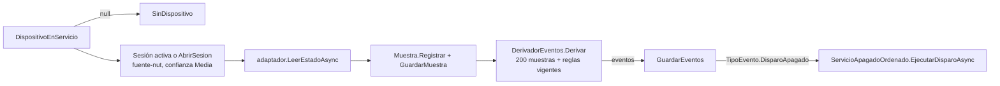

# 04 — Capa de aplicación y casos de uso

> **Propósito:** mapa de la capa `SAI.Service.Core.Application`: qué servicio orquesta cada caso de uso, qué puertos expone, qué códigos de resultado devuelve y cómo se traza cada CU del SDD hasta su servicio, su historia de usuario y sus BT.
> **Fuente primaria:** `src/SAI.Service.Core/SAI.Service.Core.Application/` (44 archivos `.cs` + `.csproj`), `SDD/Docs/02-Especificacion-Funcional/Casos-De-Uso/` (CU-01..CU-12), `SDD/Docs/06-Backlog-Tecnico/` (US-01..US-26, BT-01..BT-30).
> Todas las rutas son relativas a la raíz del repo. Abreviaturas: `App/` = `src/SAI.Service.Core/SAI.Service.Core.Application/`; `Domain/`, `Infrastructure/`, `Web/`, `Api/` = `src/SAI.Service.Core/SAI.Service.Core.<Capa>/`.
> Fuera de este índice: entidades y reglas de dominio → `02_Dominio-Y-Reglas.md`; tablas/EF Core y repositorios concretos → `03_Modelo-De-Datos.md`; páginas Razor y endpoints → `05_Interfaces-Panel-Y-Api.md`; adaptadores NUT/simulado y hosted services → `06_Infraestructura-Y-Adaptador-Sai.md`; pruebas → `07_Calidad-Y-Pruebas.md`.

---

## 1. Posición de la capa

| Aspecto | Valor | Fuente |
|---|---|---|
| Proyecto | `SAI.Service.Core.Application` (RootNamespace igual) | `App/SAI.Service.Core.Application.csproj` |
| Única dependencia | `SAI.Service.Core.Domain` (ProjectReference) | ídem |
| Rol declarado | «casos de uso, puertos y contratos. Depende solo de Domain» | comentario del `.csproj` |
| Arquitectura | Clean Architecture en cinco assemblies | `SDD/Docs/05-Arquitectura-Tecnica/Adrs/ADR-15-Clean-Architecture-En-Cinco-Assemblies-v1.0.md` |
| Registro DI | servicios y repositorios `AddScoped`; opciones y adaptador `AddSingleton` | `src/SAI.Service.Core/SAI.Service.Core.Infrastructure/DependencyInjection.cs` (l. 55–121) |
| Estilo | clases `sealed` con constructor primario; resultados como `record` + `enum Codigo…` (sin excepciones para errores de negocio) | todos los `Servicio*.cs` |

```text
Web (Blazor) ─┐                         ┌─► Domain (entidades, reglas, calculadores)
Api (minimal) ─┼─► Application ─────────┤
Infrastructure ┘   (servicios + puertos) └─◄ Infrastructure implementa los puertos
                                              (IRepositorio*, IAdaptadorConexion, IDescubridorSai)
```

## 2. Árbol de la capa

```text
App/
├── Abstractions/      puertos hacia el SAI + DTO de transporte (8 archivos)
├── Acciones/          apagado ordenado (CU-05)                       2
├── Equipos/           alta, verificación, ejercicio guiado (CU-02, CU-10)  8
├── Informes/          informe de período y comparación de marcas (CU-12)   4
├── Ingesta/           ingesta idempotente por API (CU-11)            4
├── Intervenciones/    recambio de batería, sustitución del SAI (CU-08, CU-09)  5
├── Monitoreo/         sondeo, panel en vivo, históricos, prueba de batería (CU-04, CU-06, CU-07)  9
└── Politicas/         políticas de apagado versionadas (CU-03)       4
```

## 3. Puertos hacia el equipo (`Abstractions/`)

| Archivo | Tipo | Contenido | Implementado por / usado por |
|---|---|---|---|
| `App/Abstractions/IAdaptadorConexion.cs` | interfaz | 4 operaciones: `LeerEstadoAsync`, `ProbarConectividadAsync`, `OrdenarApagadoConRetornoAsync(retardo, retardoRetorno)`, `LanzarTestBateriaAsync` | `Infrastructure/Adaptadores/Nut/AdaptadorConexionNut.cs`, `Infrastructure/Adaptadores/AdaptadorConexionSimulado.cs` (detalle en `06_…`) |
| `App/Abstractions/IDescubridorSai.cs` | interfaz | `DescubrirAsync` → lista de candidatos (vacía ⇒ `DISPOSITIVO_NO_DESCUBIERTO`) | mismas dos clases; misma instancia singleton que el adaptador (`DependencyInjection.cs` l. 55–75) |
| `App/Abstractions/IPlanificador.cs` | interfaz marcador | `bool Activo` («en Sprint 0 siempre es false») | **sin implementaciones ni consumidores** (grep en `src/`); el sondeo real es `Infrastructure/Monitoreo/ServicioSondeo.cs` |
| `App/Abstractions/EstadoSai.cs` | record | instantánea: `Alcanzable`, tensiones entrada/salida/batería, carga salida/batería, `EstadoUps`, `MarcaTiempoUtc` | resultado de `LeerEstadoAsync` |
| `App/Abstractions/EstadoUps.cs` | enum | `EnLinea=1` (OL), `EnBateria=2` (OB); 0 no válido | base de eventos de corte (US-09) |
| `App/Abstractions/ResultadoAccion.cs` | record | `Aceptada`, `Motivo`, `MarcaTiempoUtc` — «admitida, no que el efecto ocurrió» (ADR-11) | apagado y autotest |
| `App/Abstractions/ResultadoConectividad.cs` | record | `Conectado`, `LatenciaMilisegundos`, `Detalle` | prueba de conexión (US-03) |
| `App/Abstractions/DispositivoDescubierto.cs` | record | `NombreNut`, `Descriptor`, `VendorId`, `ProductId`, `Driver`, `NumeroSerie` | descubrimiento (US-03, CU-02 paso 2) |

Contrato del puerto: `SDD/Docs/05-Arquitectura-Tecnica/Adrs/ADR-27-Contrato-Del-Puerto-Del-Adaptador-De-Conexion-v1.0.md` (Aceptado), que supera a `ADR-22-…` (estado «Superado por ADR-27»). Los comentarios de `IAdaptadorConexion.cs` todavía dicen «ADR-22 pendiente» y «en Sprint 0 la única implementación es el simulado» (desactualizado: ya existe `AdaptadorConexionNut`).

## 4. Puertos de persistencia (por carpeta)

| Puerto | Archivo | Operaciones clave | Semántica |
|---|---|---|---|
| `IRepositorioEquipos` | `App/Equipos/IRepositorioEquipos.cs` | `MontajesDeDispositivoAsync`, `CoberturasDeHostAsync`, `GuardarAltaAsync(ConjuntoAlta)`, `ListarVerificacionesAsync`, `VerificacionDeSupuestoAsync`, `ActualizarVerificacionAsync`, `HayEquiposAsync`, `SesionEjercicioEnCursoAsync`, `Agregar/ActualizarSesionEjercicioAsync` | alta transaccional (todo o nada); verificaciones y sesión de ejercicio = update in-place |
| `ConjuntoAlta` (record) | ídem | fabricante, 2 modelos, host, dispositivo, batería, montaje, cobertura, 4 verificaciones | unidad transaccional del alta |
| `IRepositorioMonitoreo` | `App/Monitoreo/IRepositorioMonitoreo.cs` | 19 métodos: dispositivo en servicio, sesión activa, fuente, muestras (recientes/por período), reglas vigentes, eventos (recientes/por período/último corte), agregados, montaje vigente, pruebas, `GuardarPruebaConSerieAsync`, `GuardarAccionAsync`, `AccionesRecientesAsync` | muestras, eventos y acciones append-only (ADR-04) |
| `IRepositorioPoliticas` | `App/Politicas/IRepositorioPoliticas.cs` | `VigenteAsync`, `HistorialAsync`, `AgregarVersionAsync`, `ExisteAlgunaAsync`, `ListarVerificacionesAsync` | versiones append-only; vigente = mayor número |
| `IRepositorioIntervenciones` | `App/Intervenciones/IRepositorioIntervenciones.cs` | `DispositivoEnServicioAsync`, `MontajeVigenteAsync`, `MontajesDeDispositivoAsync`, `BateriaAsync`, `ModeloBateriaAsync`, `ExisteUnidadAsync`, `GuardarRecambioAsync(...)`, listados para panel | recambio en una transacción |
| `IRepositorioSustituciones` | `App/Intervenciones/IRepositorioSustituciones.cs` | `CoberturaVigenteAsync`, `CoberturasDeHostAsync`, `DispositivoAsync`, `ExisteModeloDispositivoAsync`, `ExisteUnidadAsync`, `ListarVerificacionesAsync`, `GuardarSustitucionAsync(...)`, `SustitucionesDeHostAsync` | sustitución en una transacción |
| `IRepositorioIngesta` | `App/Ingesta/IRepositorioIngesta.cs` | `BuscarPorClaveAsync`, `FuenteAsync`, `UnidadAsync`, `AgregarAsync` | la historia append-only es el almacén de idempotencia (ADR-17) |
| `IRepositorioInformes` | `App/Informes/IRepositorioInformes.cs` | `HostAsync`, `CoberturasDeHostAsync`, `MontajesDeDispositivosAsync`, `IntervencionesPorPeriodoAsync`, `SustitucionesPorPeriodoAsync`, `FichasCerradasConModeloAsync` | solo lectura; incluye unidades dadas de baja (RN-12) |

Implementaciones EF Core en `Infrastructure/Persistencia/Repositorio*.cs` (seis) y `Infrastructure/Monitoreo/RepositorioMonitoreo.cs` (el de monitoreo no está en `Persistencia/`); detalle en `03_Modelo-De-Datos.md`.

## 5. Servicios por carpeta

### 5.1 `Acciones/` — apagado ordenado (CU-05)

| Archivo | Tipo | Responsabilidad |
|---|---|---|
| `App/Acciones/ServicioApagadoOrdenado.cs` | servicio | `EjecutarDisparoAsync(eventoDisparoCodigo)`: deriva modalidad efectiva y registra una `Accion` append-only; `SituacionAsync`: modalidad, bloqueo y últimas 10 acciones para el panel |
| ídem | record `SituacionApagado` | `Solicitada`, `Efectiva`, `Verificados`, `Requeridos`, `TiempoReservadoSeg`, `Acciones` |
| `App/Acciones/OpcionesApagado.cs` | opciones (`Sai:Apagado`) | `ModalidadSolicitada=SoloAlerta`, `TiempoReservadoSeg=120`, `TiempoRetornoSeg=180` (`TiempoRetornoPorDefectoSeg`); semilla si no hay política vigente |

Árbol de decisión de `DecidirAsync`:

```text
solicitada == SoloAlerta ──────────────► Accion.SoloAviso                 (RN-01)
efectiva   == SoloAlerta ──────────────► Accion.Bloqueada  "n/4 supuestos" (RN-02, ADR-10)
adaptador.OrdenarApagadoConRetornoAsync(reservado, retorno)
   ├─ Aceptada ────────────────────────► Accion.Ejecutada                 (ADR-11, RN-03)
   └─ no aceptada ─────────────────────► Accion.EfectoNoConfirmado
```

- Parámetros: de `IRepositorioPoliticas.VigenteAsync`; si es `null`, de `OpcionesApagado`.
- Modalidad efectiva: `EvaluadorModalidad.Efectiva/Verificados` (Domain, `src/SAI.Service.Core/SAI.Service.Core.Domain/Verificaciones/EvaluadorModalidad.cs`, `SupuestosRequeridos = 4`).
- Nunca emite `shutdown.stop` (ADR-09, comentario de la clase).
- Consumidores: `ServicioMonitoreo` (disparo automático), `Web/Components/Pages/PanelDeApagado.razor` (situación y disparo manual con `eventoDisparoCodigo = null`).

### 5.2 `Equipos/` — alta, verificaciones y ejercicio guiado (CU-02, CU-10)

| Archivo | Tipo | Responsabilidad |
|---|---|---|
| `App/Equipos/ServicioAltaEquipos.cs` | servicio | `RegistrarAsync(SolicitudAltaEquipos)`; `ListarVerificacionesAsync`; `ConsultarEstadoAsync` → `EstadoPuestaEnMarcha` |
| `App/Equipos/SolicitudAltaEquipos.cs` | records | `SolicitudAltaEquipos` + `DatosFabricante`, `DatosModeloDispositivo` (potencia `Valor<double>?`), `DatosModeloBateria`, `DatosHost`, `DatosDispositivo`, `DatosBateria` |
| `App/Equipos/ResultadoAltaEquipos.cs` | record | `Exito`, `CodigoError`, modalidad, «n de 4»; fábricas `Ok`/`Error` |
| `App/Equipos/EstadoPuestaEnMarcha.cs` | record | aviso permanente del panel; `Degradado` ⇔ efectiva `SoloAlerta` (US-05) |
| `App/Equipos/ServicioVerificacion.cs` | servicio | ventana de mantenimiento (US-16): `EstadoAsync` + 4 pasos + disparo de prueba + rearme |
| ídem | enum `CodigoResultadoVerificacion` / record `ResultadoVerificacion` | `Verificado=1`, `EfectoNoConfirmado=2`, `Refutado=3`, `SinVerificacion=4`, `PruebaDisparada=5` |
| `App/Equipos/ServicioEjercicioGuiado.cs` | servicio + record `EstadoEjercicio` | sesión de acompañamiento persistida (P-7): `EstadoAsync` (cierre perezoso), `IniciarAsync` (idempotente), `AbandonarAsync` |
| `App/Equipos/OpcionesVerificacion.cs` | opciones (`Sai:Verificacion`) | `DiasPreavisoVencimiento = 30` («por vencer») |

Flujo de `RegistrarAsync` (alta):

| Paso | Acción | Error devuelto |
|---|---|---|
| 1 | construir `ModeloBateria` (invariante I-21 en el ctor) | `VIDA_FLOTACION_SIN_TEMPERATURA` |
| 2 | crear fabricante, modelo, host/dispositivo/batería y `PonerEnServicio()` | — |
| 3 | abrir `MontajeBateria` y `CoberturaHost` con `Vigencia(Instante)` abierta | — |
| 4 | `Vigencias.AdmiteNuevo` contra lo existente (I-1/I-2/I-4) | `MONTAJE_SOLAPADO`, `COBERTURA_SOLAPADA` |
| 5 | sembrar 4 `Verificacion` en `NuncaVerificado` (`Enum.GetValues<Supuesto>()`) | — |
| 6 | `GuardarAltaAsync` (transaccional) → modalidad efectiva `SoloAlerta`, 0/4 | — |

Pasos de `ServicioVerificacion` (método `ventana-mantenimiento`; vigencias en `Domain/Verificaciones/VigenciasSupuesto.cs`):

| Método | Supuesto | Evidencia exigida | Vigencia |
|---|---|---|---|
| `DispararPruebaPresupuestoAsync` | `PresupuestoDeApagado` | ordena apagado con retorno (30 s / 180 s) y deja `EsperandoReinicio` | — |
| `VerificarPresupuestoAsync(segundos)` | `PresupuestoDeApagado` | tiempo cronometrado **a mano** (ADR-25: el servicio muere con el host) | 180 días |
| `VerificarSenalBateriaAsync` | `SenalEnBateria` | `LeerEstadoAsync` con `EstadoUps.EnBateria` | 365 días |
| `VerificarCorteConRetornoAsync` | `CorteConRetorno` | `OrdenarApagadoConRetornoAsync` aceptado | no caduca |
| `RegistrarReencendidoAsync(arrancoSolo)` | `ReencendidoPorPlaca` | declaración; `false` ⇒ `Refutar` (bloqueo permanente); `true` ⇒ `Verificar` + `IniciarPrueba` (queda `EsperandoReinicio`) | 365 días |
| `RearmarPruebasPendientesAsync` | todos | limpia `PruebaEnCursoDesde` tras reinicio | — |

Consumidores: `Web/Components/Pages/AltaDeEquipos.razor`, `PanelEstadoEnVivo.razor`, `PanelDeVerificaciones.razor`; `RearmarPruebasPendientesAsync` lo invoca `Infrastructure/Monitoreo/ServicioRearmePruebas.cs` (IHostedService al arrancar).

### 5.3 `Monitoreo/` — sondeo, panel, históricos y prueba de batería (CU-04, CU-06, CU-07)

| Archivo | Tipo | Responsabilidad |
|---|---|---|
| `App/Monitoreo/ServicioMonitoreo.cs` | servicio | `SondearAsync(intervaloSeg)` → `ResultadoSondeo` (`SinDispositivo=1`, `Registrada=2`, `Perdida=3`); `CodigoFuenteNut = "fuente-nut"`; ventana de derivación 200 muestras |
| `App/Monitoreo/MapeoLecturas.cs` | `internal static` | `EstadoSai` → diccionario por variable; `EstadoUps` codificado 0/1 (`Variables.CodigoEnLinea/EnBateria`) |
| `App/Monitoreo/ServicioPanelEnVivo.cs` | servicio | `ObtenerAsync` → `EstadoEnVivo` (última muestra, procedencia por sesión, 10 eventos); sin caché (US-07 CA-3) |
| `App/Monitoreo/EstadoEnVivo.cs` | records | `EstadoEnVivo`, `LecturaEnVivo(Variable, Valor, Origen)`, `EventoEnVivo` (regla + versión) |
| `App/Monitoreo/ServicioHistoricos.cs` | servicio | `ConsultarAsync(variables, desde, hasta, resolucionForzada)`; `DiasRetencionMuestras = 30`; agrega por hora on-demand si no hay agregados persistidos |
| `App/Monitoreo/ResultadoHistorico.cs` | enums + records | `ResolucionSerie` (`Muestras`/`Agregados`), `CodigoResultadoHistorico` (`Ok`, `PeriodoSinDatos`, `AgregadoSinCobertura`), `PuntoSerie`, `MarcaEvento`, `SerieVariable`, `ResultadoHistorico` |
| `App/Monitoreo/ServicioPruebaBateria.cs` | servicio + record `ResultadoPrueba` | `EjecutarAsync` (manual) y `HistorialAsync` (10 últimas) |
| `App/Monitoreo/OpcionesPrueba.cs` | opciones (`Sai:Prueba`) | `NumeroMuestras=15`, `IntervaloMuestraMs=1000`, `FlotacionMinimaSeg=300`, `ToleranciaCargaPct=5` |
| `App/Monitoreo/IRepositorioMonitoreo.cs` | puerto | ver §4 |

Pipeline de una ronda (invocada por `Infrastructure/Monitoreo/ServicioSondeo.cs`, `BackgroundService`):



Prueba de batería (`EjecutarAsync`), errores en orden: `SIN_DISPOSITIVO` → `FLOTACION_INSUFICIENTE` (último corte < 300 s) → `SIN_BATERIA` (sin montaje vigente; se congela, I-15) → `TEST_NO_DISPONIBLE` (autotest no aceptado). Luego serie densa con `SesionSondeo` propia (`ses-prueba-…`, 1 s), veredicto con `CalculadorSaludBateria.Evaluar` (Domain) contra la primera prueba comparable del montaje, y `GuardarPruebaConSerieAsync` transaccional. Muestras perdidas se cuentan, no se interpolan (CL-13).

### 5.4 `Politicas/` — políticas de apagado versionadas (CU-03)

| Archivo | Tipo | Responsabilidad |
|---|---|---|
| `App/Politicas/ServicioPoliticas.cs` | servicio | `VigenteAsync`, `HistorialAsync`, `CrearVersionAsync(PropuestaPolitica)`, `PrevisualizarAsync` |
| ídem | records/enum | `PropuestaPolitica(Modalidad, Umbral, TiempoReservado, TiempoRetorno)`, `CodigoPolitica` (`Creada`, `TiempoApagadoExcedeTecho`, `ParametroInvalido`), `ResultadoPolitica`, `Previsualizacion` |
| `App/Politicas/DescriptorPoliticas.cs` | static | 4 `DescriptorParametro` (modalidad, umbral, reservado 12..540, retorno ≥1), `Defecto` (SoloAlerta/300/120/180), 3 `Preset` (Solo aviso, Apagado con retorno, Ciclo forzado) — «config dirigida por descriptores» |
| `App/Politicas/ExplicacionPolitica.cs` | static | `Redactar(propuesta)`: prosa «En palabras» por modalidad, cultura invariante |
| `App/Politicas/IRepositorioPoliticas.cs` | puerto | ver §4 |

Validaciones de `CrearVersionAsync` (antes de persistir): umbral > 0 y retorno > 0 → `PARAMETRO_INVALIDO`; reservado fuera de `[0, Accion.TechoDuroApagadoSeg]` → `TIEMPO_APAGADO_EXCEDE_TECHO` (RN-04). Crea `VersionPolitica.Inicial` o `vigente.Siguiente` (append-only). `PrevisualizarAsync` marca `Degradada` si la solicitada no es `SoloAlerta` y la efectiva sí.
Semilla v1 al arrancar desde `OpcionesApagado` + `DescriptorPoliticas.Defecto.UmbralDisparoSegundos`: `Web/Program.cs` (l. ~176–190). Consumidor: `Web/Components/Pages/ConfiguracionDePoliticas.razor` (presets, descriptores, previsualización y alta de versión).

### 5.5 `Intervenciones/` — recambio de batería y sustitución del SAI (CU-08, CU-09)

| Archivo | Tipo | Responsabilidad |
|---|---|---|
| `App/Intervenciones/ServicioRecambioBateria.cs` | servicio | `RegistrarAsync(SolicitudRecambio)` → `ResultadoRecambio` (con `FichaVidaUtil` proyectada) |
| ídem | records/enum | `ImporteEntrada(Monto, Moneda?, Fecha?)`, `SolicitudRecambio` (18 campos, incl. `TasaAUsd`, `FuenteCotizacion`), `CodigoRecambio` |
| `App/Intervenciones/ServicioSustitucionSai.cs` | servicio | `RegistrarAsync(SolicitudSustitucion)` → `ResultadoSustitucion` (días sin protección, `FirmwareReiniciado`) |
| ídem | records/enum | `SolicitudSustitucion` (tipo `Reparacion`/`Reemplazo`, suplente opcional), `CodigoSustitucion` |
| `App/Intervenciones/CalculadorProteccion.cs` | static puro + record `TramoProteccion` | `Sucesion(coberturas)` intercala huecos; `DiasSinProteccion(coberturas, hasta)` (CU-09 §4.6) |
| `App/Intervenciones/IRepositorioIntervenciones.cs`, `IRepositorioSustituciones.cs` | puertos | ver §4 |

| Código | Recambio (`CodigoRecambio`) | Sustitución (`CodigoSustitucion`) | Regla |
|---|---|---|---|
| Registrado | 1 | 1 | — |
| Dinero sin moneda/fecha | 2 `DINERO_SIN_MONEDA_O_FECHA` | 5 | RN-07 |
| Costos no cuadran | 3 `COSTOS_NO_CUADRAN` | — (costo único opcional) | RN-08 |
| Coherencia temporal | 4 `COHERENCIA_TEMPORAL` | 4 | RN-12, RC-08 |
| Sin vínculo vigente | 5 `SinMontajeVigente` | 2 `SinCoberturaVigente` | — |
| Solape | (dentro de 4, I-1/I-2) | 3 `COBERTURA_SOLAPADA` | I-4, RC-02 |
| Datos inválidos | 6 | 6 (incl. estado incompatible I-6) | — |

Efectos (un solo acto, `Guardar*Async`):
- **Recambio:** cierra montaje vigente, abre montaje nuevo en el mismo instante, `PonerEnServicio` a la nueva, `DarDeBaja` a la retirada, `Intervencion` + `FichaVidaUtil.Proyectar` (vida esperada = `VidaFlotacionAniosMin × 365.25` días, costo/año a USD con `TasaAUsd`).
- **Sustitución:** cierra cobertura; saliente `EnviarAReparacion()` o `DarDeBaja()` (reemplazo exige destino + receptor); suplente existente o nuevo (modelo debe existir); si cambia el modelo, `Verificacion.Reiniciar` en las cuatro (FA-2); `SustitucionSai` append-only.
- Consumidores: `Web/Components/Pages/RegistroDeIntervenciones.razor`, `SustitucionDelSai.razor` (este último usa también `CalculadorProteccion`).

### 5.6 `Ingesta/` — ingesta idempotente por API (CU-11)

| Archivo | Tipo | Responsabilidad |
|---|---|---|
| `App/Ingesta/ServicioIngesta.cs` | servicio | `IngerirAsync(clave, fuenteCodigo, entrada, huella sha256, ahora)` |
| `App/Ingesta/EntradaIngesta.cs` | records | `EntradaIngesta` (todo nullable para devolver 422 tipado), `CostosEntrada` (repuestos como arreglo), `DineroEntrada`, `DisposicionEntrada` |
| `App/Ingesta/ResultadoIngesta.cs` | enum + record | `CodigoIngesta` y `ResultadoIngesta` (id, tiempos, confianza, huellas, campo, invariante) |
| `App/Ingesta/IRepositorioIngesta.cs` | puerto | ver §4 |

| Orden | Chequeo | `CodigoIngesta` | HTTP (mapeo en `src/SAI.Service.Core/SAI.Service.Core.Api/Endpoints/EndpointsApiV1.cs`) |
|---|---|---|---|
| 1 | clave existente + misma huella | `Reintento=2` | 200 |
| 1 | clave existente + huella distinta | `ConflictoIdempotencia=3` (RN-09; sugiere rectificación, ADR-21 en estado «Propuesto») | 409 |
| 2 | `X-Fuente-Datos` no registrada | `FuenteNoRegistrada=6` | 422 |
| 3 | faltan tipo, dispositivo, tiempoValido o costos | `Validacion=4` | 422 |
| 4 | importe sin moneda/fecha | `Validacion=4` (RN-07) | 422 |
| 5 | total ≠ repuestos + mano de obra | `Validacion=4` (RN-08) | 422 |
| 6 | unidad referenciada dada de baja antes | `CoherenciaTemporal=5` (RN-12) | 422 |
| 7 | registrar `IntervencionIngerida` append-only, confianza de la fuente | `Creado=1` | 201 |

Fuente semilla `fd-gmao-externo` (confianza Media): `src/SAI.Service.Core/SAI.Service.Core.Web/Program.cs`. Contrato HTTP: `SDD/Docs/05-Arquitectura-Tecnica/Adrs/ADR-17-Manejo-De-Errores-De-La-Api-De-Ingesta-v1.0.md` (detalle en `05_…`).

### 5.7 `Informes/` — informe de período y comparación de marcas (CU-12)

| Archivo | Tipo | Responsabilidad |
|---|---|---|
| `App/Informes/ServicioInformePeriodo.cs` | servicio | `ArmarInformeAsync(desde, hasta)` y `CompararMarcasAsync()`; reutiliza `ServicioHistoricos` |
| `App/Informes/InformePeriodo.cs` | enum + records | `CodigoInforme` (`Ok`, `PeriodoSinDatos`, `AgregadoSinCobertura`), `SeccionCobertura`, `BateriaInterviniente`, `SeccionCostos`, `CostoPorTipo`, `SeccionEventosCalidad`, `EventoPorTipo`, `InformePeriodo` |
| `App/Informes/ComparacionMarcas.cs` | records | `FilaModelo` (costo/año USD, fuente de cotización, cumplió expectativa, desvío), `ComparacionMarcas` (`Concluyente`, `Aviso`) |
| `App/Informes/IRepositorioInformes.cs` | puerto + record `FichaConModelo` | ver §4 |

- Cobertura: intersección de vigencias con `[desde, hasta)`; días sin protección = complemento.
- Costos por tipo: «Recambio de batería», «Reparación del SAI», «Sustitución del SAI»; suma conserva moneda del primero y fecha más reciente (RN-07).
- Eventos/calidad: sobre `Variables.TensionEntrada`; microcortes salen de eventos (CL-16); si el histórico devuelve `AgregadoSinCobertura`, el informe también (RN-10).
- Comparación: agrupa fichas cerradas por modelo, promedio de costo/año, «cumplió» por mayoría, orden ascendente por costo; < 2 modelos ⇒ no concluyente (FA-1).
- Consumidor: `Web/Components/Pages/InformeDePeriodo.razor`.

## 6. Opciones de configuración leídas por Application

| Clase | Sección | Defaults | Lectura |
|---|---|---|---|
| `OpcionesApagado` | `Sai:Apagado` | SoloAlerta, 120 s, 180 s | `DependencyInjection.cs` (`LeerOpcionesApagado`) |
| `OpcionesVerificacion` | `Sai:Verificacion` | 30 días preaviso | `LeerOpcionesVerificacion` |
| `OpcionesPrueba` | `Sai:Prueba` | 15 muestras, 1000 ms, 300 s flotación, 5 pp | `LeerOpcionesPrueba` |
| (selector de adaptador) | `Sai:Adaptador` = `Nut` / otro ⇒ simulado | simulado | `DependencyInjection.cs` l. 58 (detalle en `06_…`) |

## 7. Trazabilidad CU → servicio → US → BT

| CU | Título (SDD) | Servicio(s) de Application | US que lo cubren | BT (matriz §3, «CU upstream») |
|---|---|---|---|---|
| CU-01 | Autenticación del administrador | **ninguno** en Application; vive en Web (`Web/Endpoints/EndpointsAcceso.cs`, `Web/Components/Pages/Acceso/*.razor`) | US-01, US-02 | BT-05, BT-07, BT-10 |
| CU-02 | Alta de equipos y puesta en marcha | `IDescubridorSai`, `IAdaptadorConexion.ProbarConectividadAsync`, `ServicioAltaEquipos` | US-03, US-04, US-05, US-25 | BT-01, BT-04, BT-07, BT-11..BT-15, BT-23 |
| CU-03 | Políticas de apagado versionadas | `ServicioPoliticas`, `DescriptorPoliticas`, `ExplicacionPolitica` | US-06 | BT-16 |
| CU-04 | Monitoreo en vivo | `ServicioMonitoreo`, `ServicioPanelEnVivo`, `MapeoLecturas` | US-07, US-08, US-09, US-10, US-25, US-26 | BT-01, BT-02, BT-05..BT-09, BT-14, BT-15, BT-17..BT-19, BT-24 |
| CU-05 | Apagado ordenado ante corte | `ServicioApagadoOrdenado` (disparado desde `ServicioMonitoreo`) | US-14, US-15, US-17 | BT-04, BT-14, BT-16, BT-17, BT-20, BT-22..BT-25, BT-29 |
| CU-06 | Históricos y gráficas | `ServicioHistoricos` | US-10, US-11 | BT-08, BT-09, BT-18, BT-19 |
| CU-07 | Prueba de batería y veredicto | `ServicioPruebaBateria` (+ `CalculadorSaludBateria` en Domain) | US-12, US-13 | BT-17, BT-21, BT-29 |
| CU-08 | Recambio de batería y ficha | `ServicioRecambioBateria` | US-18, US-19, US-24 | BT-11, BT-12, BT-26, BT-27 |
| CU-09 | Reparación y sustitución del SAI | `ServicioSustitucionSai`, `CalculadorProteccion` | US-20 | BT-11, BT-12, BT-26 |
| CU-10 | Ventana de mantenimiento | `ServicioVerificacion`, `ServicioEjercicioGuiado` | US-05, US-15, US-16, US-17 | BT-23..BT-25, BT-29 |
| CU-11 | Ingesta automatizada | `ServicioIngesta` | US-21, US-22 | BT-03, BT-26, BT-28 |
| CU-12 | Informe y comparación de marcas | `ServicioInformePeriodo` | US-19, US-23, US-24 | BT-12, BT-27, BT-30 |

Fuentes: columna US = fila «CU cubiertos» de §4 «Trazabilidad» de cada `SDD/Docs/06-Backlog-Tecnico/historias-usuario/US-XX-*.md`; columna BT = matriz §3 «Trazabilidad BT↔US↔CU» de `SDD/Docs/06-Backlog-Tecnico/Backlog-Tecnico-v1.0.md`. Las filas «BT derivadas» de las US son un subconjunto de la matriz (no declaran BT-01/BT-04/BT-05/BT-14 en varias US) salvo US-24, que declara BT-30 aunque la matriz la ata solo a CU-12 (ver D-12).

### 7.1 Historias: épica, prioridad y servicio

| US | Épica | MoSCoW | SP | Servicio / método principal |
|---|---|---|---|---|
| US-01, US-02 | EP-03 | Must | 3, 3 | fuera de Application (Web, Identity) |
| US-03 | EP-04 | Must | 5 | `IDescubridorSai.DescubrirAsync`, `IAdaptadorConexion.ProbarConectividadAsync` |
| US-04 | EP-04 | Must | 8 | `ServicioAltaEquipos.RegistrarAsync` |
| US-05 | EP-04 | Must | 3 | `ServicioAltaEquipos.ConsultarEstadoAsync` (siembra en `RegistrarAsync`) |
| US-06 | EP-04 | Must | 5 | `ServicioPoliticas.CrearVersionAsync/PrevisualizarAsync` |
| US-07 | EP-05 | Must | 5 | `ServicioPanelEnVivo.ObtenerAsync` |
| US-08 | EP-05 | Must | 8 | `ServicioMonitoreo.SondearAsync` |
| US-09 | EP-05 | Must | 5 | `ServicioMonitoreo` → `DerivadorEventos` (Domain) |
| US-10 | EP-05 | Must | 3 | `LecturaEnVivo.Origen`, `SerieVariable.Procedencia` |
| US-11 | EP-05 | Must | 8 | `ServicioHistoricos.ConsultarAsync` |
| US-12 | EP-05 | Must | 8 | `ServicioPruebaBateria.EjecutarAsync` (solo manual, ver §8) |
| US-13 | EP-05 | Must | 8 | `CalculadorSaludBateria.Evaluar` vía `ServicioPruebaBateria` |
| US-14 | EP-06 | Must | 13 | `ServicioApagadoOrdenado.EjecutarDisparoAsync` |
| US-15 | EP-06 | Must | 8 | `DecidirAsync` (bloqueo + efecto observado) |
| US-16 | EP-06 | Must | 8 | `ServicioVerificacion` + `ServicioEjercicioGuiado` |
| US-17 | EP-06 | Should | 5 | sin método dedicado (ver §8) |
| US-18 | EP-06 | Should | 8 | `ServicioRecambioBateria.RegistrarAsync` |
| US-19 | EP-06 | Should | 5 | `FichaVidaUtil.Proyectar` dentro del recambio; lectura en `CompararMarcasAsync` |
| US-20 | EP-06 | Should | 8 | `ServicioSustitucionSai.RegistrarAsync` |
| US-21 | EP-07 | Must | 8 | `ServicioIngesta.IngerirAsync` (camino 201/200) |
| US-22 | EP-07 | Must | 5 | `ServicioIngesta.IngerirAsync` (camino 409/422) |
| US-23 | EP-07 | Should | 8 | `ServicioInformePeriodo.ArmarInformeAsync` |
| US-24 | EP-07 | Should | 5 | `ServicioInformePeriodo.CompararMarcasAsync` |
| US-25, US-26 | EP-07 | Could | 5, 3 | diseñadas, no implementadas en v1 (nota de extensibilidad en `Backlog-Tecnico-v1.0.md` §2) |

Totales del backlog: 18 Must (114 SP), 6 Should (39 SP), 2 Could (8 SP) — `SDD/Docs/06-Backlog-Tecnico/README.md`. Épicas EP-01..EP-07 con fase y release en el mismo README; DoR en `Definition-Of-Ready-v1.0.md`.

### 7.2 Códigos de error del SDD vs. código

| Código CU | CU | Dónde aparece en Application |
|---|---|---|
| `ADMIN_YA_EXISTE`, `CREDENCIAL_INVALIDA`, `CONTRASENA_ACTUAL_INVALIDA`, `SESION_REQUERIDA` | CU-01 | fuera de Application (`Web/Components/Pages/Acceso/*.razor` para los dos primeros; ver `05_…`) |
| `DISPOSITIVO_NO_DESCUBIERTO` | CU-02 | doc de `IDescubridorSai` (lista vacía); literal en `Web/Components/Pages/AltaDeEquipos.razor` e `Infrastructure/Adaptadores/Nut/AdaptadorConexionNut.cs` |
| `VIDA_FLOTACION_SIN_TEMPERATURA` | CU-02 | `ServicioAltaEquipos` |
| `PRUEBA_CONEXION_FALLIDA` | CU-02 | en Application solo `ResultadoConectividad.Conectado=false`; el literal lo pone `Infrastructure/Adaptadores/Nut/AdaptadorConexionNut.cs` |
| `TIEMPO_APAGADO_EXCEDE_TECHO`, `PARAMETRO_INVALIDO` | CU-03 | `ServicioPoliticas` |
| `PERDIDA_COMUNICACION`, `TENSION_FUERA_DE_RANGO` | CU-04 | sin literal en `src/` (grep); equivalen a `TipoEvento.DesconexionUsb` / `TipoEvento.TensionFueraDeRango` de `Domain/Monitoreo/DerivadorEventos.cs` (reglas sembradas en `Web/Program.cs`), no en Application |
| `BLOQUEADA_POR_VERIFICACION`, `EFECTO_NO_CONFIRMADO` | CU-05 | sin literal; fábricas `Accion.Bloqueada` / `Accion.EfectoNoConfirmado` en `ServicioApagadoOrdenado` |
| `NOTIFICACION_REMOTA_FALLIDA` | CU-05 | sin implementación en `src/` (grep) |
| `PERIODO_SIN_DATOS`, `AGREGADO_SIN_COBERTURA` | CU-06, CU-12 | `CodigoResultadoHistorico`, `CodigoInforme` |
| `FLOTACION_INSUFICIENTE` | CU-07 | `ServicioPruebaBateria` |
| `PRUEBA_NO_COMPARABLE`, `DERIVADO_NO_CALCULABLE` | CU-07 | sin literal en `src/`; `Comparable=false` / `MotivoNoCalculable` del resultado de `Domain/Monitoreo/CalculadorSaludBateria.cs` |
| `COSTOS_NO_CUADRAN`, `DINERO_SIN_MONEDA_O_FECHA`, `COHERENCIA_TEMPORAL` | CU-08, CU-11 | `ServicioRecambioBateria`, `ServicioIngesta` |
| `COBERTURA_SOLAPADA` | CU-09 | `ServicioSustitucionSai`, `ServicioAltaEquipos` |
| `SUPUESTO_REFUTADO`, `EFECTO_NO_CONFIRMADO` | CU-10 | sin literal; `CodigoResultadoVerificacion.Refutado` / `.EfectoNoConfirmado` |
| `CONFLICTO_IDEMPOTENCIA` | CU-11 | `CodigoIngesta.ConflictoIdempotencia` |

## 8. Divergencias y huecos detectados (evidencia vs. SDD)

| # | Hallazgo | Evidencia |
|---|---|---|
| D-1 | La fila «Historias de usuario a generar» de cada CU usa una numeración tentativa (p. ej. CU-05 → «US-02, US-04»; CU-03 → «US-03») que no coincide con las US finales; la trazabilidad válida es la de las US y la matriz BT↔US↔CU | §9 de `CU-0X-*.md` vs. §4 de `US-XX-*.md` |
| D-2 | RN-11 / CU-05 CA-02 (acción referida a versión de política): `ServicioApagadoOrdenado` lee la versión vigente pero no la pasa a `Accion`, y `Domain/Acciones/Accion.cs` no tiene campo de política | grep `politica` sin resultados en `Accion.cs` |
| D-3 | US-17 / CU-05 FA-2 (renovación por evidencia ante corte real): `ServicioMonitoreo` no renueva verificaciones; solo `ServicioVerificacion` verifica, a pedido | `App/Monitoreo/ServicioMonitoreo.cs`; grep `renova` en `src/` |
| D-4 | US-12 «programada y manual»: `ServicioPruebaBateria` expone solo `EjecutarAsync` manual, invocado desde `PruebaDeBateria.razor`; no hay disparo programado ni elevación de cadencia del sondeo principal (usa sesión densa propia) | grep `EjecutarAsync(` en `src/` |
| D-5 | `IPlanificador` es un marcador sin implementación ni uso | grep en `src/` |
| D-6 | Comentarios de `IAdaptadorConexion`, `EstadoSai`, `ResultadoAccion`, `ResultadoConectividad` aún dicen «Placeholder de Sprint 0» / «ADR-22 pendiente», ya superados (ADR-27 Aceptado; adaptador NUT existe) | archivos de `App/Abstractions/` |
| D-7 | `ServicioAltaEquipos`: un `<summary>` huérfano (del `ConsultarEstadoAsync`) quedó encima de `ListarVerificacionesAsync` | `App/Equipos/ServicioAltaEquipos.cs` |
| D-8 | `ServicioVerificacion` usa retardo fijo de 30 s (no el tiempo reservado de la política) para las órdenes de prueba | `App/Equipos/ServicioVerificacion.cs` |
| D-9 | `PanelDeApagado.razor` puede invocar `EjecutarDisparoAsync(null)` a mano (disparo sin evento) | `Web/Components/Pages/PanelDeApagado.razor` l. 105 |
| D-10 | `ServicioAltaEquipos.ConsultarEstadoAsync` evalúa siempre con solicitada `SoloAlerta` (comentario: «sin política configurada todavía»), así que `EstadoPuestaEnMarcha.Degradado` es siempre `true`: el aviso de `PanelEstadoEnVivo.razor` queda en Warning aun con 4/4 y política vigente | `App/Equipos/ServicioAltaEquipos.cs`; `Domain/Verificaciones/EvaluadorModalidad.cs` |
| D-11 | `DescriptorPoliticas` fija mínimo 12 s al tiempo reservado, pero `CrearVersionAsync` acepta `[0, 540]`: la validación del servicio es más laxa que el descriptor | `App/Politicas/DescriptorPoliticas.cs` (`TiempoReservadoMinimo`), `App/Politicas/ServicioPoliticas.cs` |
| D-12 | US-24 declara BT-30 y CU-08, pero la matriz §3 da BT-30 → solo CU-12; las US no listan BT-01/04/05/14 que la matriz les asigna | `historias-usuario/US-24-*.md` §4 vs. `Backlog-Tecnico-v1.0.md` §3 |
| D-13 | `ServicioIngesta` guarda la confianza de la fuente (`fuente.ConfianzaBase`) pero responde `Confianza: "media"` fijo en 201 y 200 | `App/Ingesta/ServicioIngesta.cs` |

El estado de estos ítems como pendientes formales se consolida en `11_Estado-Y-Pendientes.md`.

## 9. Pruebas de esta capa

Unitarias en `tests/SAI.Service.Core.Application.Tests/` (5 archivos: andamiaje, `CalculadorProteccion`, `ServicioInformePeriodo`, `ServicioIngesta`, `ServicioPoliticas`); el resto de los servicios se ejercita en `tests/SAI.Service.Core.Integration.Tests/*IntegracionTests.cs` contra EF Core real. Conteos, compuertas y cobertura en `07_Calidad-Y-Pruebas.md`.
