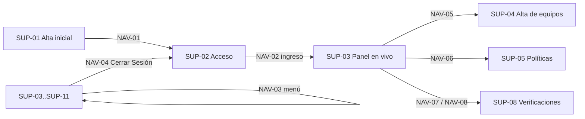

# 05 — Interfaces: panel Blazor y API REST

> **Propósito:** mapa de las superficies de usuario (panel Blazor Server + MudBlazor), su navegación, la autenticación del panel y de la API, los endpoints REST y la guía UX/UI del SDD (categoría 03 y maqueta de la Fase B2) contra la que se mide el panel.
> **Fuente primaria:** `src/SAI.Service.Core/SAI.Service.Core.Web/` (composition root + panel), `src/SAI.Service.Core/SAI.Service.Core.Api/` (endpoints), `SDD/Docs/03-UX-UI-DX/` y `SDD/Maquetas/Sai-Service-Core/`.
> Rutas relativas a la raíz del repo `SAI.Service.Core`. Abreviaturas: `Web/` = `src/SAI.Service.Core/SAI.Service.Core.Web/`, `Api/` = `src/SAI.Service.Core/SAI.Service.Core.Api/`, `Pages/` = `Web/Components/Pages/`.
> Fuera de este índice: lógica de los servicios que invocan las páginas → `04_Aplicacion-Y-Casos-De-Uso.md`; reglas RN/invariantes → `02_Dominio-Y-Reglas.md`; Identity/EF/SQLite → `03_Modelo-De-Datos.md`; adaptador NUT/simulado → `06_Infraestructura-Y-Adaptador-Sai.md`; pruebas → `07_Calidad-Y-Pruebas.md`; Kestrel/TLS/contenedor → `08_Devops-Despliegue-Y-Operacion.md`; términos → `10_Glosario.md`.

---

## 1. Vista de conjunto

```text
Navegador LAN ──cookie "sai.auth"──►  Panel Blazor (Web/Components)   ── IServiceScopeFactory ──► Servicios Application
                                      ├─ SSR estático: /alta-inicial, /acceso, /cuenta/cambiar-contrasena
                                      └─ InteractiveServer: las 10 superficies de trabajo

Cliente máquina (GMAO) ──Bearer JWT──► API REST /api/v1  (Api/Endpoints + Web/Endpoints/EndpointsAcceso.cs)
curl / smoke test  ──anónimo────────► GET /health
```

| Pieza | Archivo | Rol |
| --- | --- | --- |
| Host / composition root | `Web/Program.cs` | Registra Blazor + MudBlazor, `AddApi()`, `AddInfrastructure()`, Identity, DataProtection, cookie, JwtBearer, policy `Api`; siembra datos; arma el pipeline y mapea endpoints y componentes |
| Proyecto Web | `Web/SAI.Service.Core.Web.csproj` | SDK Web; referencia Api + Infrastructure; paquetes `MudBlazor` 8.5.0 y `Microsoft.AspNetCore.Authentication.JwtBearer` 10.0.0; `UserSecretsId` `sai-service-core-web` |
| Proyecto Api | `Api/SAI.Service.Core.Api.csproj` | Librería (FrameworkReference `Microsoft.AspNetCore.App`) que depende solo de Application; versionado por segmento de ruta `/api/v1/`, sin librería de versionado |
| Cableado Api | `Api/DependencyInjection.cs` | `AddApi()` = `AddEndpointsApiExplorer()`; `MapApi()` = `MapEndpointsSalud()` + `MapEndpointsApiV1()` |

---

## 2. Pipeline HTTP y orden de middlewares

Orden exacto en `Web/Program.cs`:

| # | Paso | Detalle |
| --- | --- | --- |
| 1 | Migración + semillas | `MigrateAsync()`, rol `administrador`, reglas de derivación v1, política v1, fuente `fd-gmao-externo` (detalle en `03_Modelo-De-Datos.md`) |
| 2 | `UseHsts()` | Solo fuera de Development |
| 3 | `UseHttpsRedirection()`, `UseStaticFiles()` | — |
| 4 | **Guarda de primer arranque (capa de ruteo)** | Middleware inline: mientras no haya ningún usuario, toda "superficie de panel" redirige a `/alta-inicial`; al detectar un admin, una bandera `hayAdministrador` cacheada apaga la comprobación para siempre |
| 5 | `UseAuthentication()` → `UseAuthorization()` | — |
| 6 | `UseAntiforgery()` | **Después** de autenticación, para que el token de formularios SSR autenticados se valide contra el usuario correcto (comentario en `Program.cs`) |
| 7 | `MapApi()` + `MapEndpointsAcceso()` | `/health`, `/api/v1/*`, `/api/v1/token`, `/cuenta/cerrar-sesion` |
| 8 | `MapRazorComponents<App>().AddInteractiveServerRenderMode()` | Panel |

Rutas **exentas** de la guarda de ruteo (`EsSuperficieDePanel` en `Web/Program.cs`): `/alta-inicial`, `/acceso`, `/cuenta`, `/health`, `/api`, `/_blazor`, `/_framework`, `/_content` y cualquier ruta cuyo último segmento tenga extensión (activos estáticos).

---

## 3. Endpoints HTTP (REST y de acceso)

| Verbo | Ruta | Auth | Nombre (`WithName`) | Archivo | Respuesta |
| --- | --- | --- | --- | --- | --- |
| GET | `/health` | Anónimo | `Salud` (tag `Salud`) | `Api/Endpoints/EndpointsSalud.cs` | `200 {estado:"ok", servicio, utc}` — lo usa el smoke test del pipeline |
| GET | `/api/v1/` | Anónimo | `ApiV1Raiz` | `Api/Endpoints/EndpointsApiV1.cs` | `200 {api, version:"v1", estado:"operativo", nota}` |
| GET | `/api/v1/ping` | Policy `Api` (Bearer) | `ApiV1Ping` | `Api/Endpoints/EndpointsApiV1.cs` | `200 {api, version, respuesta:"pong", usuario, utc}`; sin token `401` |
| POST | `/api/v1/intervenciones` | Policy `Api` (Bearer) | `ApiV1IngestaIntervenciones` | `Api/Endpoints/EndpointsApiV1.cs` | Ingesta idempotente CU-11 → ver §3.1 |
| POST | `/api/v1/token` | Anónimo, `DisableAntiforgery` | `TokenRopc` (tag `Acceso`) | `Web/Endpoints/EndpointsAcceso.cs` | ROPC → ver §3.2 |
| POST | `/cuenta/cerrar-sesion` | Sin `RequireAuthorization` (no exige sesión; no hay `FallbackPolicy`), `DisableAntiforgery` | `CerrarSesion` (tag `Acceso`) | `Web/Endpoints/EndpointsAcceso.cs` | `SignOutAsync()` y `302 → /acceso` |

`EndpointsAcceso` vive en Web (no en Api) porque necesita `HttpContext`, `UserManager`/`SignInManager` y el store de Identity (`Web/Endpoints/EndpointsAcceso.cs`). Errores de la API en `problem+json` vía `AddProblemDetails()` (`Web/Program.cs`, ADR-17).

### 3.1 `POST /api/v1/intervenciones` (contrato hacia terceros)

Fuente: `Api/Endpoints/EndpointsApiV1.cs`; servicio `ServicioIngesta` (`04_Aplicacion-Y-Casos-De-Uso.md`); decisión `SDD/Docs/05-Arquitectura-Tecnica/Adrs/ADR-17-Manejo-De-Errores-De-La-Api-De-Ingesta-v1.0.md`.

| Elemento | Valor |
| --- | --- |
| Cabeceras obligatorias | `X-Idempotency-Key`, `X-Fuente-Datos` (la fuente sembrada es `fd-gmao-externo`, `Web/Program.cs`) |
| Cuerpo | JSON → `EntradaIngesta` (deserialización case-insensitive) |
| Huella | `sha256:` + hex del cuerpo crudo UTF-8 (reintento byte a byte idéntico ⇒ misma huella) |

| Código | Caso | `type` problem+json | Extensiones |
| --- | --- | --- | --- |
| 201 Created | `CodigoIngesta.Creado` | — | Body `{id, creado:true, confianza, tiempoValido, tiempoRegistrado}`; `Location: /api/v1/intervenciones/{id}` |
| 200 OK | `Reintento` (misma clave, misma huella) | — | `{id, creado:false}` |
| 400 | Faltan cabeceras / JSON inválido / cuerpo vacío | `cabeceras_faltantes` / `validacion` | — |
| 409 Conflict | `ConflictoIdempotencia` (misma clave, otro cuerpo) | `conflicto_idempotencia` | `sha256Original`, `sha256Recibido`, `accionSugerida` |
| 422 | `CoherenciaTemporal` | `coherencia_temporal` | `campo`, `invariante` |
| 422 | Resto (validación) | `validacion` | `campo`, `invariante` (default `validacion`) |
| 401 | Sin Bearer válido | — | — |

No hay `GET /api/v1/intervenciones/{id}` mapeado aunque el `Location` lo apunte (`Api/Endpoints/EndpointsApiV1.cs`). El endpoint de rectificación del 409 es el pendiente P-05 (`SDD/Docs/03-UX-UI-DX/README.md`).

### 3.2 `POST /api/v1/token` (ROPC)

| Paso | Comportamiento (`Web/Endpoints/EndpointsAcceso.cs`) |
| --- | --- |
| Formato | Exige `application/x-www-form-urlencoded`/form; si no, `400 {error:"invalid_request"}` |
| `grant_type` | Debe ser `password`; si no, `400 {error:"unsupported_grant_type"}` |
| Credenciales | `username`/`password` contra `UserManager`; usuario inexistente o clave mala ⇒ `400 {error:"invalid_grant"}` indiferenciado |
| Éxito | `200 {access_token, token_type:"Bearer", expires_in}` |

Justificación de ROPC (cliente de primera parte en LAN): comentario del endpoint (que cita ADR-16 / ADR-20) y la decisión `SDD/Docs/05-Arquitectura-Tecnica/Adrs/ADR-28-Autenticacion-De-La-Api-Con-Bearer-Jwt-Via-Ropc-v1.0.md`.

---

## 4. Autenticación y autorización

### 4.1 Esquema dual

| Esquema | Para | Configuración | Fuente |
| --- | --- | --- | --- |
| Cookie de Identity (default) | Panel Blazor | `AddIdentity<AdministradorUser, IdentityRole>` sobre `SaiDbContext`; cookie `sai.auth`, `LoginPath`/`AccessDeniedPath` = `/acceso`, `SlidingExpiration` | `Web/Program.cs`, ADR-16 |
| JwtBearer | API `/api/v1` | Policy `Api` = `AddAuthenticationSchemes(Bearer)` + `RequireAuthenticatedUser()`; la cookie no autoriza la API | `Web/Program.cs`, ADR-28 |

### 4.2 Política de contraseña (Identity)

| Opción | Valor | Fuente |
| --- | --- | --- |
| `RequiredLength` | 12 | `Web/Program.cs` (cita EST-03 de la Línea-Base-Visual) |
| `RequireDigit` / `RequireLowercase` | true / true | ídem |
| `RequireUppercase` / `RequireNonAlphanumeric` | false / false | ídem |
| `RequireUniqueEmail` / `RequireConfirmedAccount` | false / false | ídem |
| Lockout | `lockoutOnFailure: false` en el login | `Pages/Acceso/Acceso.razor` |

### 4.3 JWT

| Clase | Archivo | Contenido |
| --- | --- | --- |
| `OpcionesJwt` | `Web/Autenticacion/OpcionesJwt.cs` | Sección `Jwt`: `Emisor` (`sai-service-core`), `Audiencia` (`sai-service-core-api`), `ClaveFirma` (≥ 32 bytes, secreto), `MinutosVigencia` (60) |
| `GeneradorTokens` | `Web/Autenticacion/GeneradorTokens.cs` | HS256; claims `sub`, `unique_name`, `name`, `role=administrador`, `jti`; devuelve token + `expires_in` en segundos. Constante `RolAdministrador = "administrador"` (rol único) |
| Validación | `Web/Program.cs` | Diferida desde `IOptions<OpcionesJwt>` (mismo origen que la firma); valida emisor, audiencia, firma y vigencia; `ClockSkew` 30 s |
| Arranque | `Web/Program.cs` | Lanza `InvalidOperationException` si `Jwt:ClaveFirma` < 32 bytes |
| Clave | `Web/appsettings.json` (vacía, ranura `Jwt__ClaveFirma`) / `Web/appsettings.Development.json` (clave de desarrollo) | Gestión de secretos → `08_Devops-Despliegue-Y-Operacion.md` |

### 4.4 Estado de autenticación en Blazor

| Pieza | Archivo | Rol |
| --- | --- | --- |
| `ProveedorEstadoAutenticacionServidor` | `Web/Autenticacion/ProveedorEstadoAutenticacionServidor.cs` | `AuthenticationStateProvider` + `IHostEnvironmentAuthenticationStateProvider`; recibe el usuario de la cookie, sin revalidación periódica |
| `AddCascadingAuthenticationState()` | `Web/Program.cs` | Expone el estado a `AuthorizeRouteView`/`AuthorizeView` |
| DataProtection | `Web/Program.cs`, `Web/appsettings.json` | `SetApplicationName("SAI.Service.Core")`; si `DataProtection:RutaLlaves` está definido, persiste el keyring (cookie + antiforgery sobreviven reinicios) |

### 4.5 Guarda de primer arranque en tres capas

Design-Rules-Primer-Arranque §3, materializado así:

| Capa | Dónde | Predicado / efecto |
| --- | --- | --- |
| Ruteo | Middleware de `Web/Program.cs` + `Web/Components/RedirigirAAcceso.razor` | Sin admin ⇒ `/alta-inicial`; con admin y sin sesión ⇒ `/acceso` (`NavigateTo(..., forceLoad:true)`) |
| Superficie | `Pages/Acceso/AltaInicial.razor` (GET con admin ⇒ `/acceso`); `Pages/Acceso/Acceso.razor` (sin admin ⇒ `/alta-inicial`; con sesión ⇒ `/`) | Redirección neutra |
| Acción | `AltaInicial.razor` → `Crear()` revalida `Usuarios.Users.Any()` antes de crear | Última barrera ante carrera |

---

## 5. Shell, layout y navegación

### 5.1 Componentes raíz

| Archivo | Rol |
| --- | --- |
| `Web/Components/App.razor` | Documento HTML (`lang="es"`), carga `_content/MudBlazor/MudBlazor.min.css`, `app.css`, `MudBlazor.min.js`, `_framework/blazor.web.js`. Modo de render por página: `InteractiveServer` salvo páginas con `[ExcludeFromInteractiveRouting]` (detectado por `HttpContext.AcceptsInteractiveRouting()`) |
| `Web/Components/Routes.razor` | `Router` + `AuthorizeRouteView` (layout por defecto `MainLayout`); `NotAuthorized` ⇒ `<RedirigirAAcceso/>`; `Authorizing` ⇒ `MudProgressCircular`; `NotFound` ⇒ «Página no encontrada»; `FocusOnNavigate` a `h1` |
| `Web/Components/RedirigirAAcceso.razor` | Guarda global (ver §4.5) |
| `Web/Components/_Imports.razor` | Usings globales (MudBlazor, Identity, Authorization, namespaces de páginas y `PanelVerificaciones`) |

### 5.2 Layouts

| Layout | Archivo | Contenido |
| --- | --- | --- |
| `MainLayout` | `Web/Components/Layout/MainLayout.razor` | `MudAppBar`: botón menú, ícono `MonitorHeart`, «Sai-Service-Core», nombre del usuario (`AuthorizeView`), botón «Cambiar Contraseña» (`/cuenta/cambiar-contrasena`), formulario POST «Cerrar Sesión» (`/cuenta/cerrar-sesion`, `data-enhance="false"`), chip de versión con tooltip de diagnóstico. `MudDrawer` responsive «Modulos» con `MudNavMenu` |
| `LayoutAcceso` | `Web/Components/Layout/LayoutAcceso.razor` | Sin menú ni barra: contenedor `ExtraSmall` centrado + pie «Sai-Service-Core · v {versión}» |
| Tema | `Web/Components/Layout/TemaSai.cs` | `MudTheme` con la paleta de la maqueta: primario `#0F6E56`, drawer `#04342C`, appbar blanca, warning `#854F0B`, error `#A03030`, info `#185FA5`, fondo `#F1F1EF`; radio 10px; drawer 260px; fuente Inter |
| Estilos | `Web/wwwroot/app.css` | Drawer oscuro con ítem activo verde, `.skip-link`, clases de acceso `.sai-acceso-tarjeta`, `.sai-campo`, `.sai-hint`, `.sai-boton-primario`, `.sai-banda(-error/-exito)` |
| Sello | `Web/SelloVersion.cs` + sección `Sello` de `Web/appsettings.json` | `VersionLegible` (`0.1.0-alpha.1`), `ModeloUx`, `FechaIteracion` (`2026-07-20`), `EsPreliminar` (true ⇒ «· preliminar») |

### 5.3 Menú lateral (orden real)

Arreglo `Superficies` en `Web/Components/Layout/MainLayout.razor`:

| # | Título | Ruta | Ícono Material | Match |
| --- | --- | --- | --- | --- |
| 1 | Panel de estado en vivo | `/` | MonitorHeart | All |
| 2 | Alta de equipos | `/alta-de-equipos` | Power | Prefix |
| 3 | Configuracion de politicas | `/configuracion-de-politicas` | Tune | Prefix |
| 4 | Prueba de bateria | `/prueba-de-bateria` | BatteryChargingFull | Prefix |
| 5 | Historicos y graficas | `/historicos-y-graficas` | ShowChart | Prefix |
| 6 | Panel de verificaciones | `/panel-de-verificaciones` | VerifiedUser | Prefix |
| 7 | Apagado ordenado | `/panel-de-apagado` | PowerSettingsNew | Prefix |
| 8 | Registro de intervenciones | `/registro-de-intervenciones` | Build | Prefix |
| 9 | Reparacion y sustitucion del SAI | `/sustitucion-del-sai` | SwapHoriz | Prefix |
| 10 | Informe de periodo | `/informe-de-periodo` | Description | Prefix |

El comentario del código dice «Las 9 superficies de trabajo», pero el arreglo tiene 10: la 7 (Apagado ordenado) no está en la maqueta (`SDD/Docs/03-UX-UI-DX/Linea-Base-Visual-v1.0.md`, CMP-02 = 9 superficies).

---

## 6. Páginas (rutas `@page`)

Patrón común de las páginas de trabajo: `@attribute [Authorize]`, layout `MainLayout`, `InteractiveServer`; cada acción abre un alcance (`IServiceScopeFactory.CreateScope()`) y resuelve el servicio de Application con `GetRequiredService<T>()` (los servicios de Application no se inyectan con `@inject`; sí se inyectan directo `IDescubridorSai`, `IAdaptadorConexion`, `ISnackbar`, `IDialogService` y las opciones, ver tabla).

### 6.1 Superficies de acceso (SSR estático, `LayoutAcceso`, `[ExcludeFromInteractiveRouting]`)

| Ruta | Archivo | Auth | Qué hace | Llama a | Origen |
| --- | --- | --- | --- | --- | --- |
| `/alta-inicial` | `Pages/Acceso/AltaInicial.razor` | `[AllowAnonymous]` | Form `alta-inicial` (usuario default `administrador`, contraseña, repetir). Crea el usuario, lo agrega al rol `administrador`, `SignInAsync` y va a `/` | `UserManager.CreateAsync`, `AddToRoleAsync`, `SignInManager.SignInAsync` | US-01 / CU-01 |
| `/acceso` | `Pages/Acceso/Acceso.razor` | `[AllowAnonymous]` | Form `acceso`; `PasswordSignInAsync(isPersistent:false, lockoutOnFailure:false)`; rechazo indiferenciado. Query `?estado=contrasena-actualizada` o `sesion-vencida` muestra banda de aviso. Leyenda «sin registro · sin recordarme · sin recuperación · sin selector de cuentas» | `SignInManager.PasswordSignInAsync` | US-02 / CU-01 |
| `/cuenta/cambiar-contrasena` | `Pages/Acceso/CambiarContrasena.razor` | `[Authorize]` | Form `cambiar-contrasena` (actual, nueva, repetir); `ChangePasswordAsync`, luego `SignOutAsync` y `/acceso?estado=contrasena-actualizada` | `UserManager.ChangePasswordAsync`, `SignInManager.SignOutAsync` | US-02 |

Los `EditForm` SSR emiten el token antiforgery solos; agregar `<AntiforgeryToken/>` duplicaría el campo y daría HTTP 400 (comentario en las tres páginas).

### 6.2 Superficies de trabajo (InteractiveServer, `[Authorize]`)

| Ruta | Archivo | Qué muestra | Servicios / dependencias que llama |
| --- | --- | --- | --- |
| `/` y `/panel-estado-en-vivo` | `Pages/PanelEstadoEnVivo.razor` | Chip «actualizado hace…»; alerta de puesta en marcha (n de m supuestos, «solo aviso», link «Ventana de mantenimiento» a verificaciones); sin dispositivo ⇒ aviso con link a `/alta-de-equipos`; tarjetas Estado del SAI (OL/OB, tensiones, carga), Batería, Conectividad (último sondeo, calidad), tabla Eventos recientes (hora, evento, duración ±incertidumbre, regla vN). Refresco con `PeriodicTimer` de 5 s que siempre relee de la base | `ServicioPanelEnVivo.ObtenerAsync`, `ServicioAltaEquipos.ConsultarEstadoAsync` |
| `/alta-de-equipos` | `Pages/AltaDeEquipos.razor` | Asistente de 4 pasos: descubrir, probar conexión, declarar catálogo e inventario (fabricante, modelos, host, dispositivo, batería, posición; defaults `fab-innotech`, `mod-sai-qx`, `mod-bat-12v`, `host-01`, `ups-01`, `bat-01`, `principal`), confirmar. Traduce `VIDA_FLOTACION_SIN_TEMPERATURA`, `MONTAJE_SOLAPADO`, `COBERTURA_SOLAPADA`; snackbar de éxito y vuelve a `/` | `IDescubridorSai.DescubrirAsync`, `IAdaptadorConexion.ProbarConectividadAsync`, `ServicioAltaEquipos.RegistrarAsync`, `ISnackbar` |
| `/configuracion-de-politicas` | `Pages/ConfiguracionDePoliticas.razor` | Versión vigente; formulario «Nueva versión» con presets (`DescriptorPoliticas.Presets`), modalidad, umbral, tiempo reservado, tiempo de retorno con ayuda del descriptor; panel «En palabras» con previsualización y aviso de degradación a solo aviso (RN-02); botones Confirmar/Descartar; historial de versiones | `ServicioPoliticas.VigenteAsync`, `HistorialAsync`, `PrevisualizarAsync`, `CrearVersionAsync` |
| `/prueba-de-bateria` | `Pages/PruebaDeBateria.razor` | Botón «Lanzar prueba de batería» (1 Hz), veredicto + confianza + comparable, caída de tensión, muestras/perdidas, reserva; historial. Traduce `FLOTACION_INSUFICIENTE`, `TEST_NO_DISPONIBLE`, `SIN_DISPOSITIVO`, `SIN_BATERIA` | `ServicioPruebaBateria.EjecutarAsync`, `HistorialAsync` |
| `/historicos-y-graficas` | `Pages/HistoricosYGraficas.razor` | Selector de período (1 h, 6 h, 24 h, 7 d, 30 d) y variables (entrada, salida, carga, batería); `MudChart` de líneas; aviso de serie agregada con cobertura; estado `PERIODO_SIN_DATOS`; tabla de eventos y conteo de microcortes | `ServicioHistoricos.ConsultarAsync(variables, desde, hasta, resolucionForzada:null)` |
| `/panel-de-verificaciones` | `Pages/PanelDeVerificaciones.razor` | Orquestador del panel rediseñado (§7): encabezado de estado, indicador en vivo (sondeo propio de 5 s iniciado en `OnAfterRenderAsync`), banner de ejercicio, tira de secuencia, una tarjeta por supuesto, mensaje de resultado | `ServicioVerificacion` (`EstadoAsync`, `VerificarSenalBateriaAsync`, `VerificarPresupuestoAsync`, `DispararPruebaPresupuestoAsync`, `VerificarCorteConRetornoAsync`, `RegistrarReencendidoAsync`), `ServicioEjercicioGuiado` (`EstadoAsync`, `IniciarAsync`, `AbandonarAsync`), `IAdaptadorConexion.LeerEstadoAsync`, `IDialogService`, `OpcionesVerificacion`, `OpcionesApagado` |
| `/panel-de-apagado` | `Pages/PanelDeApagado.razor` | Modalidad solicitada vs efectiva (armado / bloqueado por verificación / solo aviso); botón «Simular disparo de apagado»; tabla Últimas acciones (estado `Ejecutada`, `EfectoNoConfirmado`, `BloqueadaPorVerificacion`, `SoloAviso`) | `ServicioApagadoOrdenado.SituacionAsync`, `EjecutarDisparoAsync(null)` |
| `/registro-de-intervenciones` | `Pages/RegistroDeIntervenciones.razor` | `<h1>` «Recambio de batería»: batería entrante y contexto, costos (moneda, fecha, repuestos, mano de obra, total con chequeo de cuadre, cotización USD y fuente), hallazgos y disposición final; muestra la ficha de vida útil resultante | `IRepositorioIntervenciones.DispositivoEnServicioAsync`, `ServicioRecambioBateria.RegistrarAsync` |
| `/sustitucion-del-sai` | `Pages/SustitucionDelSai.razor` | Cobertura vigente; formulario de intervención (Reparación / Reemplazo) con suplente, fechas y costo; tabla «Sucesión de coberturas» con tramos «SIN PROTECCIÓN»; aviso de firmware reiniciado | `IRepositorioSustituciones.CoberturaVigenteAsync`, `CoberturasDeHostAsync`, `ServicioSustitucionSai.RegistrarAsync` |
| `/informe-de-periodo` | `Pages/InformeDePeriodo.razor` | Fechas desde/hasta y modo «Informe de período» / «Comparación de marcas». Informe: cobertura (días con/sin protección, dispositivos, baterías intervinientes), intervenciones y costos por tipo, eventos y calidad (crudo vs agregados). Comparación: modelo, marca, costo/año USD, fichas, cumplió, desvío | `ServicioInformePeriodo.ArmarInformeAsync`, `CompararMarcasAsync` |

Lo que cada servicio calcula → `04_Aplicacion-Y-Casos-De-Uso.md`.

---

## 7. Panel de verificaciones: componentes de presentación

Carpeta `Pages/PanelVerificaciones/`. Rediseño UX (P-1…P-7) según CHANGELOG (`CHANGELOG.md`, «Rediseño UX/UI del Panel de verificaciones — Fases 1 y 2», «Ejercicio guiado…», «Indicador de estado del SAI en vivo…»). La SPEC citada en el CHANGELOG no está versionada en el repo (no verificado dónde vive).

| Archivo | Marca | Rol |
| --- | --- | --- |
| `EncabezadoEstadoServicio.razor` | P-1 | Bloque (no alerta): chip «Apagado automático»/«Solo aviso», «n de m pruebas verificadas», barra de segmentos (`EvaluadorModalidad.SupuestosRequeridos` = 4), consecuencia en lenguaje llano; botón «Iniciar ejercicio guiado» condicionado a `MostrarIniciarEjercicio` (el comentario de cabecera todavía dice «Sin acción primaria (P-7 diferido)») |
| `IndicadorEnVivo.razor` | — | `role="status"`, `aria-live="polite"`; en línea / en batería / sin lectura; borde ámbar solo en batería |
| `DescriptorEnVivo.cs` | — | Función pura `EstadoSai? → VistaEnVivo(Titulo, Detalle, Tono, Icono, EnBateria)` |
| `BannerEjercicio.razor` | P-7 | Paso n de N, desde cuándo, «Salir del ejercicio»; aviso cuando el próximo paso apaga el host (`PresupuestoDeApagado`, `CorteConRetorno`) |
| `TiraSecuencia.razor` | P-3 | Cadena neutra: «Cortás la red → El SAI avisa OB → El host se apaga → El SAI corta salida → Vuelve la luz, arranca solo» |
| `TarjetaVerificacion.razor` | P-2/P-4/P-5/P-6 | Tarjeta por prueba: colapsada si vigente/por vencer, expandida con procedimiento si no; chips de contexto; chip «Corta corriente real»; callbacks `OnConfirmarSenal`, `OnRegistrarMedicion(int)`, `OnDispararApagado`, `OnEjecutarCorte`, `OnReencendido(bool)` |
| `ChipEstado.razor` | — | `EstadoVerificacion` → etiqueta + color + ícono (Pendiente, Vigente, Por vencer, Vencido, Refutado); nunca solo color |
| `DialogoConfirmacionRiesgo.razor` | P-5 | `MudDialog` para acciones destructivas: consecuencia, precondiciones, exige tipear el nombre del equipo; Esc cancela, sin cierre por backdrop |
| `FormatoRelativo.cs` | — | Fechas «18 ene 2027 (faltan 6 meses)»; meses a mano porque la solución compila con `InvariantGlobalization=true`; ISO solo en `title` |
| `VistaPanelVerificaciones.cs` | — | `ModoServicio`, `ModoServicioVista`, `VistaVerificacion` (view model) y `ConstructorVistaPanel` (orden físico, estado efectivo con preaviso, modo del servicio) |

Acciones con riesgo (`Pages/PanelDeVerificaciones.razor`):

| Acción | Diálogo | Método de `ServicioVerificacion` |
| --- | --- | --- |
| Confirmar señal | No | `VerificarSenalBateriaAsync` |
| Registrar medición (s) | No | `VerificarPresupuestoAsync(segundos)` |
| Registrar reencendido | No | `RegistrarReencendidoAsync(arrancoSolo)` |
| Ejecutar prueba de apagado | Sí: «Ejecutar apagado» | `DispararPruebaPresupuestoAsync` |
| Ejecutar corte con retorno | Sí: «Ejecutar corte» | `VerificarCorteConRetornoAsync` |

El nombre a tipear sale del código de la verificación `ver-{dispositivo}-{supuesto}` (segundo segmento).

---

## 8. Guía UX/UI del SDD (categoría 03)

Carpeta `SDD/Docs/03-UX-UI-DX/`. Variante UX/UI, `project_type: web-monolith`; todo con fecha 2026-07-20. Los 11 wireframes están en Borrador (v1.1; `Wireframes-Configuracion-De-Politicas-v1.0.md` en v1.2).

| Artefacto | Estado | Qué fija |
| --- | --- | --- |
| `README.md` | Borrador | Índice, mapa superficie → CU → estados, catálogo de diseño aplicado, pendientes P-04/P-05/P-09 |
| `Experiencia-De-Uso-v1.0.md` (v1.2) | Borrador | Audiencia (administrador único, LAN), Nielsen + Hick/Jakob/Fitts/Miller, frontera configuración de aplicación vs de entorno (techo 540 s informativo), 6 flujos, estados, WCAG 2.2 AA, solo español, performance percibida (5 s, skeleton > 400 ms, sin optimistic UI en el camino crítico), taxonomía de errores |
| `Glosario-UX-v1.0.md` (v1.1) | Borrador | Vocabulario de superficie, estado, configuración por esquema, primer arranque e identidad de versión; los términos de dominio quedan en 02 |
| `Linea-Base-Visual-v1.0.md` | Vigente | Inventario aprobado: 11 `SUP-XX`, 19 `CMP-XX`, 79 `EST-XX`, 9 `NAV-XX` (base para sensar deriva) |
| `Contrato-Datos-Maqueta-v1.0.md` | Vigente (Fase B2) | 24 campos `DM-XX`, formato de presentación acordado, 10 campos no exhibidos, 3 discrepancias |
| `Bitacora-Validacion-Maqueta-v1.0.md` | Vigente (Fase B2) | It-1..It-3 («secreto»→«contraseña», «Salir»→«Cerrar Sesión», «parque»→«equipos»); aprobación humana 2026-07-20 |

Catálogo de diseño aplicado (`SDD/Docs/03-UX-UI-DX/README.md`): `Design-Rules-Web-Generico` (base), `Design-Rules-Blazor-Mudblazor` (stack) y 4 extensiones: `Config-Esquema`, `Primer-Arranque`, `Acceso-Monousuario`, `Identidad-De-Version`.

### 8.1 Wireframes → superficie → código

| Wireframe (`SDD/Docs/03-UX-UI-DX/`) | SUP | CU | Ruta en código |
| --- | --- | --- | --- |
| `Wireframes-Alta-Inicial-Administrador-v1.0.md` | SUP-01 | CU-01 | `/alta-inicial` |
| `Wireframes-Acceso-Login-v1.0.md` | SUP-02 | CU-01 | `/acceso` |
| `Wireframes-Panel-Estado-En-Vivo-v1.0.md` | SUP-03 | CU-04, CU-05 | `/` |
| `Wireframes-Alta-De-Equipos-v1.0.md` | SUP-04 | CU-02 | `/alta-de-equipos` |
| `Wireframes-Configuracion-De-Politicas-v1.0.md` | SUP-05 | CU-03 | `/configuracion-de-politicas` |
| `Wireframes-Prueba-De-Bateria-v1.0.md` | SUP-06 | CU-07 | `/prueba-de-bateria` |
| `Wireframes-Historicos-Y-Graficas-v1.0.md` | SUP-07 | CU-06 | `/historicos-y-graficas` |
| `Wireframes-Panel-De-Verificaciones-v1.0.md` | SUP-08 | CU-10, CU-05 | `/panel-de-verificaciones` |
| `Wireframes-Registro-De-Intervenciones-v1.0.md` | SUP-09 | CU-08 | `/registro-de-intervenciones` |
| `Wireframes-Sustitucion-Del-SAI-v1.0.md` | SUP-10 | CU-09 | `/sustitucion-del-sai` |
| `Wireframes-Informe-De-Periodo-v1.0.md` | SUP-11 | CU-12 | `/informe-de-periodo` |
| — (sin wireframe ni maqueta) | — | CU-05 | `/panel-de-apagado` (agregado en «Etapa 4 · Incremento B — Ejecución del apagado ordenado», `CHANGELOG.md`) |
| — (acción de barra, sin superficie en maqueta) | — | CU-01 | `/cuenta/cambiar-contrasena` |

Cada wireframe sigue la misma estructura: 1 pantalla y propósito (nombre canónico), 2 layout (ASCII), 3 componentes, 4 interacciones, 5 estados, 6 responsive, 7 notas de implementación, 8 trazabilidad, 9 control de cambios.

### 8.2 Navegación aprobada (`NAV-XX`, `Linea-Base-Visual-v1.0.md` §4)



### 8.3 Catálogo de códigos de resultado de acceso (maqueta)

`SDD/Maquetas/Sai-Service-Core/assets/js/Datos-Maqueta.js` (`D.codigosResultado`): `ACC-RECHAZO`, `ACC-RESTRINGIDO`, `ACC-FORM-VENCIDO`, `ACC-IDENTIDAD-CREADA`, `ACC-SECRETO-ACTUALIZADO`, `ACC-SESION-VENCIDA`. En el código los textos están inline en cada página; existen equivalentes de rechazo, contraseña actualizada y sesión vencida (`Pages/Acceso/Acceso.razor`).

---

## 9. Maqueta de validación (Fase B2)

Carpeta `SDD/Maquetas/Sai-Service-Core/`: HTML5 + Bootstrap 5.3.3 por CDN + JS vanilla, sin build ni backend; no usa MudBlazor real (`README.md`).

| Archivo | Rol |
| --- | --- |
| `index.html` | Portada del instrumento: catálogo de las 11 superficies + contrato de campos (no es superficie del producto) |
| `Acceso-Login.html`, `Alta-Inicial-Administrador.html`, `Panel-Estado-En-Vivo.html`, `Alta-De-Equipos.html`, `Configuracion-De-Politicas.html`, `Prueba-De-Bateria.html`, `Historicos-Y-Graficas.html`, `Panel-De-Verificaciones.html`, `Registro-De-Intervenciones.html`, `Sustitucion-Del-SAI.html`, `Informe-De-Periodo.html` | Cascarones de 17 líneas con `data-superficie="<NombreCanónico>"`; nada hardcodeado |
| `assets/js/Datos-Maqueta.js` | Fuente única de datos (intake §20 E-1..E-8): `D.version`, `D.codigosResultado`, `D.usuario`, `D.altaEquipos`, `D.panelEstado`, `D.descriptores`, `D.politica`, `D.pruebaBateria`, `D.historicos`, `D.verificaciones`, `D.intervenciones`, `D.sustitucion`, `D.informe`, `D.contratoCampos`, `D.superficies` (+ helper `D.porId`) |
| `assets/js/Maqueta.js` | Render: helpers (`badge`, `banda`, `proc`, `card`, `kv`, `tabla`, `vacio`, `cargando`), shell (`navHtml` con `aria-current`), objeto `V` por superficie, barra de validación, recarga automática por HEAD/ETag, modal de diagnóstico |
| `assets/css/Estilos-Maqueta.css` | Tokens como variables CSS (`--color-brand-primary #0F6E56`, `--color-brand-primary-dark #04342C`, semánticos, `--font-sans` Inter); de acá salen los valores de `Web/Components/Layout/TemaSai.cs` |
| `README.md` | Cómo abrirla (`python3 -m http.server 8080`), barra de validación (no es producto), corrección a mano vs por prompt, datos reconstruidos (sustitución, sello), accesibilidad |

---

## 10. Divergencias observadas código ↔ guía UX

Observaciones de lectura directa, sin juicio de cuál manda; su estado/decisión es de `11_Estado-Y-Pendientes.md`.

| # | Tema | Guía (fuente) | Código (fuente) |
| --- | --- | --- | --- |
| D-1 | Destino tras el alta inicial | NAV-01: Alta inicial → Acceso-Login (`Linea-Base-Visual-v1.0.md` §4) | Crea, inicia sesión y redirige a `/` («US-01») (`Pages/Acceso/AltaInicial.razor`) |
| D-2 | Superficies del menú | 9 superficies de trabajo (CMP-02) | 10 ítems; se suma «Apagado ordenado» `/panel-de-apagado` (`Layout/MainLayout.razor`) |
| D-3 | Panel de verificaciones | Stepper «Iniciar ventana» de 4 pasos (`Wireframes-Panel-De-Verificaciones-v1.0.md` §2) | Columna de tarjetas en secuencia física + ejercicio guiado en modo foco (`Pages/PanelDeVerificaciones.razor`, `CHANGELOG.md`) |
| D-4 | Separador decimal | Coma rioplatense, p. ej. `232,9` (`Contrato-Datos-Maqueta-v1.0.md` §2) | `ToString("0.0", InvariantCulture)` ⇒ punto (`Pages/PanelEstadoEnVivo.razor`, `PruebaDeBateria.razor`) |
| D-5 | Enums | Forma canónica de dominio (`SoloAlerta`…) (`Contrato-Datos-Maqueta-v1.0.md` §2) | Etiquetas traducidas («Solo aviso», «Apagar host (con retorno)») (`ConfiguracionDePoliticas.razor`, `PanelDeApagado.razor`) |
| D-6 | Detalle de diagnóstico del sello | Modal con copia «en un solo gesto» (`Experiencia-De-Uso-v1.0.md` §2.1, CMP-04) | Solo `MudTooltip` sobre el chip de versión (`Layout/MainLayout.razor`) |
| D-7 | Acceso restringido temporalmente | Estado `ACC-RESTRINGIDO` (`Experiencia-De-Uso-v1.0.md` §8) | `lockoutOnFailure: false`; no hay ese estado (`Pages/Acceso/Acceso.razor`) |
| D-8 | Enlace «saltar al contenido» | CMP-18 en todas las superficies | `.skip-link` en `Web/wwwroot/app.css`, sin uso en ningún `.razor` |
| D-9 | Ranura del asistente de IA | Reservada y deshabilitada en Configuración de políticas (`Experiencia-De-Uso-v1.0.md` §10) | No aparece en `Pages/ConfiguracionDePoliticas.razor` |
| D-10 | Fechas | ISO corto `AAAA-MM-DD` (`Contrato-Datos-Maqueta-v1.0.md` §2) | Mezcla: ISO UTC en tablas de políticas/apagado; «dd/MM HH:mm» local en históricos/prueba; «18 ene 2027» en verificaciones (`FormatoRelativo.cs`) |
| D-11 | ADR citado para TLS/secretos | ADR-20 figura «Superado por ADR-26» (`SDD/Docs/05-Arquitectura-Tecnica/Adrs/ADR-20-…`) | Los comentarios de `Program.cs`, `OpcionesJwt.cs`, `Web/Endpoints/EndpointsAcceso.cs` y `appsettings*.json` siguen citando ADR-20 |
| D-12 | `<h1>` de Registro de intervenciones | Superficie «Registro-De-Intervenciones» | Menú «Registro de intervenciones», `<h1>` «Recambio de batería» (`Pages/RegistroDeIntervenciones.razor`) |

---

## 11. Pruebas que tocan este dominio (solo referencia)

| Archivo | Cubre |
| --- | --- |
| `tests/SAI.Service.Core.Integration.Tests/AccesoIntegracionTests.cs` | Acceso del panel y flujo de token |
| `tests/SAI.Service.Core.Integration.Tests/IngestaIntegracionTests.cs` | `POST /api/v1/intervenciones` (201/200/409/422, 401, 400) |
| `tests/SAI.Service.Core.Integration.Tests/ConstructorVistaPanelTests.cs` | `ConstructorVistaPanel` |
| `tests/SAI.Service.Core.Integration.Tests/DescriptorEnVivoTests.cs` | `DescriptorEnVivo` |
| `tests/SAI.Service.Core.Integration.Tests/FormatoRelativoTests.cs` | `FormatoRelativo` |

Detalle, conteos y estrategia → `07_Calidad-Y-Pruebas.md`.

---

*Generado desde el árbol versionado (último commit leído: `6fd23d5`, 2026-08-04). Sin consultar la ia-db previa.*
