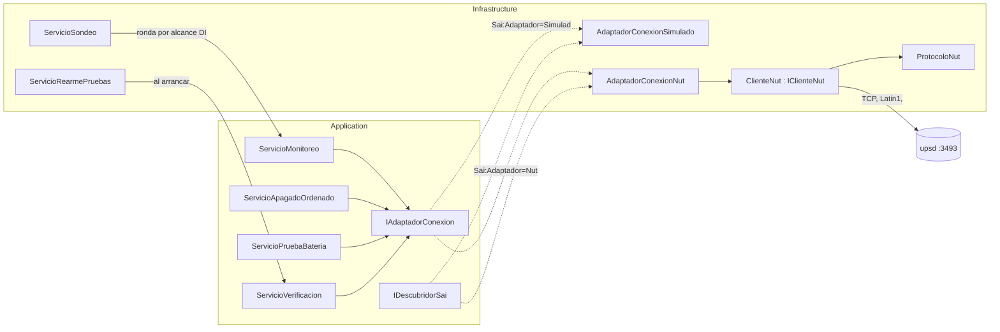
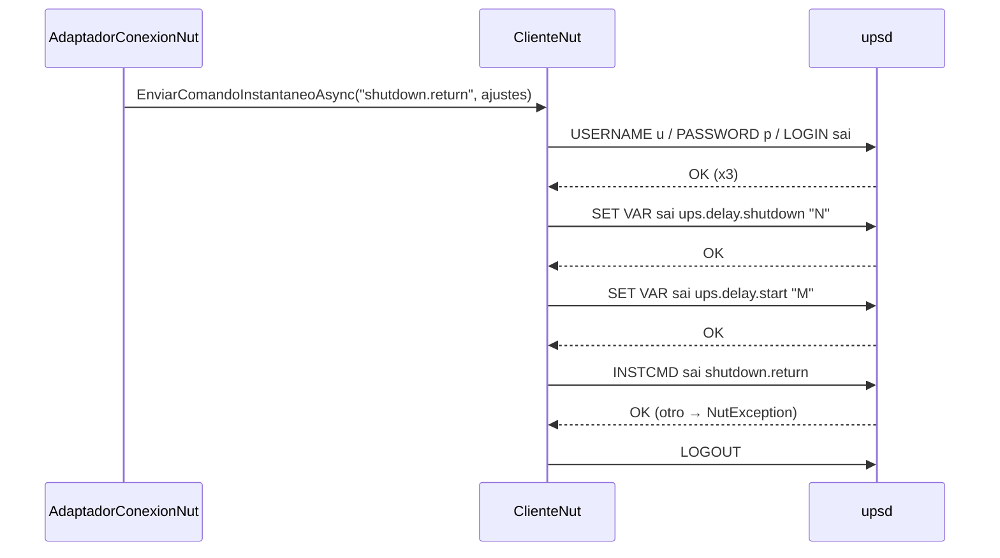

# 06 — Infraestructura y adaptador SAI

> **Propósito:** mapa del puerto de conexión con el SAI (`IAdaptadorConexion` + `IDescubridorSai`), sus dos implementaciones construidas (NUT y simulado), el cliente del protocolo NUT, los servicios de fondo de `Infrastructure/Monitoreo` y las claves de configuración `Sai:*` con sus valores por defecto.
> **Fuente primaria:** `src/SAI.Service.Core/SAI.Service.Core.Infrastructure/` (`Adaptadores/`, `Monitoreo/`, `DependencyInjection.cs`), `src/SAI.Service.Core/SAI.Service.Core.Application/Abstractions/` y `src/SAI.Service.Core/SAI.Service.Core.Web/appsettings*.json`. Decisiones: ADR-01, ADR-02, ADR-03, ADR-09, ADR-11, ADR-25, ADR-27 en `SDD/Docs/05-Arquitectura-Tecnica/Adrs/`.
> Todas las rutas son relativas a la raíz del repo `SAI.Service.Core`.

Fuera de este índice (se referencian, no se repiten):

| Tema | Índice |
|---|---|
| Capas, dependencias entre proyectos, composition root | `01_Arquitectura.md` |
| Reglas RN-*, techo duro 540 s, modalidades, eventos | `02_Dominio-Y-Reglas.md` |
| `SaiDbContext`, interceptor append-only, migraciones, repositorios de `Persistencia/` | `03_Modelo-De-Datos.md` |
| `ServicioMonitoreo`, `ServicioApagadoOrdenado`, `ServicioPruebaBateria`, `ServicioVerificacion` (consumidores del puerto) | `04_Aplicacion-Y-Casos-De-Uso.md` |
| Páginas que usan el puerto (`AltaDeEquipos.razor`, `PanelDeVerificaciones.razor`), Jwt, Kestrel | `05_Interfaces-Panel-Y-Api.md` |
| Detalle de las pruebas (`AdaptadorConexionNutTests`, `ProtocoloNutTests`, `FabricaSai`) | `07_Calidad-Y-Pruebas.md` |
| Dockerfile, volúmenes, variables de entorno de despliegue, udev | `08_Devops-Despliegue-Y-Operacion.md` |

---

## 1. Inventario del dominio

### 1.1 Puerto y tipos de transporte (Application)

| Archivo | Tipo | Contenido |
|---|---|---|
| `src/SAI.Service.Core/SAI.Service.Core.Application/Abstractions/IAdaptadorConexion.cs` | interfaz | Puerto de operación: 4 operaciones async cancelables (ADR-02/ADR-27) |
| `src/SAI.Service.Core/SAI.Service.Core.Application/Abstractions/IDescubridorSai.cs` | interfaz | Capacidad separada: `DescubrirAsync` (US-03, CU-02) |
| `src/SAI.Service.Core/SAI.Service.Core.Application/Abstractions/EstadoSai.cs` | record | Instantánea leída del equipo |
| `src/SAI.Service.Core/SAI.Service.Core.Application/Abstractions/EstadoUps.cs` | enum | `EnLinea = 1`, `EnBateria = 2` |
| `src/SAI.Service.Core/SAI.Service.Core.Application/Abstractions/ResultadoConectividad.cs` | record | `Conectado`, `LatenciaMilisegundos?`, `Detalle` |
| `src/SAI.Service.Core/SAI.Service.Core.Application/Abstractions/ResultadoAccion.cs` | record | `Aceptada`, `Motivo`, `MarcaTiempoUtc` |
| `src/SAI.Service.Core/SAI.Service.Core.Application/Abstractions/DispositivoDescubierto.cs` | record | `NombreNut`, `Descriptor`, `VendorId?`, `ProductId?`, `Driver?`, `NumeroSerie?` |
| `src/SAI.Service.Core/SAI.Service.Core.Application/Abstractions/IPlanificador.cs` | interfaz | Marcador `bool Activo` del Sprint 0; **sin implementaciones ni usos** en `src/` (verificado por grep) |

### 1.2 Infraestructura

| Archivo | Tipo | Rol |
|---|---|---|
| `src/SAI.Service.Core/SAI.Service.Core.Infrastructure/Adaptadores/AdaptadorConexionSimulado.cs` | clase sealed | Implementación simulada de `IAdaptadorConexion` + `IDescubridorSai` |
| `src/SAI.Service.Core/SAI.Service.Core.Infrastructure/Adaptadores/Nut/AdaptadorConexionNut.cs` | clase sealed partial | Implementación real vía NUT; mapea variables y traduce errores |
| `src/SAI.Service.Core/SAI.Service.Core.Infrastructure/Adaptadores/Nut/IClienteNut.cs` | interfaz | Abstracción del transporte (permite cliente falso en pruebas) |
| `src/SAI.Service.Core/SAI.Service.Core.Infrastructure/Adaptadores/Nut/ClienteNut.cs` | clase sealed | Cliente TCP del protocolo de red de `upsd` |
| `src/SAI.Service.Core/SAI.Service.Core.Infrastructure/Adaptadores/Nut/ProtocoloNut.cs` | clase static | Parseo puro (sin socket) de líneas del protocolo |
| `src/SAI.Service.Core/SAI.Service.Core.Infrastructure/Adaptadores/Nut/NutException.cs` | excepción | Falla de transporte, no veredicto sobre el equipo |
| `src/SAI.Service.Core/SAI.Service.Core.Infrastructure/Adaptadores/Nut/OpcionesNut.cs` | opciones | Sección `Sai:Nut` |
| `src/SAI.Service.Core/SAI.Service.Core.Infrastructure/Monitoreo/ServicioSondeo.cs` | `BackgroundService` | Planificador de sondeo (BT-17) |
| `src/SAI.Service.Core/SAI.Service.Core.Infrastructure/Monitoreo/ServicioRearmePruebas.cs` | `IHostedService` | Rearme de pruebas de verificación al arrancar (Etapa 4·E, ADR-25) |
| `src/SAI.Service.Core/SAI.Service.Core.Infrastructure/Monitoreo/OpcionesSondeo.cs` | opciones | Sección `Sai:Sondeo` |
| `src/SAI.Service.Core/SAI.Service.Core.Infrastructure/Monitoreo/RepositorioMonitoreo.cs` | repositorio EF | Implementa `IRepositorioMonitoreo` (detalle de persistencia en `03_Modelo-De-Datos.md`) |
| `src/SAI.Service.Core/SAI.Service.Core.Infrastructure/DependencyInjection.cs` | extensión DI | `AddInfrastructure`: selección de adaptador, lectura manual de opciones, hosted services |
| `src/SAI.Service.Core/SAI.Service.Core.Infrastructure/SAI.Service.Core.Infrastructure.csproj` | proyecto | Paquetes de la capa |

### 1.3 Configuración y pruebas del dominio

| Archivo | Rol |
|---|---|
| `src/SAI.Service.Core/SAI.Service.Core.Web/appsettings.json` | Valores base `Sai:Adaptador`, `Sai:Nut`, `Sai:Sondeo`, `ConnectionStrings:Sai` |
| `src/SAI.Service.Core/SAI.Service.Core.Web/appsettings.Development.json` | No toca `Sai:*` (solo Kestrel, Logging, Jwt) |
| `src/SAI.Service.Core/SAI.Service.Core.Application/Acciones/OpcionesApagado.cs` | Opciones `Sai:Apagado` (leídas por `DependencyInjection.cs`) |
| `src/SAI.Service.Core/SAI.Service.Core.Application/Monitoreo/OpcionesPrueba.cs` | Opciones `Sai:Prueba` |
| `src/SAI.Service.Core/SAI.Service.Core.Application/Equipos/OpcionesVerificacion.cs` | Opciones `Sai:Verificacion` |
| `tests/SAI.Service.Core.Integration.Tests/AdaptadorConexionNutTests.cs` | Adaptador NUT con cliente falso |
| `tests/SAI.Service.Core.Integration.Tests/ProtocoloNutTests.cs` | Parseo del protocolo |
| `tests/SAI.Service.Core.Integration.Tests/AdaptadorNutVivoTests.cs` | Contra `upsd` real (omitidas salvo `SAI_NUT_LIVE=1`) |
| `tests/SAI.Service.Core.Integration.Tests/HechoNutVivoAttribute.cs` | Atributo `[HechoNutVivo]` que omite sin `SAI_NUT_LIVE=1` |

---

## 2. Vista de conjunto



Consumidores del puerto (verificado por grep; el detalle de cada uno va en `04_...` y `05_...`):

| Consumidor | Operaciones usadas |
|---|---|
| `src/SAI.Service.Core/SAI.Service.Core.Application/Monitoreo/ServicioMonitoreo.cs` | `LeerEstadoAsync` |
| `src/SAI.Service.Core/SAI.Service.Core.Application/Monitoreo/ServicioPruebaBateria.cs` | `LanzarTestBateriaAsync`, `LeerEstadoAsync` |
| `src/SAI.Service.Core/SAI.Service.Core.Application/Acciones/ServicioApagadoOrdenado.cs` | `OrdenarApagadoConRetornoAsync` |
| `src/SAI.Service.Core/SAI.Service.Core.Application/Equipos/ServicioVerificacion.cs` | `LeerEstadoAsync`, `OrdenarApagadoConRetornoAsync` |
| `src/SAI.Service.Core/SAI.Service.Core.Web/Components/Pages/AltaDeEquipos.razor` | `DescubrirAsync`, `ProbarConectividadAsync` |
| `src/SAI.Service.Core/SAI.Service.Core.Web/Components/Pages/PanelDeVerificaciones.razor` | `LeerEstadoAsync` |

---

## 3. Puerto `IAdaptadorConexion`

Fuente: `src/SAI.Service.Core/SAI.Service.Core.Application/Abstractions/IAdaptadorConexion.cs`; decisión en `SDD/Docs/05-Arquitectura-Tecnica/Adrs/ADR-27-Contrato-Del-Puerto-Del-Adaptador-De-Conexion-v1.0.md` (Aceptado, supera a ADR-22).

| Operación | Firma (código) | Retorno |
|---|---|---|
| Leer estado | `LeerEstadoAsync(CancellationToken)` | `EstadoSai` |
| Probar conectividad | `ProbarConectividadAsync(CancellationToken)` | `ResultadoConectividad` |
| Apagado con retorno | `OrdenarApagadoConRetornoAsync(TimeSpan retardo, TimeSpan retardoRetorno, CancellationToken)` | `ResultadoAccion` |
| Test de batería | `LanzarTestBateriaAsync(CancellationToken)` | `ResultadoAccion` |
| Descubrir (en `IDescubridorSai`) | `DescubrirAsync(CancellationToken)` | `IReadOnlyList<DispositivoDescubierto>` (vacía = `DISPOSITIVO_NO_DESCUBIERTO`) |

Principios del contrato:

- **Validación por efecto observado** (ADR-11, RN-03): el resultado describe lo observado; nunca se asume éxito por ausencia de excepción (`IAdaptadorConexion.cs`, ADR-27 §2).
- Las fallas **no** se reportan con excepción: la excepción es falla de transporte y el adaptador la traduce a resultado (ADR-27 §2; `NutException.cs`).
- `retardo` = ventana del host para bajar limpio; `retardoRetorno` = espera del SAI, tras volver la red, antes de reponer la salida (fuerza la transición ausencia→presencia del autoencendido BIOS, ADR-09).

`EstadoSai` (`EstadoSai.cs`):

| Campo | Variable NUT | Nota |
|---|---|---|
| `Alcanzable` (bool) | presencia de `ups.status` | efecto observado |
| `TensionEntradaVoltios` | `input.voltage` | medido |
| `TensionSalidaVoltios` | `output.voltage` | medido |
| `CargaSalidaPorcentaje` | `ups.load` | medido |
| `CargaBateriaPorcentaje` | `battery.charge` | estimado por driver, nunca medido (RN-05) |
| `EstadoUps` (`EstadoUps?`) | `ups.status` | `EnLinea` / `EnBateria`; `null` si no hay status |
| `TensionBateriaVoltios` | `battery.voltage` | medido; base del disparo BT-20 (ADR-12) |
| `MarcaTiempoUtc` | — | instante de la lectura |

Divergencias doc ↔ código del contrato:

| Punto | Documento | Código |
|---|---|---|
| Firma del apagado | ADR-27 §2: `OrdenarApagadoConRetornoAsync(TimeSpan retardo, CancellationToken ct)` | agrega `TimeSpan retardoRetorno` (commit `087ad71`, «tiempo de retorno del SAI configurable») |
| Riqueza de `EstadoSai` | ADR-27 §2: cada variable con procedencia (`Origen`, ADR-06), driver y dialecto | record plano sin procedencia; `EstadoSai.cs` se declara «placeholder de Sprint 0» |
| `ResultadoAccion` | ADR-27 §2: estado del equipo después de la acción, con evidencia | `Aceptada` + `Motivo` + marca de tiempo; para NUT, «efecto» = el servidor respondió `OK` |
| Comentario del puerto | `IAdaptadorConexion.cs` cita «ADR-22 pendiente» y «única implementación el simulado» | ADR-22 está superado por ADR-27 y existe `AdaptadorConexionNut` (comentario desactualizado) |
| Otros comentarios viejos | `DependencyInjection.cs` (`<summary>` de `AddInfrastructure`: «en la Etapa 1, la implementación simulada»), `SAI.Service.Core.Infrastructure.csproj` («adaptador simulado»), `IClienteNut.cs` («cliente de lectura») | hoy se elige NUT o simulado por `Sai:Adaptador` y el cliente también escribe (`EnviarComandoInstantaneoAsync`) |

---

## 4. Implementaciones (ADR-02)

| Implementación | Estado | Fuente |
|---|---|---|
| NUT | construida, real | `Adaptadores/Nut/AdaptadorConexionNut.cs` |
| Simulada | construida, default | `Adaptadores/AdaptadorConexionSimulado.cs` |
| Directa (add-on de dialecto) | diseñada, **no implementada** (v2) | `SDD/Docs/05-Arquitectura-Tecnica/Adrs/ADR-02-Adaptador-De-Conexion-Con-Tres-Implementaciones-v1.0.md`; `SDD/Docs/06-Backlog-Tecnico/historias-usuario/US-25-Adaptador-De-Conexion-Directo-v1.0.md` (F-27, Could) |

### 4.1 Selección en DI

Fuente: `src/SAI.Service.Core/SAI.Service.Core.Infrastructure/DependencyInjection.cs` (`AddInfrastructure`, invocado desde `src/SAI.Service.Core/SAI.Service.Core.Web/Program.cs`).

```text
Sai:Adaptador == "Nut" (ignora mayúsculas)?
├── sí → IClienteNut      = singleton new ClienteNut(LeerOpcionesNut(config))
│        AdaptadorConexionNut (singleton)
│        IAdaptadorConexion, IDescubridorSai → misma instancia de AdaptadorConexionNut
└── no → AdaptadorConexionSimulado (singleton) { SimularEnBateria = Sai:Simulado:EnBateria == "true" (ignora mayúsculas) }
         IAdaptadorConexion, IDescubridorSai → misma instancia del simulado
```

- Cualquier valor distinto de `Nut` (incluido ausente) cae en el simulado.
- Las opciones se leen **a mano** (sin el binder de configuración, que Infrastructure no referencia).

### 4.2 Adaptador NUT

Fuente: `src/SAI.Service.Core/SAI.Service.Core.Infrastructure/Adaptadores/Nut/AdaptadorConexionNut.cs`.

| Operación | Llamada al cliente | Éxito | Falla |
|---|---|---|---|
| `LeerEstadoAsync` | `LeerVariablesAsync` | `Alcanzable = contiene ups.status`; números con `double.TryParse` invariante (no parseable → `null`) | `NutException` → `EstadoSai(false, null…, ahora)` |
| `ProbarConectividadAsync` | `LeerVariablesAsync` + `Stopwatch` | `Conectado=true`, latencia, detalle `Conectado a host:puerto (UPS x); ups.status=…, driver=…` | sin `ups.status` → `PRUEBA_CONEXION_FALLIDA: … no expuso ups.status` (con latencia medida); `NutException` → `PRUEBA_CONEXION_FALLIDA: <mensaje>` (latencia `null`) |
| `DescubrirAsync` | `ListarUpsAsync`, luego `LeerVariablesAsync` | solo el UPS configurado se enriquece con vendor/product/driver/serie | `NutException` en `LIST UPS` → lista vacía; en `LIST VAR` → descriptores sin datos |
| `OrdenarApagadoConRetornoAsync` | `EnviarComandoInstantaneoAsync("shutdown.return", ajustes)` | `Aceptada=true` | sin credenciales → `MensajeSinPermiso`; `NutException` → `MensajeEquipoNoRespondio` |
| `LanzarTestBateriaAsync` | `EnviarComandoInstantaneoAsync("test.battery.start.quick", [])` | `Aceptada=true` | ídem apagado |

Interpretación de `ups.status`: vacío → `null`; contiene `OB` → `EnBateria`; otro → `EnLinea` (admite flags múltiples como `OL CHRG`, `OB DISCHRG`; DM-05).

Variables leídas:

| Variable | Uso |
|---|---|
| `ups.status`, `input.voltage`, `output.voltage`, `ups.load`, `battery.charge`, `battery.voltage` | `EstadoSai` |
| `driver.name` | detalle de conectividad y `DispositivoDescubierto.Driver` |
| `driver.parameter.vendorid`, `driver.parameter.productid` | id USB del descriptor |
| `device.serial` (si falta, `ups.serial`) | número de serie |

Variables escritas (`SET VAR` previo al apagado, ADR-27 §6.2):

| Variable | Valor | Acotado |
|---|---|---|
| `ups.delay.shutdown` | `retardo` en segundos (redondeo) | mínimo 0 |
| `ups.delay.start` | `retardoRetorno` en segundos | mínimo 1 |

Comandos `INSTCMD`:

| Comando | Para | Nota |
|---|---|---|
| `shutdown.return` | apagado con retorno (ADR-09) | corta la salida y la repone al volver la red; **nunca** se emite `shutdown.stop` (ciclo forzado, no cancelable) |
| `test.battery.start.quick` | autotest rápido de batería (US-12) | — |

Descriptor de descubrimiento: `"<vendor>:<product> · <descripción|sin marca ni modelo> · serie: <serie|vacío>"`; sin ids → `id USB desconocido`.

Mensajes y logs:

| Constante / log | Nivel | Texto (resumen) |
|---|---|---|
| `MensajeSinPermiso` | UI | el sistema no tiene permiso para enviar órdenes; ajuste de configuración, no del equipo |
| `MensajeEquipoNoRespondio` | UI | el SAI no respondió o rechazó la orden; revisar conexión y reintentar |
| `SinCredencialesEscritura` | Warning | pide configurar `Sai:Nut:Usuario` y `Sai:Nut:Password` |
| `OrdenNoConfirmada` | Warning | el SAI no confirmó la orden; no se observó el efecto (con la excepción) |

Regla: los mensajes al operador no llevan jerga de NUT ni claves de configuración; el detalle técnico va al log (comentario del archivo; commit `5b333cf`; aserto en `tests/SAI.Service.Core.Integration.Tests/AdaptadorConexionNutTests.cs`).

### 4.3 Cliente y protocolo NUT

Fuentes: `Adaptadores/Nut/ClienteNut.cs`, `Adaptadores/Nut/IClienteNut.cs`, `Adaptadores/Nut/ProtocoloNut.cs`.

Transporte (`ClienteNut.ConConexionAsync`):

| Aspecto | Valor |
|---|---|
| Conexión | `TcpClient` **efímero por operación** (sin pool ni keepalive) |
| Codificación / fin de línea | `Encoding.Latin1`, `NewLine = "\n"`, `AutoFlush` |
| Timeout | `CancelAfter(TimeoutSegundos)` sobre un token enlazado al del llamador |
| Cierre | envía `LOGOUT`; si falla (`IOException`/cancelación) se ignora |
| Errores → `NutException` | timeout (si no canceló el llamador): `Tiempo de espera agotado (Ns)…`; `SocketException`/`IOException`: `No se pudo hablar con NUT en host:puerto…` |
| Cancelación del llamador | se propaga como `OperationCanceledException` (no se envuelve) |

Comandos emitidos:

| Método | Diálogo | Requiere login |
|---|---|---|
| `ObtenerVersionAsync` | `VER` → banner (o `ERR`) | no — sin usos en `src/` fuera de su definición (verificado por grep) |
| `ListarUpsAsync` | `LIST UPS` … hasta `END LIST UPS` | no |
| `LeerVariablesAsync` | `LIST VAR <ups>` … hasta `END LIST VAR` | no |
| `EnviarComandoInstantaneoAsync` | `USERNAME` → `PASSWORD` → `LOGIN <ups>` → `SET VAR <ups> <var> "<valor>"`* → `INSTCMD <ups> <cmd>`; cada paso exige `OK` | sí |



Detalles de robustez:

- Sin credenciales, `EnviarComandoInstantaneoAsync` lanza `NutException` **antes** de conectar; el adaptador ya lo chequea con `TieneCredencialesEscritura` y no llega a llamarlo.
- Al rechazar un paso solo se registra el **verbo** (`USERNAME`, `PASSWORD`…), para no filtrar la clave en logs/errores (`ClienteNut.EnviarYEsperarOkAsync`).
- Listados: primera línea `ERR`/nula → `NutException`; conexión cerrada sin `END LIST` → `NutException`.

Parseo puro (`ProtocoloNut`, protocolo textual line-based, RFC 9271):

| Función | Comportamiento |
|---|---|
| `EsError(linea)` | `ERR` o empieza con `ERR ` |
| `EsOk(linea)` | `OK` o empieza con `OK ` |
| `Entrecomillar(valor)` | comillas dobles, escapa `\` → `\\` y `"` → `\"` |
| `ParsearLineaVar(linea, ups)` | `VAR <ups> <var> "<valor>"` → `(var, valor)`; otra cosa → `null` |
| `ParsearLineaUps(linea)` | `UPS <nombre> "<desc>"` → `(nombre, desc)` |
| `LeerValorDeVar(linea, ups, var)` | para respuestas `GET VAR`; sin usos en `src/` (solo pruebas) |
| `DesescaparEntreComillas` (privada) | toma el primer par de comillas; tolera comilla de cierre ausente |

Comentario desactualizado: el `<summary>` de `ClienteNut.cs` dice que usa solo comandos de lectura y que la escritura «llega en la Etapa 4»; el write path ya está implementado (commit `63e1b59`).

### 4.4 Adaptador simulado

Fuente: `src/SAI.Service.Core/SAI.Service.Core.Infrastructure/Adaptadores/AdaptadorConexionSimulado.cs`. No habla con ningún equipo.

| Operación | Respuesta fija |
|---|---|
| `LeerEstadoAsync` | alcanzable; entrada 220 V (0 V si `SimularEnBateria`); salida 220 V; carga 35 %; batería 100 %; `EnLinea` (o `EnBateria`); tensión de batería 13,2 V |
| `ProbarConectividadAsync` | conectado, 5 ms, «conectividad fija (stub de Sprint 0)» |
| `DescubrirAsync` | un candidato `sai`, descriptor `0000:0000 · SAI simulado (sin hardware) · serie: vacío`, driver `simulado` |
| `OrdenarApagadoConRetornoAsync` | aceptada, «Sin efecto real» con los retardos en el motivo |
| `LanzarTestBateriaAsync` | aceptada; arranca una **descarga simulada** |

Descarga simulada: durante 12 s tras el test, `battery.voltage = 13,2 − 0,7·sin(π·progreso)` (valle a mitad de ventana, redondeo a 2 decimales), para que la serie densa muestre una caída (US-12/US-13).

`SimularEnBateria` (propiedad pública): se fija por `Sai:Simulado:EnBateria` o desde pruebas, para ejercitar el corte y la verificación en batería (US-16) sin hardware.

---

## 5. Servicios de fondo (`Infrastructure/Monitoreo`)

Registro en `DependencyInjection.cs`: `AddHostedService<ServicioSondeo>()` y `AddHostedService<ServicioRearmePruebas>()`.

| Servicio | Base | Ciclo | Hace | Ante error |
|---|---|---|---|---|
| `ServicioSondeo` | `BackgroundService` | `PeriodicTimer(max(1, IntervaloSeg))`; primera ronda inmediata | cada ronda en un alcance DI nuevo resuelve `ServicioMonitoreo.SondearAsync(IntervaloSeg)` | ronda fallida se loguea (`RondaConError`) y el planificador sigue; `Perdida` incrementa `_fallidosConsecutivos` (en memoria, reconstruible desde la historia) |
| `ServicioRearmePruebas` | `IHostedService` (`StopAsync` no-op) | una vez, en `StartAsync`, en su propio alcance DI | `ServicioVerificacion.RearmarPruebasPendientesAsync`: el arranque del servicio es la señal de que el host cicló (ADR-25) | best-effort: loguea `RearmeConError` y no tumba el arranque |

```text
ServicioSondeo.ExecuteAsync
├── Habilitado == false → log "deshabilitado" y termina
└── loop hasta stoppingToken
    ├── EjecutarRondaAsync
    │   ├── Perdida      → _fallidosConsecutivos++ ; Warning "Sondeo perdido (N consecutivos)"
    │   └── SinDispositivo | Registrada → _fallidosConsecutivos = 0
    └── WaitForNextTick (cancelación → break)
```

Logs (source-generated `[LoggerMessage]`):

| Clase | Mensaje | Nivel |
|---|---|---|
| `ServicioSondeo` | Planificador deshabilitado por configuración / iniciado (intervalo N s) | Information |
| `ServicioSondeo` | Sondeo perdido (N consecutivos): el SAI no respondió | Warning |
| `ServicioSondeo` | Error en una ronda de sondeo | Error |
| `ServicioRearmePruebas` | Rearme completado (reinicio detectado por arranque) | Information |
| `ServicioRearmePruebas` | Error al rearmar las pruebas en el arranque | Error |

Notas:

- El rearme corre después de las migraciones: `src/SAI.Service.Core/SAI.Service.Core.Web/Program.cs` aplica `MigrateAsync` en un alcance previo a `app.Run()`, que es donde arrancan los hosted services.
- En pruebas de integración se **quita** `ServicioSondeo` del contenedor para que sean deterministas (`tests/SAI.Service.Core.Integration.Tests/FabricaSai.cs`).
- `ServicioSondeo` no implementa `IPlanificador` (el marcador de `Application/Abstractions` quedó sin uso).
- `RepositorioMonitoreo.cs` vive en esta carpeta pero es persistencia: ver `03_Modelo-De-Datos.md`.

---

## 6. Configuración (`Sai:*` y afines)

Lectura: `DependencyInjection.cs` (manual, `int.TryParse`/`bool.TryParse`; si no parsea, usa el default de la clase). Variables de entorno con `__` (p. ej. `Sai__Nut__Host`).

| Clave | Default en código | `appsettings.json` | Fuente del default | Notas |
|---|---|---|---|---|
| `Sai:Adaptador` | simulado (todo ≠ `Nut`) | `Simulado` | `DependencyInjection.cs` | Dockerfile fija `Sai__Adaptador=Simulado` |
| `Sai:Simulado:EnBateria` | `false` | — | `DependencyInjection.cs` | solo `"true"` (sin distinguir mayúsculas) lo activa |
| `Sai:Nut:Host` | `127.0.0.1` | `127.0.0.1` | `OpcionesNut.cs` | en despliegue, `upsd` local al contenedor (ADR-25) |
| `Sai:Nut:Puerto` | `3493` | `3493` | `OpcionesNut.cs` | puerto estándar NUT |
| `Sai:Nut:Ups` | `sai` | `sai` | `OpcionesNut.cs` | nombre en `ups.conf` |
| `Sai:Nut:TimeoutSegundos` | `5` | `5` | `OpcionesNut.cs` | por operación de red |
| `Sai:Nut:Usuario` | `""` | — | `OpcionesNut.cs` | rol de escritura en `upsd.users`; vacío = solo lectura |
| `Sai:Nut:Password` | `""` | — | `OpcionesNut.cs` | secreto; no está en el repo |
| `Sai:Sondeo:IntervaloSeg` | `5` | `5` | `OpcionesSondeo.cs` | N-07; el servicio usa `max(1, …)` |
| `Sai:Sondeo:Habilitado` | `true` | `true` | `OpcionesSondeo.cs` | `false` apaga el poller |
| `Sai:Apagado:ModalidadSolicitada` | `SoloAlerta` | — | `Application/Acciones/OpcionesApagado.cs` | `Enum.TryParse` sin distinguir mayúsculas; solo semilla de la política inicial |
| `Sai:Apagado:TiempoReservadoSeg` | `120` | — | `OpcionesApagado.cs` | acotado a `[0, 540]` (`Accion.TechoDuroApagadoSeg`, RN-04/I-10) |
| `Sai:Apagado:TiempoRetornoSeg` | `180` | — | `OpcionesApagado.cs` | mínimo 1 |
| `Sai:Prueba:NumeroMuestras` | `15` | — | `Application/Monitoreo/OpcionesPrueba.cs` | serie densa de la prueba de batería |
| `Sai:Prueba:IntervaloMuestraMs` | `1000` | — | `OpcionesPrueba.cs` | — |
| `Sai:Prueba:FlotacionMinimaSeg` | `300` | — | `OpcionesPrueba.cs` | precondición de flotación |
| `Sai:Prueba:ToleranciaCargaPct` | `5` | — | `OpcionesPrueba.cs` | — |
| `Sai:Verificacion:DiasPreavisoVencimiento` | `30` | — | `Application/Equipos/OpcionesVerificacion.cs` | — |
| `ConnectionStrings:Sai` | `Data Source=sai.db` | `Data Source=sai.db` | `DependencyInjection.cs` | se resuelve al crear el contexto (respeta overrides de pruebas); Dockerfile: `/app/data/sai.db` |

Variables de entorno de las pruebas en vivo (`tests/SAI.Service.Core.Integration.Tests/AdaptadorNutVivoTests.cs`, `HechoNutVivoAttribute.cs`):

| Variable | Default | Uso |
|---|---|---|
| `SAI_NUT_LIVE` | — | `1` habilita las pruebas `[HechoNutVivo]` |
| `SAI_NUT_HOST` | `127.0.0.1` | host de `upsd` |
| `SAI_NUT_PORT` | `3493` | puerto |
| `SAI_NUT_UPS` | `sai` | nombre del UPS |

Las claves de `appsettings*.json` ajenas a este dominio (`Jwt`, `DataProtection`, `Sello`, `Kestrel`, `Logging`) se tratan en `05_Interfaces-Panel-Y-Api.md` y `08_Devops-Despliegue-Y-Operacion.md`.

---

## 7. Paquetes de la capa

Fuente: `src/SAI.Service.Core/SAI.Service.Core.Infrastructure/SAI.Service.Core.Infrastructure.csproj` (referencia a `SAI.Service.Core.Application`).

| Paquete | Versión | Motivo |
|---|---|---|
| `Microsoft.EntityFrameworkCore.Sqlite` | 10.0.0 | persistencia SQLite (ADR-18) |
| `Microsoft.Extensions.Hosting.Abstractions` | 10.0.0 | `BackgroundService` / `AddHostedService` (BT-17) |
| `SQLitePCLRaw.bundle_e_sqlite3` | 2.1.12 | pin transitivo por GHSA-2m69-gcr7-jv3q |
| `Microsoft.AspNetCore.Identity.EntityFrameworkCore` | 10.0.0 | administrador único (ADR-16) |
| `System.Security.Cryptography.Xml` | 10.0.10 | pin transitivo por GHSA-23rf-6693-g89p |
| `Microsoft.EntityFrameworkCore.Design` | 10.0.0 | `dotnet ef` (PrivateAssets=all) |

---

## 8. Ubicación de NUT (decisiones)

| ADR | Estado | Qué fija |
|---|---|---|
| `ADR-01-Adopcion-De-Nut-Como-Acceso-Al-Sai-v1.0.md` | Aceptado | NUT como herramienta de acceso; no se escribe traductor de dialecto propio |
| `ADR-02-Adaptador-De-Conexion-Con-Tres-Implementaciones-v1.0.md` | Aceptado | puerto en Application, tres implementaciones |
| `ADR-03-Anclaje-Del-Usb-Por-Ruta-Fisica-De-Puerto-v1.0.md` | Aceptado | USB anclado por `ID_PATH` vía `udev`, no por serial |
| `ADR-19-Ubicacion-De-Nut-Contenedor-O-Host-v1.0.md` | Superado por ADR-25 | — |
| `ADR-22-Contrato-Del-Adaptador-De-Conexion-v1.0.md` | Superado por ADR-27 | — |
| `ADR-25-Nut-En-El-Contenedor-v1.0.md` | Aceptado | `nutdrv_qx` + `upsd` dentro del contenedor del servicio; único consumidor del USB |
| `ADR-27-Contrato-Del-Puerto-Del-Adaptador-De-Conexion-v1.0.md` | Aceptado | firma del puerto y efecto observado |

Divergencia: ADR-25 §7 dice que la imagen de PROD incluye `nut` (`nutdrv_qx`, `upsd`, `upsc`); el `Dockerfile` del repo parte de `mcr.microsoft.com/dotnet/aspnet:10.0` y no instala NUT (verificado: sin `apt-get` ni `nut`). Cómo se provee `upsd` en el despliegue real: (no verificado) — ver `08_Devops-Despliegue-Y-Operacion.md`.

---

## 9. Historia del dominio (git)

| Commit | Fecha | Cambio |
|---|---|---|
| `42157fe` | 2026-07-21 | Sprint 0: andamiaje, simulado como stub |
| `933fc8f` | 2026-07-21 | Etapa 2·B: adaptador NUT real y descubrimiento (BT-15, US-03) |
| `859f7d3` | 2026-07-21 | Etapa 3·A: sondeo y persistencia de muestras (BT-17) |
| `a04e33f` | 2026-07-21 | Etapa 3·B1: eventos (BT-19/BT-20); los adaptadores exponen `EstadoUps` y `battery.voltage` |
| `ddf5df2` | 2026-07-22 | Etapa 3·C: prueba de batería |
| `1799207` | 2026-07-22 | Etapa 4·A: `SimularEnBateria` en el simulado (US-16) |
| `63e1b59` | 2026-07-22 | Etapa 4·B: write path NUT (`shutdown.return`) |
| `cae3529` | 2026-07-23 | disparo del apagado + rearme por reinicio del host (ADR-25) |
| `5b333cf` | 2026-07-24 | mensaje al operador sin jerga de NUT |
| `087ad71` | 2026-07-27 | tiempo de retorno configurable (`retardoRetorno`, `ups.delay.start`) |

Fuente: `git log -- src/SAI.Service.Core/SAI.Service.Core.Infrastructure/Adaptadores src/SAI.Service.Core/SAI.Service.Core.Infrastructure/Monitoreo` (se omiten `8523c5f` y `96dd3eb`, que solo tocan `RepositorioMonitoreo.cs`: ver `03_Modelo-De-Datos.md`).
