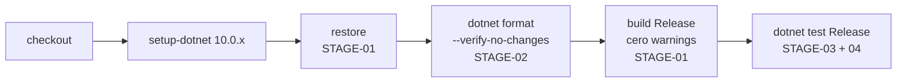

# 07 — Calidad y pruebas

> **Propósito:** mapa de cómo se asegura la calidad de SAI.Service.Core: las tres suites de tests (qué cubre cada clase), sus fixtures y la prueba contra NUT real, la estrategia y los umbrales del SDD 08, las reglas de compilación estricta y el resultado de las auditorías de fase.
> **Fuentes primarias:** `tests/` (código), `Directory.Build.props`, `.github/workflows/ci.yml`, `SDD/Docs/08-Calidad-Y-Pruebas/` (norma) y `SDD/Docs/Audit/` (auditorías). Rutas relativas a la raíz del repo `SAI.Service.Core`.
> **Fuera de este índice:** reglas de negocio y sus invariantes → `02_Dominio-Y-Reglas.md`; el adaptador NUT y el simulado → `06_Infraestructura-Y-Adaptador-Sai.md`; los stages 5–10 del pipeline, la imagen y el despliegue → `08_Devops-Despliegue-Y-Operacion.md`; el árbol SDD entero → `09_Documentacion-Sdd.md`; las brechas abiertas → `11_Estado-Y-Pendientes.md`.

---

## 1. Panorama en una pantalla

| Aspecto | Valor | Fuente |
|---|---|---|
| Proyectos de test | 3 (`Domain.Tests`, `Application.Tests`, `Integration.Tests`) | `tests/*/*.csproj` |
| Archivos `.cs` en `tests/` | 47 (19 Domain + 5 Application + 23 Integration) | `git ls-files tests` |
| Métodos de test (`[Fact]` + `[Theory]` + `[HechoNutVivo]`) | 270 (Domain 124 · Application 31 · Integration 115) | conteo con grep sobre `tests/` |
| Tests que piden NUT real | 3, omitidos salvo `SAI_NUT_LIVE=1` | `tests/SAI.Service.Core.Integration.Tests/AdaptadorNutVivoTests.cs` |
| Stack de test | xUnit 2.9.2, xunit.runner.visualstudio 2.8.2, FluentAssertions 6.12.2, Microsoft.NET.Test.Sdk 17.12.0, coverlet.collector 6.0.2 | los tres `.csproj` |
| Extras de integración | Microsoft.AspNetCore.Mvc.Testing 10.0.0 (WebApplicationFactory), Microsoft.EntityFrameworkCore.Sqlite 10.0.0 | `tests/SAI.Service.Core.Integration.Tests/SAI.Service.Core.Integration.Tests.csproj` |
| Compilación | net10.0, `TreatWarningsAsErrors`, `EnforceCodeStyleInBuild`, `AnalysisLevel=latest-recommended`, `Nullable`, `InvariantGlobalization` | `Directory.Build.props` |
| CI | un job `build-test` en `ubuntu-latest`: restore → `dotnet format --verify-no-changes` → build Release → test | `.github/workflows/ci.yml` |
| Pirámide objetivo | 70 % unit / 25 % integración / 5 % e2e | `SDD/Docs/08-Calidad-Y-Pruebas/Estrategia-Testing-v1.0.md` §1 |
| Pisos de cobertura | Domain 90/85, global 80/70 (líneas/ramas) y pisos por capa | `Estrategia-Testing-v1.0.md` §2 |
| Auditoría de 08 (Fase E) | APROBADO, 0 P0 / 0 P1 / 1 P2 / 3 P3 | `SDD/Docs/Audit/Fase-E-Calidad-Y-Pruebas-v1.0.md` |

Resultado actual de la suite (verde o rojo) y cobertura medida: **(no verificado)**. No se corrió `dotnet test` para armar este índice; en el host no hay `dotnet`, el SDK vive en el Dev Container (`AGENTS.md` §Construir).

---

## 2. Reglas de calidad de compilación

### 2.1 `Directory.Build.props` (aplica a los 5 assemblies de `src/` y a los 3 de `tests/`)

| Propiedad | Valor | Para qué (según el comentario del archivo) |
|---|---|---|
| `TargetFramework` | `net10.0` | marco único |
| `LangVersion` | `latest` | — |
| `Nullable` | `enable` | — |
| `ImplicitUsings` | `enable` | — |
| `TreatWarningsAsErrors` | `true` | STAGE-01: cero errores y cero warnings |
| `EnforceCodeStyleInBuild` | `true` | el estilo rompe el build |
| `AnalysisLevel` | `latest-recommended` | STAGE-02: analizadores .NET en nivel recomendado |
| `EnableNETAnalyzers` | `true` | — |
| `InvariantGlobalization` | `true` | cultura invariante, sin sorpresas de formato |
| `Version` | `0.1.0-alpha.1` | versión de referencia; en el pipeline real la calcula MinVer |

Consecuencias que ya dejaron huella en los tests:

| Efecto | Dónde se ve |
|---|---|
| Con `InvariantGlobalization=true`, pedir la cultura `es-AR` lanza `CultureNotFoundException`. Desde un inicializador estático tumbaba el render del panel entero (regresión en producción). | `tests/SAI.Service.Core.Integration.Tests/FormatoRelativoTests.cs` (prueba `FechaCortaNoDependeDeUnaCulturaNombrada`); commit `b3bcdfc` |
| Las migraciones de EF Core se marcan `generated_code = true` para que los analizadores y el «warnings como error» no las traten como código propio. | `src/SAI.Service.Core/SAI.Service.Core.Infrastructure/Persistencia/Migraciones/.editorconfig` |

### 2.2 Validación local antes de cerrar un cambio (`AGENTS.md`)

```text
./scripts/build-all.sh                                   → 0 warnings (son errores)
dotnet test SAI.Service.Core.sln --configuration Release → 0 failed
dotnet ef migrations has-pending-model-changes ...       → sin cambios (si tocaste el modelo)
```

`scripts/build-all.sh` hace restore y build Release de toda la solución, nada más; no corre tests. El `Dockerfile` no compila los tests: corren en la CI (comentario de las líneas 33–35).

---

## 3. Pipeline de CI que existe hoy



| Atributo | Valor | Fuente |
|---|---|---|
| Disparadores | `push` y `pull_request` sobre `main` | `.github/workflows/ci.yml` |
| Permisos | `contents: read` | ídem |
| Matriz | un solo eje (`ubuntu-latest`, .NET 10, linux-amd64) | ídem |
| Stages cubiertos | 1–4 de los 10 de 09; el workflow dice que «los stages 5 a 10 (e2e, SCA, SBOM, imagen, firma, publicación) se agregan en etapas posteriores» | ídem (comentario de cabecera) |
| Cobertura en CI | el workflow no recolecta cobertura ni la compara con umbrales; `coverlet.collector` está referenciado en los `.csproj` pero no se invoca con `--collect` | `.github/workflows/ci.yml`, `tests/*/*.csproj` |

---

## 4. Las tres suites

### 4.1 Topología

```text
tests/
├── SAI.Service.Core.Domain.Tests/        → ProjectReference: Domain        (puro, sin infraestructura)
├── SAI.Service.Core.Application.Tests/   → ProjectReference: Application   (servicios con repositorios falsos en memoria)
└── SAI.Service.Core.Integration.Tests/   → ProjectReference: Web (composition root; arrastra Api + Infrastructure)
                                            + Mvc.Testing + EFCore.Sqlite
```

No hay proyecto de test propio para `Api`, `Infrastructure` ni `Web`: esas capas se ejercitan desde `Integration.Tests`. Tampoco hay tests de bUnit, de Playwright ni la suite de contrato `AdaptadorConexionContractTests<T>` que prevé el SDD (no aparecen en `git ls-files`); ver §7.

### 4.2 Conteo por suite

| Suite | Archivos `.cs` | Clases de test | Métodos | `[Theory]` | `InlineData` | Dobles propios |
|---|---|---|---|---|---|---|
| Domain.Tests | 19 | 19 | 124 (122 Fact + 2 Theory) | `DineroTests`, `ValorConOrigenTests` | 9 | ninguno |
| Application.Tests | 5 | 5 | 31 Fact | — | 0 | `RepositorioFalso` (en Ingesta y en Políticas), `RepositorioInformesFalso`, `RepositorioMonitoreoVacio` |
| Integration.Tests | 23 (21 de test + 2 de soporte) | 21 | 115 (109 Fact + 3 Theory + 3 HechoNutVivo) | `ProtocoloNutTests`, `FormatoRelativoTests` | 12 | `FabricaSai`, `HechoNutVivoAttribute`, `ClienteNutFalso`, `Hecho` + `ContextoHechos` |

### 4.3 Domain.Tests — `tests/SAI.Service.Core.Domain.Tests/`

| Archivo | Tests | Qué fija | Trazas citadas |
|---|---|---|---|
| `AndamiajeDominioTests.cs` | 1 | andamiaje del Sprint 0: el assembly de dominio es referenciable | — |
| `VigenciaTests.cs` | 13 | invariantes I-1..I-4: intervalo semiabierto, solape, cierre, montaje y cobertura sin doble vigente | ADR-05, RC-02, RC-03 |
| `VigenciaInterseccionTests.cs` | 5 | recorte de una vigencia a un período `[desde, hasta)` para el informe | CU-12 |
| `ResolutorTemporalTests.cs` | 8 | batería, dispositivo o cobertura vigente en un instante; solape ⇒ excepción | RC-07, CL-17 |
| `UnidadFisicaTests.cs` | 10 | baja lógica consultable (I-5), la máquina de estados no salta pasos (I-6), coherencia temporal de la baja | RC-08 |
| `ValorConOrigenTests.cs` | 5 | I-7: no hay `Valor<T>` sin `Origen` | ADR-06, RN-05 |
| `MonitoreoTests.cs` | 7 | calidad de la muestra (completa/parcial/perdida), procedencia, agregado con mín/máx/prom y cobertura | US-08, US-10, BT-18 |
| `DerivadorEventosTests.cs` | 6 | eventos derivados (corte, microcorte, desconexión a 3 sondeos, tensión fuera de rango); el disparo nunca depende del flag LB | ADR-12, US-09, BT-19, BT-20, CL-10, RC-09 |
| `SaludBateriaTests.cs` | 6 | salud por caída de tensión a carga igualada, confianza baja con menos de 4 pruebas, muestras perdidas ignoradas | ADR-13, RN-06, US-13, BT-21 |
| `ModeloBateriaTests.cs` | 4 | I-21: vida de flotación exige temperatura de referencia | RN-13 |
| `VerificacionesTests.cs` | 21 | siembra en `NuncaVerificado` ⇒ `SoloAlerta`; solo con los cuatro verificados se habilita la acción; refutado, vencido, prueba en curso, rearme | ADR-10, RN-01, RN-02 |
| `SecuenciaFisicaTests.cs` | 6 | orden físico de los cuatro supuestos y paso pendiente derivado | P-2, P-7 |
| `SesionEjercicioTests.cs` | 4 | ciclo de vida de la sesión de ejercicio guiado (abrir, completar, abandonar, no cerrar dos veces) | P-7 |
| `VersionPoliticaTests.cs` | 8 | política versionada append-only, techo de 540 s, umbral positivo, tiempo de retorno positivo | CU-03, RN-04, US-06 |
| `AccionTests.cs` | 5 | acción de apagado append-only con modalidad solicitada/efectiva, techo de 540 s | ADR-11, CU-05, RN-02, RN-04, US-14, US-15 |
| `DineroTests.cs` | 2 | I-18: importe con moneda y fecha | RN-07 |
| `IntervencionesTests.cs` | 6 | cuadre de costos, moneda, ficha de vida útil con costo por año en USD | RN-07, RN-08, US-19 |
| `IntervencionIngeridaTests.cs` | 4 | intervención de la API externa: append-only, clave e huella de idempotencia, cuadre | RN-08, CU-11 |
| `SustitucionSaiTests.cs` | 3 | sustitución del SAI: costo y disposición opcionales | CU-09 |

Varias clases se declaran «mitigación del riesgo R-10» (los invariantes corren como pruebas): `VigenciaTests`, `UnidadFisicaTests`, `ValorConOrigenTests`, `ModeloBateriaTests`.

### 4.4 Application.Tests — `tests/SAI.Service.Core.Application.Tests/`

| Archivo | Tests | Qué fija | Trazas citadas |
|---|---|---|---|
| `AndamiajeApplicationTests.cs` | 2 | andamiaje del Sprint 0: el puerto del adaptador declara cuatro operaciones y sus records se pueden construir | — |
| `CalculadorProteccionTests.cs` | 5 | sucesión de coberturas y días sin protección de un host | CU-09 §4.6, RC-03 |
| `ServicioIngestaTests.cs` | 7 | ingesta idempotente: creado, reintento, conflicto por huella, no cuadra, dinero sin moneda, posterior a la baja, fuente no registrada | CU-11, US-21, US-22, RN-07, RN-08, RN-09, RN-12 |
| `ServicioPoliticasTests.cs` | 10 | crear versión (techo, umbral, retorno), previsualización con degradación por verificación | CU-03, US-06, RN-02, RN-04 |
| `ServicioInformePeriodoTests.cs` | 7 | informe de período (recorte, bajas, días sin protección, costos por tipo) y comparación de marcas con aviso de confianza baja | CU-12, US-11, RN-07, RN-12 |

Patrón: cada servicio se prueba contra un repositorio falso escrito en el mismo archivo; no se usa ninguna biblioteca de mocks (ninguna aparece en los `.csproj`).

### 4.5 Integration.Tests — `tests/SAI.Service.Core.Integration.Tests/`

Hay tres tipos de prueba en esta suite:

| Tipo | Clases |
|---|---|
| **Host completo** con `FabricaSai` (WebApplicationFactory + SQLite en archivo) | `AccesoIntegracionTests`, `AltaEquiposIntegracionTests`, `ApagadoIntegracionTests`, `EjercicioGuiadoIntegracionTests`, `HistoricosIntegracionTests`, `InformesIntegracionTests`, `IngestaIntegracionTests`, `MonitoreoIntegracionTests`, `PoliticasIntegracionTests`, `RecambioIntegracionTests`, `SaludEndpointTests`, `SaludIntegracionTests`, `SustitucionIntegracionTests`, `VerificacionIntegracionTests` |
| **SQLite en memoria** con un contexto mínimo | `InterceptorAppendOnlyTests` |
| **Puras** (sin host ni base) | `AdaptadorConexionNutTests` (con `ClienteNutFalso`), `ProtocoloNutTests`, `ConstructorVistaPanelTests`, `DescriptorEnVivoTests`, `FormatoRelativoTests` |
| **NUT real** | `AdaptadorNutVivoTests` |

| Archivo | Tests | Qué fija | Trazas citadas |
|---|---|---|---|
| `SaludEndpointTests.cs` | 1 | el host arranca aplicando migraciones y `GET /health` responde 200 sin autenticación | ADR-16, ADR-18 |
| `AccesoIntegracionTests.cs` | 9 | guarda global (redirige al alta inicial o al acceso), alta por formulario, un único token antiforgery, cambio de contraseña, JWT por ROPC para la API | BT-10, US-01, US-02 |
| `AltaEquiposIntegracionTests.cs` | 4 | alta transaccional con siembra de 4 verificaciones en solo aviso; índice único parcial «una vigente» | CU-02, US-04, US-05 |
| `PoliticasIntegracionTests.cs` | 4 | siembra de la versión inicial, nueva versión vigente, techo, append-only | CU-03, US-06, ADR-04, RN-01 |
| `MonitoreoIntegracionTests.cs` | 7 | ronda de sondeo contra el simulado: muestra, sesión, procedencia, reglas sembradas, append-only | US-08, US-10, ADR-04 |
| `HistoricosIntegracionTests.cs` | 2 | muestras con procedencia dentro de la retención; `PERIODO_SIN_DATOS` | US-11, CU-06 |
| `SaludIntegracionTests.cs` | 2 | prueba de batería: veredicto, montaje congelado, append-only | CU-07, US-12, US-13 |
| `VerificacionIntegracionTests.cs` | 8 | ventana de mantenimiento: los 4 supuestos por efecto observado, refutación permanente, disparo y rearme por reinicio, presupuesto | US-16, US-17, CU-10, ADR-11, ADR-25 |
| `EjercicioGuiadoIntegracionTests.cs` | 6 | sesión persistida, una sola a la vez, sobrevive al reinicio, se cierra sola con 4 vigentes | P-7 |
| `ApagadoIntegracionTests.cs` | 4 | bloqueo por verificación ⇒ solo aviso; con 4 verificados ejecuta y confirma por efecto observado; nunca apaga de verdad | CU-05, US-14, US-15, RN-01, RN-02, ADR-04, ADR-11 |
| `RecambioIntegracionTests.cs` | 4 | recambio de batería en un acto: cierra y abre la vigencia, da de baja, ficha; rechaza sin efectos | CU-08, US-18, US-19, RN-07, RN-08 |
| `SustitucionIntegracionTests.cs` | 8 | sustitución del SAI con o sin suplente, días sin protección, otro modelo reinicia verificaciones | CU-09, US-20, ADR-04 |
| `IngestaIntegracionTests.cs` | 7 | `POST /api/v1/intervenciones`: caminos 201/200/409/422, sin token, sin cabeceras | CU-11, ADR-17 §8 |
| `InformesIntegracionTests.cs` | 3 | consultas por período del repositorio EF de punta a punta; período sin actividad ⇒ `PERIODO_SIN_DATOS`; comparación sin fichas avisa | CU-12, EP-07 |
| `InterceptorAppendOnlyTests.cs` | 3 | el interceptor deja insertar y rechaza modificar o borrar `IEntidadHistoria` | BT-09, ADR-04 |
| `AdaptadorConexionNutTests.cs` | 10 | mapeo a `EstadoSai`, efecto observado, descubrimiento, apagado con `shutdown.return` sin cancelar, sin credenciales de escritura, mensajes sin jerga de NUT, test de batería | ADR-09, ADR-11, US-03 |
| `ProtocoloNutTests.cs` | 9 | parseo del protocolo de red de NUT con formatos reales capturados de upsd (VAR, UPS, ERR, OK, escapes) | US-14 |
| `AdaptadorNutVivoTests.cs` | 3 | contra un upsd real: lectura de estado, conectividad, descubrimiento con descriptor USB | US-03 |
| `ConstructorVistaPanelTests.cs` | 10 | vista del panel de verificaciones: orden físico, modo del servicio, evidencia contra la ventana reservada, preaviso | SPEC 4.1/4.3, P-2, H-7 |
| `DescriptorEnVivoTests.cs` | 4 | cartel en vivo del SAI en lenguaje llano y con colores MudBlazor | mejora UX |
| `FormatoRelativoTests.cs` | 7 | fechas del panel en español sin cultura nombrada; tiempo relativo; vencimientos | SPEC 5.3 |

---

## 5. Fixtures y dobles

| Pieza | Archivo | Qué hace |
|---|---|---|
| `FabricaSai` | `tests/SAI.Service.Core.Integration.Tests/FabricaSai.cs` | `WebApplicationFactory<Program>` en entorno `Development`; base SQLite **en archivo temporal** `sai-test-<guid>.db` por instancia (se borra en `Dispose`); clave JWT de prueba; migraciones aplicadas al arrancar; **quita el hosted service `ServicioSondeo`** para que no haya escrituras en segundo plano; reemplaza `OpcionesPrueba` (5 muestras, intervalo 0 ms, flotación mínima 0 s, tolerancia 5 %); `CrearAdministradorAsync` siembra un admin por Identity |
| `HechoNutVivoAttribute` | `tests/SAI.Service.Core.Integration.Tests/HechoNutVivoAttribute.cs` | `FactAttribute` que se marca `Skip` salvo que `SAI_NUT_LIVE=1` |
| `ClienteNutFalso` | dentro de `AdaptadorConexionNutTests.cs` | cliente NUT sin socket; sus datos reproducen el SAI real (`0665:5161`, `nutdrv_qx`) |
| `Hecho` / `ContextoHechos` | dentro de `InterceptorAppendOnlyTests.cs` | `DbContext` mínimo sobre `SqliteConnection("DataSource=:memory:")` con una entidad de historia de prueba |
| `AdaptadorConexionSimulado` (de producción) | `src/SAI.Service.Core/SAI.Service.Core.Infrastructure/Adaptadores/AdaptadorConexionSimulado.cs` | es el adaptador por defecto cuando `Sai:Adaptador` no vale `Nut` (`.../Infrastructure/DependencyInjection.cs`); las pruebas lo resuelven del contenedor y ponen `SimularEnBateria = true` para simular un corte (`ApagadoIntegracionTests`, `VerificacionIntegracionTests`, `EjercicioGuiadoIntegracionTests`) |
| Repositorios falsos | `RepositorioFalso`, `RepositorioInformesFalso`, `RepositorioMonitoreoVacio` en `Application.Tests` | implementaciones en memoria de los puertos de repositorio |

### 5.1 Prueba contra NUT real

| Variable | Default | Uso |
|---|---|---|
| `SAI_NUT_LIVE` | (ausente ⇒ omitida) | `1` habilita las 3 pruebas |
| `SAI_NUT_HOST` | `127.0.0.1` | host de upsd |
| `SAI_NUT_PORT` | `3493` | puerto |
| `SAI_NUT_UPS` | `sai` | nombre del UPS |

El contenedor de pruebas necesita red hacia el upsd del host (p. ej. `--network host`), según el XML-doc de `HechoNutVivoAttribute.cs`. `AGENTS.md` lo confirma: «Los tests contra SAI real por NUT quedan *skipped* sin hardware». En la CI siempre se omiten porque `ci.yml` no define `SAI_NUT_LIVE`.

---

## 6. Estrategia normativa (SDD 08)

### 6.1 Artefactos de `SDD/Docs/08-Calidad-Y-Pruebas/`

| Archivo | Versión / estado | Contenido destilado |
|---|---|---|
| `README.md` | 1.0 Borrador | índice de los 9 artefactos, tabla de los 10 gates, la DoD como fuente canónica |
| `Estrategia-Calidad-v1.0.md` | 1.0 Borrador | qué es calidad acá (no apagar sin probar el reencendido; ningún número miente sobre su origen); 8 atributos ISO/IEC 25010 priorizados; 10 gates; RACI de un solo desarrollador; cadencia de revisión |
| `Estrategia-Testing-v1.0.md` | 1.1 Borrador | pirámide 70/25/5; **fuente única de cobertura por capa**; tooling por capacidad; BDD como integración; fixtures; datos; ambiente; F-3 no automatizable |
| `Plan-Pruebas-v1.0.md` | 1.0 Borrador | alcance (24 US Must+Should, 153 SP); 5 criterios de entrada y 7 de salida; 9 riesgos de calidad; plan por etapa (Sprint 0 + Etapas 1–5) |
| `Criterios-Validacion-v1.0.md` | 1.1 Borrador | criterios de release por CU (críticos: CU-02, 04, 05, 10, 11), SLA de N-01..N-25, regresión, calidad de código, excepciones con ADR |
| `Definition-Of-Done-v1.0.md` | 1.0 Borrador | DoD canónica en 4 capas (US, BT, sprint, release), cada criterio mecánico; excepciones |
| `Matriz-Cobertura-Pruebas-v1.0.md` | 1.1 Borrador | CU↔TC, NFR↔TC, RN↔TC, I-1..I-21↔TC-01..TC-21; cobertura por capa; 6 gaps |
| `Casos-Prueba-Referenciales-v1.0.md` | 1.0 Borrador | catálogo TC-01..TC-40: 21 de invariante, TC-22..TC-37 de integración, 2 e2e (TC-38, TC-39), 1 de contrato (TC-40); todos con `Status: pendiente` |
| `Guia-Testing-Extensibilidad-v1.0.md` | 1.0 Borrador | cómo probar el puerto `IAdaptadorConexion`: contrato de 4 operaciones, suite de contrato compartida, simulado como doble, alta de una implementación nueva en 4 pasos |
| `Matriz-Sensado-Deriva-v1.0.md` | 1.0 Vigente | 142 filas SD-01..SD-142 contra la línea base visual de la maqueta (11 SUP, 19 CMP, 79 EST, 9 NAV, 24 DM): 115 por test, 27 por inspección; todas `Sin verificar` |

### 6.2 Pirámide

| Nivel | Objetivo | Qué cubre según la norma | Realización prevista |
|---|---|---|---|
| Unitarias | 70 % | invariantes I-1..I-21, `ResolutorTemporal`, cuadre de costos, máquina de estados, salud, degradación de modalidad | xUnit + FluentAssertions |
| Integración | 25 % | EF Core + migraciones contra SQLite físico, adaptador contra el simulado, API de ingesta 201/200/409/422; los Given-When-Then de cada CU | WebApplicationFactory |
| End-to-end | 5 % | UF-1 (alta), UF-3 (monitoreo en vivo), camino de apagado de UF-8 | bUnit + Playwright |

La regla del tipo `web-monolith` da 70/20/10; se reconcilia a favor del intake (70/25/5) sin bajar ningún piso, así que no requiere ADR (`Estrategia-Testing-v1.0.md` §1.1).

### 6.3 Cobertura mínima por capa (fuente única: `Estrategia-Testing-v1.0.md` §2)

| Capa | Líneas | Ramas | Origen |
|---|---|---|---|
| `SAI.Service.Core.Domain` | 90 % | 85 % | intake P.6 (N-22) |
| `SAI.Service.Core.Application` | 80 % | 70 % | regla §2.2 web-monolith |
| `SAI.Service.Core.Infrastructure` | 70 % | 60 % | regla §2.2 web-monolith |
| `SAI.Service.Core.Api` | 80 % | 70 % | frontera del contrato de ingesta |
| `SAI.Service.Core.Web` | 60 % | 50 % | regla §2.2 web-monolith (piso de presentación) |
| Solución (gate global) | 80 % | 70 % | intake P.6 (N-21) |

Reglas: la cobertura se reporta **por capa**, nunca como un único número global; los pisos se pueden subir sin ADR y bajarlos exige ADR; mutation testing no se adopta en v1. Herramienta prevista: Coverlet + reportgenerator (`Matriz-Cobertura-Pruebas-v1.0.md` §3, N-21/N-22). Cobertura medida hoy: **(no verificado)**; la matriz la deja «Pendiente».

### 6.4 Los 10 quality gates (`Estrategia-Calidad-v1.0.md` §3)

| # | Gate | Condición | ¿Está en `ci.yml`? |
|---|---|---|---|
| 1 | Build | cero errores y cero warnings (Release) | sí |
| 2 | Lint/formato | `dotnet format --verify-no-changes` + analizadores | sí |
| 3 | Test unitario | 100 % verde + Domain ≥ 90/85 | tests sí; umbral no |
| 4 | Test de integración | 100 % verde + global ≥ 80/70 | tests sí; umbral no |
| 5 | e2e | flujos críticos verdes (bUnit + Playwright) | no |
| 6 | SCA | `dotnet list package --vulnerable --include-transitive` sin altas/críticas | no |
| 7 | SBOM | CycloneDX válido | no |
| 8 | Imagen | `docker build` + smoke test de salud | no |
| 9 | Firma | cosign keyless (tags) | no |
| 10 | Publicación | push solo desde `main` con tag SemVer y 1–9 verdes | no |

La realización de los gates 5–10 se detalla en `08_Devops-Despliegue-Y-Operacion.md`.

### 6.5 Otras decisiones de la estrategia

| Tema | Decisión | Fuente |
|---|---|---|
| BDD | Given-When-Then como pruebas de integración; sin `.feature`/gherkin; el CU o RN se nombra en el test | `Estrategia-Testing-v1.0.md` §4 |
| Aislamiento | el adaptador simulado es la pieza central: guiona OL/OB, caídas, muestras perdidas, comandos sin efecto | ídem §5, `Guia-Testing-Extensibilidad-v1.0.md` §4 |
| Datos | sintéticos, versionados, derivados de los escenarios E-1..E-8 del intake (E-9 para sustitución) | `Estrategia-Testing-v1.0.md` §6, `Plan-Pruebas-v1.0.md` §4 |
| Ambiente | SQLite efímero por test/clase; Dev Container; sin staging | `Estrategia-Testing-v1.0.md` §7 |
| Prueba imposible | F-3 (apagado y reencendido físico, CU-05) no se automatiza; se verifica en la ventana de mantenimiento (CU-10) y queda como evidencia de una `Verificacion`; hasta entonces el servicio sigue en `SoloAlerta` | ídem §8 |
| Regresión | todo defecto cerrado deja al menos un test de regresión | `Estrategia-Calidad-v1.0.md` §5, `Definition-Of-Done-v1.0.md` §1.1 |
| NFR sin cifra | N-03 (resto del apagado del SO), N-20 (tamaño de SQLite), N-25 (SLO) quedan PENDIENTE; se aceptan con ADR o se miden | `Criterios-Validacion-v1.0.md` §3, §6 |

### 6.6 Gaps que declara la propia matriz (`Matriz-Cobertura-Pruebas-v1.0.md` §6)

| Gap | Remediación prevista |
|---|---|
| F-3 no automatizable | simulado para la lógica; evidencia física en CU-10 |
| N-03 sin medir | cronometrar en la ventana de mantenimiento (`ver-presupuesto-apagado`) |
| N-20 sin dimensionar | medir el archivo bajo ~6,3 M filas/año antes de producción |
| N-25 sin definir | ratio de rondas como monitoreo en 09 |
| Mutation testing | evaluarlo sobre Domain más adelante |
| Endpoint de rectificación (409) | contrato sin definir (P-05 de CU-11) |

---

## 7. Norma frente a código (derivado de cotejar §4–§6)

| Lo que prevé el SDD | Lo que hay en `tests/` y en `ci.yml` |
|---|---|
| Gates de cobertura 3 y 4 bloqueantes por capa | `coverlet.collector` está referenciado, pero la CI no recolecta ni compara cobertura |
| e2e con bUnit + Playwright (TC-38, TC-39) | no hay paquetes ni tests de bUnit o Playwright; la lógica del panel se prueba en clases puras (`ConstructorVistaPanelTests`, `DescriptorEnVivoTests`, `FormatoRelativoTests`) |
| Suite de contrato `AdaptadorConexionContractTests<TAdaptador>` contra NUT y simulado (TC-40) | no existe; NUT se prueba con `ClienteNutFalso` y en vivo, y el simulado de forma indirecta desde el host |
| Nombres `AdaptadorNut` / `AdaptadorSimulado`; selección por `SAI_ADAPTADOR` (`Guia-Testing-Extensibilidad-v1.0.md` §3, §5) | las clases son `AdaptadorConexionNut` / `AdaptadorConexionSimulado` y la clave es `Sai:Adaptador` (`.../Infrastructure/DependencyInjection.cs`) |
| Trazas por TC-XX en el catálogo | los tests citan CU/US/RN/ADR en su XML-doc; un `TC-XX` aparece una sola vez, en un comentario (`tests/SAI.Service.Core.Domain.Tests/VigenciaTests.cs`, línea 15, «TC-03») |
| `Status: pendiente` en los 40 TC y `Sin verificar` en las 142 SD | la matriz y el catálogo no se actualizaron después de la codificación (emitidos el 2026-07-21; primer commit en `tests/` el mismo 2026-07-21 (`42157fe`, andamiaje del Sprint 0) y último el 2026-07-27 (`087ad71`) según `git log -- tests`; la propia matriz dice que el estado es pendiente «porque el dominio aún no está implementado (R-10)» (`Matriz-Cobertura-Pruebas-v1.0.md` §1, §5)) |
| Reloj inyectado (`Casos-Prueba-Referenciales-v1.0.md` §0) | (no verificado) caso por caso |

Seguimiento de estas brechas: `11_Estado-Y-Pendientes.md`.

---

## 8. Auditorías (`SDD/Docs/Audit/`)

Las auditorías revisan **la documentación SDD**, no el código ni la ejecución de tests.

| Archivo | Fase / categorías | Fecha | P0/P1/P2/P3 | Veredicto |
|---|---|---|---|---|
| `Fase-A-Contexto-Necesidades-Negocio-v1.0.md` | A — 00, 01 | 2026-07-20 | 0/1/3/3 | APROBADO CON OBSERVACIONES |
| `Fase-B-Especificacion-Funcional-UX-UI-v1.0.md` | B — 02, 03 | 2026-07-20 | 0/1/3/2 | APROBADO CON OBSERVACIONES |
| `Fase-C-Arquitectura-Tecnica-v1.0.md` | C — 05 | 2026-07-20 | 0/0/2/3 | APROBADO CON OBSERVACIONES |
| `Fase-D-Backlog-Plan-Sprint-v1.0.md` | D — 06, 07 | 2026-07-21 | 0/1/1/3 | primero NO APROBADO por P1-01; después, «veredicto actualizado tras corrección: APROBADO CON OBSERVACIONES» (§8, addendum de cierre) |
| `Fase-E-Calidad-Y-Pruebas-v1.0.md` | **E — 08** | 2026-07-21 | 0/0/1/3 | **APROBADO** |
| `Fase-F-Devops-v1.0.md` | F — 09 | 2026-07-21 | 0/0/1/1 | APROBADO |
| `Fase-G-Examples-v1.0.md` | G — Examples | 2026-07-21 | 0/0/2/3 | APROBADO |
| `Fase-H-Consolidado-Final-v1.0.md` | H — consolidado | 2026-07-21 | 0/1/0/1 | APROBADO CON OBSERVACIONES, apto para codificar; trae una nota de reajuste del 2026-07-26 (renumeración de categorías 10/11) |

### 8.1 Hallazgos de la Fase E (la que audita 08)

| ID | Nivel | Hallazgo | Estado |
|---|---|---|---|
| P2-01 | medio | umbrales de cobertura de Infraestructura/Api distintos en Estrategia-Testing, Criterios-Validacion y Matriz-Cobertura | resuelto: Estrategia-Testing v1.1, Criterios-Validacion v1.1 y Matriz-Cobertura v1.1 unifican la tabla (Infra 70/60, Api 80/70) y la fuente única es `Estrategia-Testing-v1.0.md` §2 |
| P3-01 | bajo | negritas de énfasis cerca del límite de lo decorativo | (no verificado) si se corrigió |
| P3-02 | bajo | F-3 atribuido a CU-05 en un documento y a CU-10 en otros | resuelto en las v1.1: «F-3 atribuido a CU-05 con verificación física en CU-10» |
| P3-03 | bajo | README de 08 describe el motor de extensión como «add-ons de dialecto»; la Guía, como el puerto del adaptador | sigue abierto: `README.md` §1 conserva la redacción anterior |

Criterios que verificó la Fase E: los 10 documentos presentes, las 3 tablas de trazabilidad más invariantes y cobertura por capa, test o medición para cada NFR con cifra (22 de 25), 142 filas SD que coinciden con la línea base, y la DoD en 4 capas sin solaparse con la DoR de 06.

El detalle de las demás fases corresponde a `09_Documentacion-Sdd.md`.

---

## 9. Para retomar rápido

| Necesito | Ir a |
|---|---|
| Correr los tests | `dotnet test SAI.Service.Core.sln --configuration Release` dentro del Dev Container (`AGENTS.md`) |
| Correr las pruebas contra el SAI real | `SAI_NUT_LIVE=1` (+ `SAI_NUT_HOST/PORT/UPS`) con red al upsd (`HechoNutVivoAttribute.cs`) |
| Agregar una prueba de integración con host | heredar el patrón de `FabricaSai`; poner `SimularEnBateria` en el simulado si hace falta un corte |
| Saber qué piso de cobertura aplica | `SDD/Docs/08-Calidad-Y-Pruebas/Estrategia-Testing-v1.0.md` §2 |
| Saber si un ítem está terminado | `SDD/Docs/08-Calidad-Y-Pruebas/Definition-Of-Done-v1.0.md` |
| Trazar un CU o RN a su caso de prueba | `Matriz-Cobertura-Pruebas-v1.0.md` §2–§4 y, en el código, el XML-doc de cada clase (§4 de este índice) |
