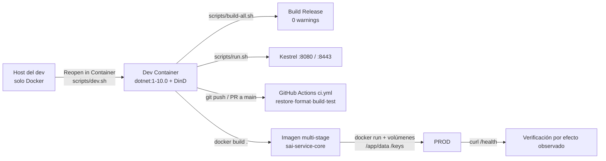

# 08 · DevOps, despliegue y operación

> **Propósito:** cómo se construye, se versiona, se empaqueta, se despliega y se opera `SAI.Service.Core`: scripts, Dev Container, imagen Docker multi-stage, pipeline de CI, versionado/CHANGELOG, despliegue en el host `<host de producción>` e incidentes conocidos. Distingue lo **especificado** (SDD 09) de lo **implementado** (archivos del repo) y lista las divergencias.
>
> **Fuente primaria:** `Dockerfile`, `.dockerignore`, `.github/workflows/ci.yml`, `.devcontainer/devcontainer.json`, `scripts/*.sh`, `Directory.Build.props`, `CHANGELOG.md`, `SDD/Docs/09-Devops/`. Operación: `SDD/Docs/11-Documentacion/{Guia-Despliegue,Guia-Contenedor,Runbook-Operacion,Bitacora-Eventualidades}-v1.0.md`. Rutas relativas a la raíz del repo `SAI.Service.Core/`.
>
> **No cubre:** capas y ADR de arquitectura en general (`01_Arquitectura.md`), migraciones/esquema EF (`03_Modelo-De-Datos.md`), endpoints y panel (`05_Interfaces-Panel-Y-Api.md`), adaptador NUT y configuración `Sai:*` (`06_Infraestructura-Y-Adaptador-Sai.md`), estrategia de pruebas, DoD y gates de cobertura (`07_Calidad-Y-Pruebas.md`), mapa del árbol SDD (`09_Documentacion-Sdd.md`).

---

## 1. Inventario del dominio

| Ruta | Líneas | Qué es |
| --- | --- | --- |
| `Dockerfile` | 96 | Build multi-stage `sdk:10.0` → `aspnet:10.0`, usuario no-root, volúmenes `/app/data` y `/keys` |
| `.dockerignore` | 41 | Recorta el contexto de build (sin `.git`, `bin/obj`, `SDD`, `PROMPTs`, `tests`, `*.db`, `keys`, `core.*`) |
| `.github/workflows/ci.yml` | 47 | Único workflow: job `build-test` (STAGE-01..04) |
| `.devcontainer/devcontainer.json` | 27 | Entorno DEV: imagen `mcr.microsoft.com/devcontainers/dotnet:1-10.0` + docker-in-docker |
| `scripts/build.sh` | 22 | Compila **un** proyecto (Release) buscándolo bajo `src/` y `tests/` |
| `scripts/build-all.sh` | 12 | `restore` + `build` Release de `SAI.Service.Core.sln` |
| `scripts/run.sh` | 25 | Corre **un** proyecto con `ASPNETCORE_ENVIRONMENT=Development` por defecto |
| `scripts/run-all.sh` | 7 | Delegado: `run.sh SAI.Service.Core.Web` (el host es el único proceso) |
| `scripts/dev.sh` | 18 | `devcontainer up` + `build-all.sh` dentro del contenedor (requiere `@devcontainers/cli`) |
| `Directory.Build.props` | 30 | `net10.0`, `TreatWarningsAsErrors`, analizadores `latest-recommended`, `InvariantGlobalization`, `Version=0.1.0-alpha.1` |
| `.gitignore` | 441 | Plantilla VisualStudio + `.publish-e1/`, `core.[0-9]*`, `sai.db`, `sai.db-*`, `sai-design.db`, `sai-design.db-*`, `*.env` |
| `CHANGELOG.md` | 617 | Keep a Changelog + SemVer; `[Unreleased]`, `[0.1.0]`, `[0.0.1]` |
| `README.md` | 39 | «Cómo correr»: Dev Container → `build-all.sh` → `run.sh` → F5 → `dotnet test` |
| `AGENTS.md` | 64 | Comandos de build/test/validación para agentes (deriva de `SDD/Docs/11-Documentacion/Contrato-Agentes-v1.0.md`) |
| `src/SAI.Service.Core/SAI.Service.Core.Web/appsettings.json` | 52 | Kestrel `:8080`, `DataProtection:RutaLlaves`, `Jwt:ClaveFirma` vacía, `Sello` de versión |
| `src/SAI.Service.Core/SAI.Service.Core.Web/appsettings.Development.json` | 22 | Kestrel `:8080` + `:8443`, clave JWT de desarrollo |
| `src/SAI.Service.Core/SAI.Service.Core.Api/Endpoints/EndpointsSalud.cs` | 31 | `GET /health` anónimo (smoke test y operador) |
| `src/SAI.Service.Core/SAI.Service.Core.Web/SelloVersion.cs` | 21 | Sello de versión del panel, enlazado desde `Sello` de `appsettings.json` |
| `.vscode/launch.json`, `.vscode/tasks.json` | — | Config F5 *coreclr* y tareas `build`/`build-release`/`test` (versionados; contenido no indexado por regla de `.vscode`) |

Documentación SDD del dominio:

| Ruta | Líneas | Qué cubre |
| --- | --- | --- |
| `SDD/Docs/09-Devops/README.md` | 58 | Índice de 09, orden de lectura, PENDIENTE trazados |
| `SDD/Docs/09-Devops/Estrategia-Versionado-v1.0.md` | 128 | SemVer, Conventional Commits, MinVer, trunk-based, canales, deprecation `/api/v1` |
| `SDD/Docs/09-Devops/Pipeline-CI-CD-v1.0.md` | 218 | 10 stages, triggers, matriz, caché, promoción, rollback, NFR→gate |
| `SDD/Docs/09-Devops/Entornos-Deploy-v1.0.md` | 116 | DEV/PROD sin QA/STAGING (ADR-24), provisión, 12-factor, secretos |
| `SDD/Docs/09-Devops/Guia-Publicacion-Image-Docker-v1.0.md` | 162 | Build/firma/push, deploy en `<host de producción>`, verificación, rollback, métricas |
| `SDD/Docs/09-Devops/Supply-Chain-Seguridad-v1.0.md` | 116 | SBOM CycloneDX, cosign keyless, SLSA L2, SCA, SAST/DAST, política CVE |
| `SDD/Docs/11-Documentacion/Guia-Inicio-Rapido-v1.0.md` | 79 | Arranque en máquina limpia con Dev Container (Docker ≥ 24.0, CLI `devcontainer`) hasta `/health` = `ok` |
| `SDD/Docs/11-Documentacion/Guia-Despliegue-v1.0.md` | 99 | Topologías, prerrequisitos, procedimiento de publish, verificación, rollback |
| `SDD/Docs/11-Documentacion/Guia-Contenedor-v1.0.md` | 111 | Contrato del contenedor: env vars, puertos, volúmenes, USB, healthcheck |
| `SDD/Docs/11-Documentacion/Runbook-Operacion-v1.0.md` | 90 | Procedimientos base, logs, métricas, incidentes `OPS-01..04` |
| `SDD/Docs/11-Documentacion/Bitacora-Eventualidades-v1.0.md` | 89 | `EVE-01..07` con causa e intentos descartados |

ADR relacionados (detalle en `01_Arquitectura.md`): ADR-18 (SQLite + migraciones al arranque), ADR-19 → superado por ADR-25 (NUT en el contenedor), ADR-20 → superado por ADR-26 (TLS autofirmado en Kestrel), ADR-23 (omisión de Developer Guide, superado), ADR-24 (DEV/PROD sin staging), ADR-29 (keyring de DataProtection persistido) — `SDD/Docs/05-Arquitectura-Tecnica/Adrs/`.

---

## 2. Flujo de punta a punta (implementado hoy)



Fuentes: `.devcontainer/devcontainer.json`, `scripts/*.sh`, `.github/workflows/ci.yml`, `Dockerfile`, `SDD/Docs/09-Devops/Entornos-Deploy-v1.0.md §1`. Firma, SBOM y push a registro **no** están implementados (ver §9).

---

## 3. Scripts (`scripts/`)

Todos con `set -euo pipefail`, resuelven `RAIZ` desde su propia ubicación y son ejecutables (modo git `100755`).

| Script | Uso | Comando efectivo | Notas |
| --- | --- | --- | --- |
| `build.sh <proyecto>` | `./scripts/build.sh SAI.Service.Core.Web` | `dotnet build <csproj> --configuration Release` | Busca `<proyecto>.csproj` con `find src tests`; exit 2 sin argumento, 1 si no lo encuentra |
| `build-all.sh` | `./scripts/build-all.sh` | `dotnet restore` + `dotnet build --configuration Release --no-restore` sobre la `.sln` | Equivalente local de STAGE-01 (`Pipeline-CI-CD §7`) |
| `run.sh <proyecto>` | `./scripts/run.sh SAI.Service.Core.Web` | `dotnet run --project <csproj>` | Exporta `ASPNETCORE_ENVIRONMENT=Development` si no está; **no es para depurar** (F5) |
| `run-all.sh` | `./scripts/run-all.sh` | `exec run.sh SAI.Service.Core.Web` | Web-monolith: «toda la solución» = el host |
| `dev.sh` | `./scripts/dev.sh` | `devcontainer up` + `devcontainer exec … ./scripts/build-all.sh` | Opcional; sin CLI `devcontainer` sugiere *Reopen in Container* |

Regla: depuración por `.vscode/launch.json` (F5, *coreclr*), nunca por los scripts (`scripts/run.sh` línea 3, `README.md` paso 4, `Entornos-Deploy §1`).

---

## 4. Dev Container (`.devcontainer/devcontainer.json`)

| Clave | Valor | Motivo |
| --- | --- | --- |
| `image` | `mcr.microsoft.com/devcontainers/dotnet:1-10.0` | SDK .NET 10 dentro del contenedor; el host solo necesita Docker. Nota en el archivo: «verificar tag» (§17.P.1) |
| `features` | `docker-in-docker:2` | Permite `docker build` de la imagen de producción desde adentro (STAGE-08) |
| `forwardPorts` | `8080` (SAI HTTP), `8443` (SAI HTTPS) | Coinciden con `Kestrel:Endpoints` de `appsettings*.json` |
| `postCreateCommand` | `dotnet restore SAI.Service.Core.sln && dotnet dev-certs https` | Restore + certificado de desarrollo (el `--trust` se hace a mano la primera vez, `README.md`) |
| `customizations.vscode` | `csdevkit`, `csharp`; `dotnet.defaultSolution` | — |
| `remoteUser` | `vscode` | — |

Sin `dotnet` fuera del Dev Container: alternativa documentada = contenedor SDK efímero `mcr.microsoft.com/dotnet/sdk:10.0` montando el repo (`AGENTS.md`; `Bitacora-Eventualidades EVE-02`).

---

## 5. Imagen Docker (`Dockerfile` + `.dockerignore`)

Introducida en `baa9a54` (2026-08-04, `build(docker): empaqueta el servicio en imagen multi-stage`). Ubicada en la **raíz** del repo, lo que habilita el contexto remoto `docker build https://github.com/UTN-FRP-TUP-Aplicada-2025/SAI.Service.Core.git#main` (`Dockerfile` líneas 10-14).

### 5.1 Etapas

```
Etapa build  (mcr.microsoft.com/dotnet/sdk:10.0, WORKDIR /src)
 ├─ COPY Directory.Build.props        ← ANTES del restore (si falta: obj/ inconsistente y
 │                                       publish sin wwwroot/_framework/blazor.web.js)
 ├─ COPY 5 × .csproj (Domain, Application, Infrastructure, Api, Web)  ← capa de restore cacheada
 ├─ RUN dotnet restore …Web.csproj    ← arrastra las 4 capas por ProjectReference
 ├─ COPY . .
 └─ RUN dotnet publish …Web.csproj -c Release -o /app/publish   (sin --no-restore, a propósito)

Etapa final  (mcr.microsoft.com/dotnet/aspnet:10.0, WORKDIR /app)
 ├─ ARG/ENV BUILD_VERSION=dev
 ├─ appuser/appgroup uid/gid 1001 (no-root)
 ├─ mkdir /app/data /keys (chown appuser)
 ├─ COPY --from=build --chown=appuser:appgroup /app/publish .
 ├─ USER appuser · VOLUME ["/app/data","/keys"] · EXPOSE 8080
 └─ ENTRYPOINT ["dotnet","SAI.Service.Core.Web.dll"]
```

### 5.2 Defaults de entorno de la imagen

| Variable | Valor en imagen | Notas |
| --- | --- | --- |
| `ConnectionStrings__Sai` | `Data Source=/app/data/sai.db` | SQLite append-only, migrada al arranque (`MigrateAsync`, `Web/Program.cs`; ADR-18) |
| `DataProtection__RutaLlaves` | `/keys` | Sin persistir: cada reinicio invalida cookie y antiforgery (ADR-29, `OPS-03`) |
| `Sai__Adaptador` | `Simulado` | Default seguro; con SAI real `Nut` + `Sai__Nut__Host` (config en `06_…`) |
| `ASPNETCORE_ENVIRONMENT` | `Production` | — |
| `BUILD_VERSION` | `dev` (build-arg) | Pensado para inyectar tag/SHA desde el pipeline; **ningún código lo lee** (grep en `src/` sin resultados) |

Decisiones explícitas del `Dockerfile` (líneas 81-88) y `CHANGELOG.md [Unreleased]`:

- **No** se define `ASPNETCORE_URLS`: el binding lo fija `Kestrel:Endpoints` (`http://0.0.0.0:8080`) y la variable pisaría la ranura TLS de producción.
- **No** se hornea `Jwt__ClaveFirma`: se inyecta en el despliegue (≥ 32 bytes o el arranque falla, `Web/Program.cs`).
- **No** hay `HEALTHCHECK`: la imagen `aspnet` no trae `curl`/`wget`; se declara en el orquestador.
- La imagen **no instala NUT** (`nutdrv_qx`/`upsd`), pese a ADR-25 (ver §9).

### 5.3 `.dockerignore`

| Grupo | Patrones | Razón |
| --- | --- | --- |
| VCS | `.git`, `.gitignore`, `.gitattributes`, `.github` | Metadatos |
| Artefactos del host | `**/bin`, `**/obj`, `.publish-e1`, `*.user`, `*.suo` | Un `obj/` de otro SDK/RID contamina MSBuild |
| Editor | `.vs`, `.vscode`, `.devcontainer` | No intervienen en producción |
| Volcados | `core.*`, `**/core.*` | Core dumps de ejecuciones locales |
| Docs | `SDD`, `PROMPTs`, `*.md` | No se compilan |
| Tests | `tests` | Corren en CI, no en la imagen |
| Datos/llaves | `*.db`, `*.db-shm`, `*.db-wal`, `keys` | Nunca dentro de la imagen |

---

## 6. Integración continua

### 6.1 Implementado (`.github/workflows/ci.yml`)

| Aspecto | Valor |
| --- | --- |
| Triggers | `push` y `pull_request` a `main` |
| Permisos | `contents: read` |
| Runner | `ubuntu-latest`, `actions/checkout@v4`, `actions/setup-dotnet@v4` (`10.0.x`) |
| Env | `DOTNET_NOLOGO`, `DOTNET_CLI_TELEMETRY_OPTOUT`, `DOTNET_SKIP_FIRST_TIME_EXPERIENCE` |

| Paso | Comando | Stage SDD |
| --- | --- | --- |
| Restore | `dotnet restore SAI.Service.Core.sln` | STAGE-01 |
| Formato | `dotnet format … --verify-no-changes --no-restore` | STAGE-02 |
| Build | `dotnet build … --configuration Release --no-restore` (cero warnings por `Directory.Build.props`) | STAGE-01 |
| Test | `dotnet test … --configuration Release --no-build --verbosity normal` | STAGE-03 + STAGE-04 |

Comentario del workflow: «Los stages 5 a 10 (e2e, SCA, SBOM, imagen, firma, publicación) se agregan en etapas posteriores».

### 6.2 Especificado (`SDD/Docs/09-Devops/Pipeline-CI-CD-v1.0.md`)

| Stage | Contenido | Estado en `ci.yml` |
| --- | --- | --- |
| STAGE-01 Build | Release, `TreatWarningsAsErrors` | Implementado |
| STAGE-02 Lint | `dotnet format --verify-no-changes` + analizadores | Implementado |
| STAGE-03 Unit | Domain + Application con `--collect:"XPlat Code Coverage"`; Domain ≥ 90/85 % (N-22) | Parcial: corre en un solo `dotnet test`, **sin recolección ni gate de cobertura** |
| STAGE-04 Integración | Integration.Tests; global ≥ 80/70 % (N-21) | Parcial: idem |
| STAGE-05 E2E | bUnit + Playwright (UF-1, UF-3, apagado UF-8 contra simulado) | No implementado |
| STAGE-06 SCA | `dotnet list package --vulnerable --include-transitive`; + `schedule` semanal | No implementado |
| STAGE-07 SBOM | `dotnet CycloneDX` (JSON) | No implementado |
| STAGE-08 Imagen | `docker build` + smoke `curl /health` | No en CI (el `Dockerfile` existe) |
| STAGE-09 Firma | `cosign sign` keyless (solo en tag) | No implementado |
| STAGE-10 Publicación | `docker push` a registro privado (solo tag limpio) | No implementado |

Triggers especificados (`Pipeline-CI-CD §1.1`): PR y push a `main` → STAGE-01..08; tag `v<X.Y.Z>` → 01..10; `schedule` semanal → 06. Matriz de un eje (`ubuntu-latest` / .NET 10 / `linux/amd64`, §2). Caché NuGet sobre `~/.nuget/packages` con lockfile recomendado (§3.1; no hay `packages.lock.json` en el repo). Retención de artefactos (§3.2): cobertura/TRX/SCA 90 días, SBOM y firma indefinidos. Trazabilidad NFR→gate (§8): 22 NFR numéricos con gate, N-03/N-20/N-25 PENDIENTE (umbrales y gates de prueba en `07_Calidad-Y-Pruebas.md`).

---

## 7. Versionado y CHANGELOG

### 7.1 Estrategia (`SDD/Docs/09-Devops/Estrategia-Versionado-v1.0.md`)

| Tema | Regla |
| --- | --- |
| SemVer 2.0.0 | MAJOR = cambio incompatible de `/api/v1/` o migración destructiva; MINOR = etapa cerrada; PATCH = fix |
| Conventional Commits 1.0.0 | `feat`→MINOR, `fix`→PATCH, `!`/`BREAKING CHANGE`→MAJOR; `docs/refactor/test/chore/build/ci/perf` sin bump |
| Herramienta | MinVer (`PackageReference` en `Directory.Build.props`), prefijo `v`, preestreno `-alpha.N` por altura |
| Branching | Trunk-based: `main` siempre desplegable; ramas cortas `etapa/NN-<slug>`; merge solo por PR con gates en verde |
| Canal | Único: imagen de contenedor; etiquetas `v<X.Y.Z>`, `latest`, `<X.Y.Z>-alpha.N` (no se publica) |
| Feed | Sin feed público; `redistribuible: false`; registro privado si se publicara |
| Deprecation | `/api/v1` se mantiene mientras exista el consumidor `fd-gmao-externo`; aditivos son MINOR |

### 7.2 Estado real

| Hecho | Valor | Fuente |
| --- | --- | --- |
| Versión de ensamblado | `0.1.0-alpha.1` fija | `Directory.Build.props` línea 27 |
| Sello del panel | `VersionLegible: 0.1.0-alpha.1`, `EsPreliminar: true`, `FechaIteracion: 2026-07-20` | `Web/appsettings.json` sección `Sello` |
| MinVer | **No referenciado** (solo comentarios «en el pipeline real la calcula MinVer») | `Directory.Build.props`, `Web/SelloVersion.cs` |
| Tags git | **Ninguno** (`git tag` vacío) | historial git |
| Ramas usadas | `feature/…`, `docs/…`, `fix/…` (p. ej. `feature/etapa-4b-apagado-ordenado`, `feature/politica-retardo-retorno`), no `etapa/NN-<slug>` | mensajes de merge, `git log --merges` |
| Commits | Conventional Commits con scope (`feat(politicas)`, `build(docker)`, `docs(sdd)`) | `git log` |

### 7.3 `CHANGELOG.md`

| Sección | Fecha | Contenido |
| --- | --- | --- |
| `[Unreleased]` · Añadido | — | Todo el código: Sprint 0, Etapas 1–5, Fases A–H del SDD, y al tope el empaquetado Docker (`Dockerfile` + `.dockerignore`) y el tiempo de retorno configurable |
| `[Unreleased]` · Cambiado | — | Reajuste SDD v3.0 (cat. 10↔11), categoría 11-Documentacion, rediseño UX del panel de verificaciones, unificación de terminología |
| `[Unreleased]` · Notas | — | Desactualizadas: dicen «Pendiente: Fase B2 y Fases C a H», que ya figuran en Añadido (`CHANGELOG.md` líneas 583-587) |
| `[0.1.0]` | 2026-07-20 | Solo documentación: estructura SDD e intake v1.0; stack .NET 10 + Blazor + EF Core + SQLite |
| `[0.0.1]` | 2026-07-18 | Commit inicial (`README.md`, `.gitignore`) |

Última versión publicada en el CHANGELOG: **0.1.0** (documental). Ninguna versión con código fue cortada todavía (no hay tag ni entrada de release posterior).

---

## 8. Despliegue y operación

### 8.1 Ambientes (ADR-24, `Entornos-Deploy-v1.0.md §1`)

| Ambiente | Destino | Aprobador |
| --- | --- | --- |
| DEV | Dev Container en la máquina del desarrollador, depuración F5 | El propio desarrollador |
| PROD | Host `<host de producción>` (`linux/amd64`) con el SAI por USB | Administrador único (release manager) |

Sin QA ni STAGING: «no habría a qué SAI conectarlo» (intake §17.P.8). La validación física del apagado se hace en la ventana de mantenimiento UF-8 / CU-10.

### 8.2 Topologías de PROD

| Topología | Estado documentado | Fuente |
| --- | --- | --- |
| Proceso publicado (`dotnet publish -o ./.publish` + `dotnet …Web.dll`) junto a NUT nativo del host (`upsd`/`upsmon`/`upssched`) | «Soportada» | `11-Documentacion/Guia-Despliegue §1, §4` |
| Contenedor de la imagen del `Dockerfile` con volúmenes `/app/data` y `/keys` | Imagen construible desde `baa9a54`; NUT no incluido en la imagen | `Dockerfile` |
| Contenedor con NUT adentro y USB por `udev` (by-path) | Objetivo de ADR-25, pendiente | `ADR-25`, `Guia-Despliegue §1` |

Qué topología corre efectivamente hoy en `<host de producción>`: **(no verificado)** desde el repo.

### 8.3 Procedimiento de despliegue (proceso publicado, `Guia-Despliegue §4`)

```bash
git fetch origin && git checkout <tag-o-main>
./scripts/build-all.sh
dotnet publish src/SAI.Service.Core/SAI.Service.Core.Web --configuration Release -o ./.publish
export ASPNETCORE_ENVIRONMENT=Production Sai__Adaptador=Nut Jwt__ClaveFirma="<secreto>" \
  DataProtection__RutaLlaves=/keys ConnectionStrings__Sai="Data Source=/data/sai.db" \
  Sai__Nut__Usuario="<usuario>" Sai__Nut__Password="<secreto>"
dotnet ./.publish/SAI.Service.Core.Web.dll    # migra y siembra al arrancar
```

Al arrancar: `MigrateAsync`, semilla idempotente del rol `administrador`, reglas de derivación, política inicial en solo aviso y fuente `fd-gmao-externo`; el primer acceso desvía a `/alta-inicial` (`Web/Program.cs`; `Guia-Despliegue §4`). La salida local de publish para validación manual se llama `.publish-e1/` (ignorada en `.gitignore` y `.dockerignore`).

### 8.4 Contrato de ejecución (variables de entorno obligatorias en PROD)

| Variable | Por qué | Fuente |
| --- | --- | --- |
| `Jwt__ClaveFirma` | ≥ 32 bytes o el proceso no arranca | `Web/Program.cs`, `Guia-Contenedor §2` |
| `DataProtection__RutaLlaves` | Volumen persistente del keyring (ADR-29) | `appsettings.json`, `Guia-Contenedor §4` |
| `Sai__Adaptador=Nut` | Con `Simulado` no hay SAI real | `Guia-Contenedor §9` |
| `Sai__Nut__Usuario` / `Sai__Nut__Password` | Solo para apagar; vacío = solo lectura | `Guia-Contenedor §2` |

Lista completa de variables `Sai__*` y su semántica: `06_Infraestructura-Y-Adaptador-Sai.md`. Puertos: `8080` HTTP siempre; `8443` HTTPS solo en Development; TLS de producción (ADR-26) **no implementado** — ranura `_RanuraTls` en `appsettings.json`. `app.UseHttpsRedirection()` está activo en todos los entornos (`Web/Program.cs`).

### 8.5 Verificación, logs y métricas

| Señal | Comando / patrón | Fuente |
| --- | --- | --- |
| Salud | `curl -sf http://localhost:8080/health` → `{"estado":"ok","servicio":"SAI.Service.Core","utc":…}` | `EndpointsSalud.cs`, `Runbook §1` |
| NUT disponible | `upsc sai@localhost ups.status` → `OL`/`OB` | `Guia-Despliegue §5` |
| Healthcheck sugerido | período 30 s, 3 fallos → no saludable | `Guia-Contenedor §6` |
| Logs | stdout; `Information`, `Microsoft.AspNetCore=Warning`; filtros por `accion\|apagado`, `nut\|alcanzable`, `migration` | `Runbook §2`, `appsettings.json` |
| Unidad systemd `sai` (`journalctl -u sai`) | citada en el runbook | **(no verificado)**: no hay unit file en el repo |
| Métricas | antigüedad del sondeo (> 15 s atención), supuestos verificados (< 4), días sin protección, estado del último apagado | `Runbook §3` |
| Recursos sugeridos | 256–512 MB, 0,5 vCPU | `Guia-Contenedor §8` |

### 8.6 Rollback

| Variante | Procedimiento | Fuente |
| --- | --- | --- |
| Proceso publicado | `git checkout <tag-anterior>` + build + publish + arrancar | `Guia-Despliegue §6` |
| Imagen (especificado) | `cosign verify` (solo en `Guia-Publicacion §4`) → `docker stop --time 150` → `docker run` de `v<X.Y.Z-1>` → `curl /health` | `Guia-Publicacion-Image-Docker §4`, `Pipeline-CI-CD §5` |
| Punto de no retorno | Migraciones hacia adelante: respaldar `sai.db` antes de una migración no aditiva (`cp sai.db sai.db.bak-<fecha>`) | ambas guías |

`docker stop --time 150` / `--stop-timeout 150` materializan el NFR **N-02** (presupuesto de shutdown-timeout de Docker).

### 8.7 Secretos y supply chain (especificado)

| Tema | Política | Fuente |
| --- | --- | --- |
| Secretos | Env vars (12-factor), `--env-file /etc/sai-service-core/prod.env` (600, root); user-secrets en DEV; sin vault | `Entornos-Deploy §3-4` |
| SBOM | CycloneDX JSON, STAGE-07 | `Supply-Chain-Seguridad §1` |
| Firma | cosign keyless con OIDC de Actions (`id-token: write`), Rekor; verificar antes de publicar y de desplegar | `§2` |
| SLSA | Build L2 objetivo, L3 como meta | `§3` |
| SCA | Cero altas/críticas bloquea; Dependabot/Renovate recomendado | `§4` |
| SAST / DAST | Analizadores .NET (STAGE-02) / DAST no aplica (LAN) | `§5` |
| CVE | Crítica mismo día; alta ≤ 7 d; media ≤ 30 d | `§6` |

Ninguno de estos controles (salvo SAST por analizadores) está en `ci.yml`.

---

## 9. Incidentes conocidos

### 9.1 Runbook (`SDD/Docs/11-Documentacion/Runbook-Operacion-v1.0.md §4`)

| ID | Síntoma | Causa / resolución |
| --- | --- | --- |
| OPS-01 | Panel muestra SAI «no alcanzable» | Problema de NUT: `upsc`, `systemctl status nut-server`, nombre `Sai__Nut__Ups`; el servicio se recupera solo |
| OPS-02 | Apagado en `EfectoNoConfirmado` | Faltan credenciales de escritura NUT (`upsmon master` con `shutdown.return`) |
| OPS-03 | Sesiones perdidas y HTTP 400 antiforgery tras reinicio | Keyring efímero: montar `DataProtection__RutaLlaves` (ADR-29) |
| OPS-04 | `upsmon` no apaga el host ante un corte | `MONITOR sai@localhost 1 <u> <c> master` en `upsmon.conf`; usuario `master` (no `slave`) en `upsd.users` |

### 9.2 Bitácora (`SDD/Docs/11-Documentacion/Bitacora-Eventualidades-v1.0.md`)

| ID | Fecha | Tema | Destino |
| --- | --- | --- | --- |
| EVE-01 | 2026-07-24 | `upsmon` sin `MONITOR` y usuario `slave` → `ERR ACCESS-DENIED` | OPS-04 |
| EVE-02 | 2026-07-22 | Sin `dotnet` fuera del Dev Container → contenedor SDK efímero; `dotnet ef` con startup-project Infrastructure | Guia-Contribucion §2 |
| EVE-03 | 2026-07-23 | `CultureNotFoundException` por `InvariantGlobalization=true` | Guia-Contribucion §3 |
| EVE-04 | 2026-07-21 | HTTP 400 antiforgery por token doble y orden de middleware | `Web/Program.cs` |
| EVE-05 | 2026-07-21 | Sesiones perdidas al reiniciar el contenedor (keyring efímero) | OPS-03 |
| EVE-06 | 2026-07-26 | Conflicto de merge en `CHANGELOG.md`, `SaiDbContext` y snapshot EF → regenerar migración | Guia-Contribucion §4 |
| EVE-07 | 2026-07-23 | Jerga NUT en la UI → mensaje llano a UI, detalle a log | Runbook §2 |

### 9.3 Trampas de build documentadas en el `Dockerfile`

| Trampa | Mitigación | Fuente |
| --- | --- | --- |
| Publish sin `blazor.web.js` (interactividad rota) | Copiar `Directory.Build.props` antes del restore; publish sin `--no-restore` | `Dockerfile` líneas 24-29, 48-50 |
| `obj/` del host con otro SDK/RID | Excluir `**/bin`, `**/obj` en `.dockerignore` | `.dockerignore` líneas 3-5 (motivo) y 14-15 (patrones) |
| `ASPNETCORE_URLS` pisa `Kestrel:Endpoints` | No definirla | `Dockerfile` líneas 82-84 |

---

## 10. Divergencias especificación ↔ implementación

| # | Especificación | Realidad | Fuentes |
| --- | --- | --- | --- |
| D-1 | `Dockerfile` en `src/SAI.Service.Core.Web/Dockerfile` (`docker build -f …`) | `Dockerfile` en la raíz | `Entornos-Deploy §2`, `Guia-Publicacion §1-2`, `Pipeline-CI-CD §7` vs `Dockerfile` |
| D-2 | 11-Documentacion: «no hay Dockerfile», imagen «ranura pendiente» (last_review 2026-07-27) | Existe desde `baa9a54` (2026-08-04) | `Guia-Contenedor §1`, `Guia-Despliegue §1` |
| D-3 | ADR-25: la imagen incluye `nutdrv_qx` y `upsd`; en el host no corre NUT | La imagen es `aspnet:10.0` sin NUT; la topología «soportada» de `Guia-Despliegue` usa NUT nativo del host | `ADR-25` vs `Dockerfile`, `Guia-Despliegue §1` |
| D-4 | Volumen de datos `/data` (`-v /var/lib/sai-service-core:/data`) | `/app/data` + `/keys` | `Guia-Publicacion §2.2`, `Guia-Contenedor §4`, `Guia-Despliegue §3-4` vs `Dockerfile` |
| D-5 | Variables ilustrativas `ConnectionStrings__Sqlite`, `Nut__Modo`, `Upsd__Usuario`, `Ups__DelayStart` | `ConnectionStrings__Sai`, `Sai__Adaptador`, `Sai__Nut__*`; el retardo de retorno pasó a la política (`TiempoRetornoSeg`) | `Entornos-Deploy §3` vs `appsettings.json`, `CHANGELOG.md` |
| D-6 | 10 stages, tag/schedule, caché NuGet, cobertura por capa | 4 stages, solo push/PR a `main`, sin caché ni gate de cobertura | §6 |
| D-7 | MinVer + tags `v<X.Y.Z>` | `Version` fija `0.1.0-alpha.1`, sin tags | §7.2 |
| D-8 | Ramas `etapa/NN-<slug>` | `feature/…`, `docs/…`, `fix/…` | §7.2 |
| D-9 | TLS autofirmado en Kestrel (ADR-26) | Solo HTTP 8080 en Production; `EXPOSE 8080`; el `Dockerfile` cita ADR-20 (superado) | `appsettings.json`, `Dockerfile` |
| D-10 | `BUILD_VERSION` inyectado por el pipeline | Ningún código lo consume; el sello sale de `appsettings.json` | `Dockerfile`, `SelloVersion.cs` |
| D-11 | Mapeo USB `--device-cgroup-rule='c 189:* rmw'` | Sin artefacto `udev` ni compose en el repo («no vive en el repositorio») | `Guia-Publicacion §2.2`, `Guia-Contenedor §5` |

Estado y priorización de estos pendientes: `11_Estado-Y-Pendientes.md`.

---

## 11. PENDIENTE trazados por 09

| Ítem | Vía de cierre | Fuente |
| --- | --- | --- |
| N-25 SLO de disponibilidad | Propuesto «rondas completadas/esperadas ≥ 0,99 mensual», medición en runtime | `09-Devops/README.md` |
| N-20 tamaño máximo de SQLite | Medición bajo carga simulada (R-07) | idem |
| N-03 resto del apagado del SO | Cronometrado en UF-8 / CU-10 | idem |
| TLS en la LAN | ADR-20 → ADR-26 aceptado; implementación pendiente | idem, `appsettings.json` |
| Ubicación de NUT | ADR-19 → ADR-25 aceptado; imagen sin NUT | idem, `Dockerfile` |
