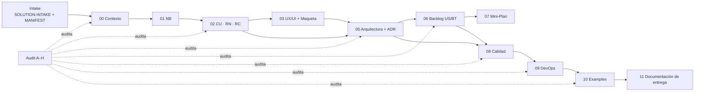

# 09 — Mapa del árbol documental SDD

> **Propósito:** ubicar cada documento del árbol `SDD/` (Intake, Docs 00–11, Audit, Maquetas) y de los documentos raíz `README.md` y `AGENTS.md`: qué hay en cada archivo, cómo se numeran los identificadores y qué contrato fija `AGENTS.md`. Es un **mapa**, no un resumen del contenido: el detalle de dominio, arquitectura, datos, pruebas o DevOps vive en los otros índices (ver §9).
>
> **Fuente primaria:** `SDD/Docs/README.md` (ancla del árbol) y los `README.md` de cada categoría; `AGENTS.md`; `SDD/Docs/11-Documentacion/Contrato-Agentes-v1.0.md`; inventario por `git ls-files SDD`. Rutas relativas a la raíz del repo `SAI.Service.Core`.

---

## 1. Árbol general

```text
(raíz del repo)
├── README.md                 ← cómo correr (Dev Container, scripts, F5, tests)
├── AGENTS.md                 ← contrato para agentes; se deriva de 11/Contrato-Agentes
├── CHANGELOG.md              ← fuente autoritativa del avance por incremento
└── SDD/
    ├── Intake/               ← insumos de entrada (2 docs)
    ├── Maquetas/Sai-Service-Core/  ← maqueta estática de la Fase B2 (11 superficies)
    └── Docs/
        ├── README.md         ← ancla del árbol (AG-ROOT)
        ├── 00-Contexto/              (4 + README)
        ├── 01-Necesidades-Negocio/   (índice + 8 NB + README)
        ├── 02-Especificacion-Funcional/ (índice + 12 CU + 13 RN + modelo + 9 RC + README)
        ├── 03-UX-UI-DX/              (marco + 11 wireframes + 3 de Fase B2 + glosario + README)
        ├── 05-Arquitectura-Tecnica/  (6 docs + 29 ADR + README)
        ├── 06-Backlog-Tecnico/       (3 docs + 26 US + README)
        ├── 07-Plan-Sprint/           (Mini-Plan + README)
        ├── 08-Calidad-Y-Pruebas/     (9 docs + README)
        ├── 09-Devops/                (5 docs + README)
        ├── 10-Examples/              (2 samples + README)
        ├── 11-Documentacion/         (10 docs + README)
        └── Audit/                    (8 informes, Fases A–H)
```

- No existe `04-Prompts-AI`: omitida porque el producto no usa LLM (`SDD/Docs/README.md` §4).
- Layout **aplanado** (caso degenerado de un solo proyecto): sin `Proyectos/<Nombre>/` ni `Solucion/` (`SDD/Docs/README.md` §2; `SDD/Docs/05-Arquitectura-Tecnica/README.md` «Notas»).
- `SDD/Docs/.gitkeep` es un marcador vacío.
- Numeración según framework SDD v3.0: **10 = Examples**, **11 = Documentacion** (se intercambiaron; commit `4f5c6bf`, `SDD/Docs/README.md` §4).

## 2. Cadena de trazabilidad



Fuente: `SDD/Docs/README.md` §4.1 (cadena 00→10: cada eslabón justifica al siguiente). Los eslabones hacia la 11 y las aristas de `Audit/` son agregado de este índice (no verificado como cadena en la fuente): la 11 enlaza sin duplicar (`SDD/Docs/11-Documentacion/README.md`) y cada informe de `Audit/` audita su fase (§5.12).

## 3. Documentos raíz

| Archivo | Qué contiene | Fuente |
| --- | --- | --- |
| `README.md` | Pasos para correr: Dev Container (único requisito del host: Docker), `scripts/build-all.sh`, `scripts/run.sh SAI.Service.Core.Web`, puertos 8080/8443, `/health`, F5, `dotnet test`. Cierra con nota de «Sprint 0 es andamiaje» (desfasada, ver §8) | `README.md` |
| `AGENTS.md` | Contrato de contexto para agentes de codificación (ver tabla siguiente) | `AGENTS.md` |
| `CHANGELOG.md` | Bitácora por incremento; el Mini-Plan y la 11 la declaran fuente autoritativa del avance (contenido → `11_Estado-Y-Pendientes.md`) | `SDD/Docs/07-Plan-Sprint/Mini-Plan-v1.0.md` §10; `SDD/Docs/11-Documentacion/README.md` §4 |
| `SDD/Docs/README.md` | Ancla del árbol: identidad, composición (1 proyecto `web-monolith`), stack, mapa de categorías, flujo de lectura por audiencia, cómo regenerar, estado por categoría, glosario rápido, responsables | `SDD/Docs/README.md` §1–§10 |

### 3.1 Contrato que fija `AGENTS.md`

`AGENTS.md` **se deriva** de `SDD/Docs/11-Documentacion/Contrato-Agentes-v1.0.md`; si divergen, manda el contrato y `AGENTS.md` se regenera.

| Sección | Qué fija | Fuente |
| --- | --- | --- |
| Qué es | `web-monolith` .NET 10, Blazor Server + API REST de ingesta + SQLite; cinco assemblies en `src/SAI.Service.Core/`; único proceso `SAI.Service.Core.Web` | `AGENTS.md` «Qué es» |
| Construir | Sin `dotnet` en el host: `devcontainer up`, `./scripts/build-all.sh` → 0 warnings / 0 errores; alternativa: contenedor efímero `mcr.microsoft.com/dotnet/sdk:10.0` | `AGENTS.md` «Construir» |
| Testear | `dotnet test SAI.Service.Core.sln --configuration Release` → 0 failed; tests contra SAI real por NUT quedan *skipped* sin hardware | `AGENTS.md` «Testear» |
| Validar antes de cerrar | build-all + test + `dotnet ef migrations has-pending-model-changes` (si se tocó el modelo) | `AGENTS.md` «Validar…» |
| Convenciones | Conventional Commits, SemVer 2.0.0, cero-warnings, `Nullable`, `InvariantGlobalization`, español rioplatense; append-only; procedencia obligatoria; orden de alta Domain → Application → Infrastructure → Api/Web → seed → tests → docs | `AGENTS.md` «Convenciones» |
| Límites (sin confirmación humana) | `IA/IA.SDD` y `PROMPTs/` solo lectura; no relajar append-only, procedencia ni estado base seguro; merge y borrado de ramas los hace el humano; todo acceso al SAI por `IAdaptadorConexion` | `AGENTS.md` «Límites» |
| Dónde mirar | Tabla de punteros a la 11 y a `05/Contratos-REST` | `AGENTS.md` «Dónde mirar» |

Diferencias entre fuente y derivado: el contrato agrega «acciones outward-facing (publicar, desplegar, enviar) requieren confirmación» y analizadores `latest-recommended`; `AGENTS.md` agrega el límite «todo acceso al SAI pasa por `IAdaptadorConexion`» y el orden de alta de funcionalidad (`Contrato-Agentes-v1.0.md` §4, §6 vs `AGENTS.md`).

## 4. `SDD/Intake/`

| Archivo | Contenido | Fuente |
| --- | --- | --- |
| `SDD/Intake/SOLUTION-INTAKE-Sai-Service-Core-v1.0.md` (v1.2, 2112 líneas) | Insumo único de toda la cadena. Parte A negocio (§1–§12: problema, stakeholders, MoSCoW F-XX, historias, flujos UF-1..UF-10, casos límite CL-XX, métricas, exclusiones, riesgos R-XX, glosario); Parte B composición (§13–§16, incl. §16.1 samples); Parte C técnica (§17 P.1–P.12: stack, estilo, integración, persistencia, seguridad, testing, versionado, CI/CD, plataformas, NFR, pre-ADR PA-01..PA-15, trade-offs; §18 demo); Parte D anexos (§20 escenarios E-1..E-8, §21 cobertura, invariantes I-1..I-21, flujos E2E); al final §19 checklist de completitud, trazabilidad downstream y control de cambios | encabezados del archivo |
| `SDD/Intake/SOLUTION-MANIFEST-Sai-Service-Core-v1.0.md` (v1.1, «En revisión») | Derivado del intake §13: bloque de solución, perfil de convención de nombres (`SAI.Service.Core` / `Sai-Service-Core`), tabla de proyectos (1), grafo de dependencias, checklist | encabezados del archivo |

Regla de edición: las contribuciones manuales se limitan al intake y a las correcciones que marcan las auditorías; lo derivado no se edita a mano (`SDD/Docs/README.md` §6).

## 5. Categorías de `SDD/Docs/`

Convención común: cabecera con Proyecto / Documento / Versión / Estado / Fecha / Autor (`Orquestador SDD (AG-NN)`) y sección final «Control de cambios». La 11 usa en cambio frontmatter YAML (`doc_id`, `status`, `version`, `last_review`, `traces`…) (`SDD/Docs/11-Documentacion/Contrato-Agentes-v1.0.md` líneas 1–15).

### 5.1 `00-Contexto/` (AG-00) — contenido → `00_MASTER-INDEX.md`

| Archivo | Qué contiene |
| --- | --- |
| `README.md` | Índice, documento omitido (`Acuerdo-Equipo`, por ser 1 dev), stakeholders, pendientes P-01..P-06 heredados |
| `Vision-Producto-v1.0.md` (v1.1) | Problema, audiencia, propuesta de valor, visión a 3 años, SMART, métricas, restricciones, riesgos, glosario |
| `Alcance-Proyecto-v1.0.md` (v1.1) | Incluido / excluido, supuestos, restricciones, criterios de aceptación, gestión de cambios |
| `Roadmap-Producto-v1.0.md` (v1.1) | Fases F0–F5 con épicas, capacidades C-01..C-16, release target v0.0→v1.0; matriz fase→épica→sprint→release |
| `Compatibilidad-Plataformas-v1.0.md` | Matriz de SO, runtime, contenedores, navegadores y NUT con versiones mínimas; cláusula de no-soporte |

### 5.2 `01-Necesidades-Negocio/` (AG-01)

| Archivo | Qué contiene |
| --- | --- |
| `README.md` | Tabla NB, mapa de dependencias (NB-04 raíz, NB-01 sumidero), orden de lectura, RACI |
| `Necesidades-Negocio-v1.0.md` (v1.1) | Índice maestro formal de las 8 NB |
| `Necesidades-De-Negocio/NB-01-Apagado-Ordenado-Y-Reencendido-Garantizado-v1.0.md` | NB-01 |
| `…/NB-02-Monitoreo-En-Vivo-Y-Alertas-v1.0.md` | NB-02 |
| `…/NB-03-Historia-Trazable-Con-Procedencia-v1.0.md` | NB-03 |
| `…/NB-04-Ciclo-De-Vida-De-Los-Equipos-v1.0.md` | NB-04 |
| `…/NB-05-Seguridad-Operativa-Bloqueo-Por-Verificacion-v1.0.md` | NB-05 (ancla la autenticación, que no tiene NB propia) |
| `…/NB-06-Evaluacion-De-Salud-De-Baterias-v1.0.md` | NB-06 |
| `…/NB-07-Configuracion-De-Politicas-De-Apagado-v1.0.md` | NB-07 |
| `…/NB-08-Ingesta-Automatizada-De-Intervenciones-v1.0.md` | NB-08 |

Estructura de cada NB: 10 secciones (descripción, ejemplo, impacto, problema, criterios de éxito, stakeholders, trazabilidad a CU, dependencias, MoSCoW, control de cambios). Todas Must Have (`SDD/Docs/01-Necesidades-Negocio/README.md`).

### 5.3 `02-Especificacion-Funcional/` (AG-02) — contenido → `02_Dominio-Y-Reglas.md`, `04_Aplicacion-Y-Casos-De-Uso.md`, `03_Modelo-De-Datos.md`

| Archivo / grupo | Qué contiene |
| --- | --- |
| `README.md` | Índice de CU, RN, modelo y RC con propósito en una línea |
| `Especificacion-Funcional-v1.0.md` (v1.1) | Índice maestro con matriz **NB → CU → RN → US**; §6 ambigüedades (autenticación sin NB, P-05, R-11, granularidad 19→12 CU) |
| `Casos-De-Uso/CU-01..CU-12-*-v1.0.md` (12) | Un CU por flujo UF-1..UF-10 + autenticación (CU-01). Estructura de 12 secciones (propósito, actores, pre/post, flujos, excepciones, criterios, trazabilidad, notas, concurrencia, cambios) |
| `Reglas-De-Negocio/RN-01..RN-13-*-v1.0.md` (13) | Una regla por archivo: enunciado, justificación, ámbito, consecuencia, CU afectados, pruebas |
| `Modelo-Datos/Modelo-Conceptual-v1.0.md` (262 l) | 27 entradas (§1.1–§1.27): capas catálogo, inventario, vínculos temporales, historia (append-only) y proyección, más objetos de valor y actor persistido; atributos, relaciones, cardinalidades, diagrama ER |
| `Modelo-Datos/reglas-conceptuales-de-modelo/RC-01..RC-09-*-v1.0.md` (9) | Restricciones conceptuales del modelo: enunciado, entidades, tipo, verificación, RN/CU que la justifican |

Archivos CU: `CU-01-Autenticacion-Del-Administrador`, `CU-02-Alta-De-Equipos-Y-Puesta-En-Marcha`, `CU-03-Configuracion-De-Politicas-De-Apagado`, `CU-04-Monitoreo-En-Vivo-Del-Estado-Del-Sai`, `CU-05-Ejecucion-Del-Apagado-Ordenado-Ante-Corte`, `CU-06-Historicos-Y-Graficas-De-Evolucion`, `CU-07-Prueba-De-Bateria-Y-Veredicto-De-Salud`, `CU-08-Recambio-De-Bateria-Y-Ficha-De-Vida-Util`, `CU-09-Reparacion-Y-Sustitucion-Del-Sai`, `CU-10-Ventana-De-Mantenimiento-Y-Verificacion`, `CU-11-Ingesta-Automatizada-De-Intervenciones`, `CU-12-Informe-De-Periodo-Y-Comparacion-De-Marcas`.

Archivos RN: `RN-01-Arranque-Seguro-En-Solo-Alerta`, `RN-02-Bloqueo-Por-Verificacion`, `RN-03-Validacion-Por-Efecto-Observado`, `RN-04-Techo-Duro-Del-Tiempo-De-Apagado`, `RN-05-Procedencia-Obligatoria-De-Todo-Valor`, `RN-06-Aptitud-De-Datos-Para-Tendencia-De-Salud`, `RN-07-Todo-Importe-Con-Moneda-Y-Fecha`, `RN-08-Cuadre-De-Costos-De-Intervencion`, `RN-09-Idempotencia-De-La-Ingesta`, `RN-10-Agregado-Con-Cobertura-Y-Advertencia`, `RN-11-Accion-Referida-A-Version-De-Politica`, `RN-12-Baja-Logica-Y-Coherencia-Temporal`, `RN-13-Vida-De-Flotacion-Con-Temperatura-De-Referencia`.

Archivos RC: `RC-01-Procedencia-Por-Valor`, `RC-02-Vigencia-Como-Entidad-Con-Intervalo`, `RC-03-Sucesion-De-Vinculos-Sin-Hueco`, `RC-04-Agregado-No-Hereda-De-Muestra`, `RC-05-Accion-Referida-A-Version-De-Politica`, `RC-06-Historia-Append-Only`, `RC-07-Resolucion-Temporal-De-La-Bateria`, `RC-08-Baja-Logica-Y-Coherencia-Temporal`, `RC-09-Evento-Referido-A-Regla-Versionada`.

### 5.4 `03-UX-UI-DX/` (AG-03; Fase B2: AG-03M) — contenido → `05_Interfaces-Panel-Y-Api.md`

| Archivo | Qué contiene | Estado |
| --- | --- | --- |
| `README.md` | Índice, mapa superficie → CU → estados declarados, catálogo de reglas de diseño aplicado (base + Blazor-MudBlazor + 4 extensiones) | Borrador |
| `Experiencia-De-Uso-v1.0.md` (v1.2) | Marco de experiencia: principios, flujos, estados, accesibilidad AA, i18n, errores | Borrador |
| `Wireframes-Alta-Inicial-Administrador-v1.0.md` | SUP-01 · CU-01 | Borrador |
| `Wireframes-Acceso-Login-v1.0.md` | SUP-02 · CU-01 | Borrador |
| `Wireframes-Panel-Estado-En-Vivo-v1.0.md` | SUP-03 · home · CU-04/CU-05 | Borrador |
| `Wireframes-Alta-De-Equipos-v1.0.md` | SUP-04 · CU-02 | Borrador |
| `Wireframes-Configuracion-De-Politicas-v1.0.md` (v1.2) | SUP-05 · CU-03 | Borrador |
| `Wireframes-Prueba-De-Bateria-v1.0.md` | SUP-06 · CU-07 | Borrador |
| `Wireframes-Historicos-Y-Graficas-v1.0.md` | SUP-07 · CU-06 | Borrador |
| `Wireframes-Panel-De-Verificaciones-v1.0.md` | SUP-08 · CU-10/CU-05 | Borrador |
| `Wireframes-Registro-De-Intervenciones-v1.0.md` | SUP-09 · CU-08 | Borrador |
| `Wireframes-Sustitucion-Del-SAI-v1.0.md` | SUP-10 · CU-09 | Borrador |
| `Wireframes-Informe-De-Periodo-v1.0.md` | SUP-11 · CU-12 | Borrador |
| `Linea-Base-Visual-v1.0.md` | Capturas por superficie SUP-01..SUP-11 y componentes CMP-XX | Vigente |
| `Contrato-Datos-Maqueta-v1.0.md` | Campos que consume la maqueta por superficie | Vigente |
| `Bitacora-Validacion-Maqueta-v1.0.md` | Registro de la validación visual de la Fase B2 | Vigente |
| `Glosario-UX-v1.0.md` | Terminología canónica de la UI (remite al glosario de dominio) | Borrador |

Cada wireframe declara un **nombre canónico de superficie** que coincide con el `.html` de la maqueta (`SDD/Docs/03-UX-UI-DX/README.md`).

### 5.5 `05-Arquitectura-Tecnica/` (AG-05) — contenido → `01_Arquitectura.md`, `03_Modelo-De-Datos.md`, `05_Interfaces-Panel-Y-Api.md`, `06_Infraestructura-Y-Adaptador-Sai.md`

| Archivo | Qué contiene |
| --- | --- |
| `README.md` | Índice de la sección (tabla de ADR desfasada, ver §8) |
| `Arquitectura-Solucion-v1.0.md` | Documento maestro: estilo, vistas, cross-cutting, **25 NFR N-01..N-25** (§8), 14 riesgos |
| `Decisiones-Arquitectura-v1.0.md` (v1.5) | **Índice vigente de ADR** con estado, fecha y origen (PA / obligatorio D8 / Sprint 0 / Etapa 1) |
| `Flujo-Ejecucion-v1.0.md` | Pipeline del planificador y del apagado ordenado |
| `Contratos-REST-v1.0.md` | Contrato de `POST /api/v1/intervenciones` (OpenAPI inline, problem+json) |
| `Extensibilidad-v1.0.md` | Puerto del adaptador de conexión y add-ons de dialecto |
| `Modelo-Datos-Logico-v1.0.md` (602 l) | Modelo lógico con tipos físicos, índices, migración inicial |
| `Adrs/ADR-NN-*-v1.0.md` (29) | Un ADR por archivo, **inmutable**; secciones: contexto, decisión, estado, alternativas, consecuencias ±, implementación, métricas, referencias, cambios |

Inventario de las 29 ADR (archivo, estado y decisión en una línea): `01_Arquitectura.md` §7. Aquí sólo su origen:

Origen: ADR-01..15 ← pre-ADR PA-01..PA-15 (intake §17 P.11); 16–18 obligatorios `web-monolith`; 19–22 decisiones abiertas de Sprint 0 (P-03..P-06); 23–24 Fase F; 25–27 cierres de Sprint 0; 28–29 Etapa 1 (`Decisiones-Arquitectura-v1.0.md` «Objetivo» y «Trazabilidad de origen»). Una decisión aceptada no se edita: se crea una nueva y la anterior pasa a `Superado por ADR-YY`.

### 5.6 `06-Backlog-Tecnico/` (AG-06) — contenido → `04_Aplicacion-Y-Casos-De-Uso.md`, `11_Estado-Y-Pendientes.md`

| Archivo / grupo | Qué contiene |
| --- | --- |
| `README.md` | Épicas EP-01..EP-07, US Must del MVP (18, 114 SP), Should (39 SP), Could (8 SP, diferidas a v2), BT prioritarias |
| `Product-Backlog-v1.0.md` (v1.1) | Objetivos, MVP, épicas EP-XX, índice de historias, métricas |
| `Backlog-Tecnico-v1.0.md` (v1.1) | Épicas técnicas, 30 tareas **BT-01..BT-30** inline, matriz BT↔US↔CU |
| `Definition-Of-Ready-v1.0.md` | DoR: 7 criterios para US, 5 para BT, excepciones |
| `historias-usuario/US-01..US-26-*-v1.0.md` (26) | Una historia por archivo: historia, contexto, criterios BDD, trazabilidad, prioridad/estimación, DoR check, notas |

Historias: US-01 Alta inicial del administrador único · US-02 Login, cierre de sesión y cambio de contraseña · US-03 Descubrimiento del dispositivo y prueba de conexión · US-04 Alta de catálogo e inventario con vínculos temporales · US-05 Siembra de verificaciones y arranque en solo aviso · US-06 Política de apagado versionada · US-07 Panel de estado en vivo desde la LAN · US-08 Sondeo periódico y persistencia de muestras con calidad · US-09 Derivación de eventos y alerta de pérdida de comunicación · US-10 Procedencia visible · US-11 Históricos y gráficas con marcas de eventos · US-12 Prueba de batería programada y manual · US-13 Veredicto de salud con confianza y comparación · US-14 Apagado ordenado ante corte · US-15 Bloqueo por verificación y efecto observado · US-16 Ventana de mantenimiento guiada · US-17 Renovación de verificaciones por evidencia · US-18 Recambio de batería · US-19 Ficha de vida útil con costo por año normalizado · US-20 Reparación o sustitución del SAI con cobertura suplente · US-21 Ingesta idempotente por API · US-22 Rechazo de conflictos de idempotencia e invariantes · US-23 Informe de período · US-24 Comparación de marcas por costo por año · US-25 Adaptador de conexión directo · US-26 Capa de add-ons de dialecto de protocolo (nombres de archivo en `git ls-files SDD/Docs/06-Backlog-Tecnico/historias-usuario`).

Regla de redacción de la 06: sin nombres de tecnología; la capacidad se cita por su ADR (Audit Fase D, hallazgo P1-01 y addendum §8).

### 5.7 `07-Plan-Sprint/` (AG-07) — contenido → `11_Estado-Y-Pendientes.md`

| Archivo | Qué contiene |
| --- | --- |
| `README.md` | Modo 1 dev (no hay `Plan-Iteracion-Sprint-XX`, plantillas de review/retro ni `Velocidad-Equipo`); tabla de etapas; «Etapa actual» (desfasada, ver §8) |
| `Mini-Plan-v1.0.md` (v1.2, 424 l) | Plan único: §1 información general (Fibonacci, timebox 2 semanas, cierre por validación humana, v1 = 24 US Must+Should, 153 SP); §2 Sprint 0 + Etapas 1–5 (EP, fase, UF, release, SP); §3–§8 una sección por etapa (objetivo, ítems, cierre, trazabilidad, riesgos); §9 DoD aplicada; §10 bitácora de avance; §11 trazabilidad CU/NB por etapa; §12 cambios |

### 5.8 `08-Calidad-Y-Pruebas/` (AG-08) — contenido → `07_Calidad-Y-Pruebas.md`

| Archivo | Qué contiene |
| --- | --- |
| `README.md` | Índice, 10 quality gates de CI, puntero a la DoD canónica |
| `Estrategia-Calidad-v1.0.md` | Calidad ISO/IEC 25010, quality gates, roles, cadencia |
| `Estrategia-Testing-v1.0.md` (v1.1) | Pirámide, cobertura por capa, tooling, BDD, mocks, datos |
| `Plan-Pruebas-v1.0.md` | Alcance y criterios de entrada/salida por etapa |
| `Criterios-Validacion-v1.0.md` (v1.1) | Criterios funcionales y no funcionales N-01..N-25, regresión |
| `Definition-Of-Done-v1.0.md` | **DoD canónica** por US, BT, sprint y release |
| `Matriz-Cobertura-Pruebas-v1.0.md` (v1.1) | CU↔Tests, NFR↔Tests, RN↔Tests, cobertura por capa |
| `Casos-Prueba-Referenciales-v1.0.md` (457 l) | Catálogo **TC-01..TC-40** |
| `Guia-Testing-Extensibilidad-v1.0.md` | Cómo testear los add-ons de dialecto (diseñados, no implementados en v1) |
| `Matriz-Sensado-Deriva-v1.0.md` (Vigente) | Contraste construido ↔ línea base visual y contrato de la maqueta (emite AG-03M, incorpora AG-08) |

### 5.9 `09-Devops/` (AG-09) — contenido → `08_Devops-Despliegue-Y-Operacion.md`

| Orden | Archivo | Qué contiene |
| --- | --- | --- |
| — | `README.md` | Orden de lectura, vínculos upstream, PENDIENTE trazados (N-03, N-20, N-25) |
| 1 | `Estrategia-Versionado-v1.0.md` | SemVer, Conventional Commits, MinVer, ramas `main` + `etapa/NN-<slug>` |
| 2 | `Pipeline-CI-CD-v1.0.md` | 10 stages STAGE-01..STAGE-10, promoción, rollback, NFR→gate |
| 3 | `Entornos-Deploy-v1.0.md` | DEV (Dev Container) y PROD (`<host de producción>`), sin QA/STAGING (ADR-24) |
| 4 | `Guia-Publicacion-Image-Docker-v1.0.md` | Publicación de la imagen, verificación, rollback |
| 5 | `Supply-Chain-Seguridad-v1.0.md` | SBOM, firma, SLSA, SCA, política de CVE |

Son especificación, no los workflows ejecutables (`.github/workflows/` es otra cosa) (`SDD/Docs/09-Devops/README.md` «Nota sobre workflows reales»).

### 5.10 `10-Examples/` (AG-10)

| Archivo | Qué contiene |
| --- | --- |
| `README.md` | Tabla maestra de samples, convenciones (autocontenidos, ≤ 5 pasos, output exacto de §20, nombre por capacidad), cómo agregar uno, desviación `02-tema-custom` → `02-api-ingesta` |
| `Ejemplo-01-Datos-Seed-v1.0.md` (v1.1) | Básico, < 5 min: datos seed + adaptador simulado; CU-02/04/06/12; contrato **VER-01** (§9); destino `/samples/01-datos-seed/` |
| `Ejemplo-02-Api-Ingesta-v1.0.md` (v1.1) | Intermedio, 10–15 min: cliente de la API idempotente; CU-11; contrato **VER-02** (§9); destino `/samples/02-api-ingesta/` |

Cada sample tiene nueve secciones obligatorias (§4.2 de `Rules-Examples`). El intake previó un único sample `ingesta-gmao/`; la regla impuso nombre por capacidad (`SDD/Intake/SOLUTION-INTAKE-Sai-Service-Core-v1.0.md` §16.1; Audit Fase G §5). La carpeta `/samples/` **no existe** en el repo (`git ls-files samples` vacío).

### 5.11 `11-Documentacion/` (AG-11) — cuerpo de entrega, todo **Vigente** (`last_review` 2026-07-27)

| Archivo | Cuerpo | Para qué (ruteo de `README.md` §1) |
| --- | --- | --- |
| `README.md` | — | Matriz rol × intención → documento; estado; orden de lectura; cómo se mantiene (`last_review`, marca «Potencialmente desactualizado» tras dos cortes) |
| `Vision-General-Sistema-v1.0.md` | Solución | Entender el sistema en 10 min: qué hace, diagramas de contexto y contenedores, flujo principal, qué NO hace |
| `Guia-Inicio-Rapido-v1.0.md` | Solución | Levantar en máquina limpia; verificación `/health` |
| `Guia-Despliegue-v1.0.md` | Solución | Desplegar en el host de producción, rollback |
| `Bitacora-Eventualidades-v1.0.md` | Solución | Incidentes vividos **EVE-01..EVE-07** (upsmon, sin `dotnet`, `CultureNotFoundException`, antiforgery 400, sesiones perdidas, merge, jerga NUT en la UI) |
| `Contrato-Agentes-v1.0.md` | Solución | Fuente de `AGENTS.md` (ver §3.1) |
| `Recorrido-Codigo-v1.0.md` | Mantenedor | Mapa arquitectura → repo, árbol comentado, flujo del disparo, «dónde vive cada cosa» |
| `Guia-Contribucion-v1.0.md` | Mantenedor | Setup, tests, cómo agregar una funcionalidad |
| `Guia-Extension-v1.0.md` | Mantenedor | **EXT-01**: extender el adaptador de conexión |
| `Guia-Contenedor-v1.0.md` | Operador | Env, puertos, volúmenes, USB del contenedor |
| `Runbook-Operacion-v1.0.md` | Operador | Procedimientos, logs, métricas, incidentes, escalamiento |

Cuerpo integrador omitido por gating: la API de ingesta ya está en `05-Arquitectura-Tecnica/Contratos-REST-v1.0.md`. Con la 11 queda superado ADR-23 (`SDD/Docs/README.md` §4).

### 5.12 `Audit/` — un informe por fase del proceso SDD

| Archivo | Audita | Veredicto |
| --- | --- | --- |
| `Fase-A-Contexto-Necesidades-Negocio-v1.0.md` | 00 + 01 | Aprobado con observaciones (1 P1, 3 P2, 3 P3) |
| `Fase-B-Especificacion-Funcional-UX-UI-v1.0.md` | 02 + 03 | Aprobado con observaciones (H-1..H-6) |
| `Fase-C-Arquitectura-Tecnica-v1.0.md` | 05 | Aprobado con observaciones (0 P0/P1) |
| `Fase-D-Backlog-Plan-Sprint-v1.0.md` | 06 + 07 | No aprobado (P1-01) → addendum §8: aprobado con observaciones |
| `Fase-E-Calidad-Y-Pruebas-v1.0.md` | 08 | Aprobado |
| `Fase-F-Devops-v1.0.md` | 09 (+ omisión de la ex 10) | Aprobado |
| `Fase-G-Examples-v1.0.md` | 10 | Aprobado |
| `Fase-H-Consolidado-Final-v1.0.md` | `SDD/Docs/README.md` + árbol | Apto para handoff a codificación |

Estructura común: resumen, matriz **D1–D8** (estilo y forma), matriz de estructura obligatoria, coherencia cross-doc, hallazgos con severidad P0–P3, veredicto. F, G y H llevan nota de reajuste 10↔11 (`SDD/Docs/README.md` §7).

## 6. `SDD/Maquetas/Sai-Service-Core/` — maqueta estática de la Fase B2

| Archivo | Qué es |
| --- | --- |
| `README.md` | Cómo abrir (`python3 -m http.server 8080`, Live Server o `file://`), barra de validación, cómo corregir a mano, fuente de datos, accesibilidad WCAG 2.2 AA |
| `index.html` | Punto de entrada: catálogo de las 11 superficies y contrato de campos |
| `Alta-Inicial-Administrador.html` · `Acceso-Login.html` | CU-01 |
| `Panel-Estado-En-Vivo.html` | CU-04 + CU-05 |
| `Alta-De-Equipos.html` | CU-02 |
| `Configuracion-De-Politicas.html` | CU-03 |
| `Prueba-De-Bateria.html` | CU-07 |
| `Historicos-Y-Graficas.html` | CU-06 |
| `Panel-De-Verificaciones.html` | CU-10 + CU-05 |
| `Registro-De-Intervenciones.html` | CU-08 |
| `Sustitucion-Del-SAI.html` | CU-09 (datos *reconstruidos*, riesgo R-11) |
| `Informe-De-Periodo.html` | CU-12 |
| `assets/js/Datos-Maqueta.js` | **Fuente única** de datos (verbatim de intake §20 E-1..E-8), contrato y descriptores |
| `assets/js/Maqueta.js` | Render, navegación, conmutación de estados, barra de validación |
| `assets/css/Estilos-Maqueta.css` | Tokens del catálogo como variables CSS |

HTML5 + Bootstrap 5 por CDN, sin build ni backend; aproxima MudBlazor, no lo usa. Ningún HTML hardcodea datos (`SDD/Maquetas/Sai-Service-Core/README.md`). Los nombres de archivo coinciden con los nombres canónicos de los wireframes de 03.

## 7. Convenciones de numeración e identificadores

**Nombre de archivo:** `<PREFIJO>-NN-Titulo-Con-Guiones-v<X.Y>.md` para artefactos atómicos (NB, CU, RN, RC, ADR, US); `Titulo-Con-Guiones-v1.0.md` para documentos de categoría. El sufijo de archivo queda en `v1.0` aunque la versión interna avance (p. ej. `Mini-Plan-v1.0.md` está en v1.2). **Estados** (enum cerrado): Borrador, Propuesto, Aprobado, Vigente, Superado, Archivado (`SDD/Docs/README.md` §10). Las categorías llevan prefijo `NN-` de dos dígitos.

Las familias de identificadores (NB, CU, RN, RC, ADR, US, BT, TC, N, I, R, P, STAGE, VER, EVE, AG…) con su significado, rango y documento que las define están en `10_Glosario.md` §7.

## 8. Desfasajes detectados en el árbol

Los documentos del árbol cuyo estado declarado quedó atrás de la evidencia (README de 05 y 07, Mini-Plan, `SDD/Docs/README.md` §3 y §7, `10-Examples/`, nota final del `README.md` raíz, entre otros) se registran en un único lugar: `11_Estado-Y-Pendientes.md` §7.

## 9. Ruteo: qué índice cubre el contenido de cada zona

| Zona del árbol | Índice de la ia-db |
| --- | --- |
| 00 (visión, alcance, stack, plataformas) | `00_MASTER-INDEX.md` |
| 05 Arquitectura-Solucion, ADR de estilo, Flujo-Ejecucion | `01_Arquitectura.md` |
| 01 NB, 02 RN, RC | `02_Dominio-Y-Reglas.md` |
| 02 Modelo-Conceptual, 05 Modelo-Datos-Logico, ADR-04..08/18 | `03_Modelo-De-Datos.md` |
| 02 CU, 06 US/BT | `04_Aplicacion-Y-Casos-De-Uso.md` |
| 03 UX/UI, Maquetas, 05 Contratos-REST | `05_Interfaces-Panel-Y-Api.md` |
| 05 Extensibilidad, ADR-01/02/03/25/27, 11 Guia-Extension | `06_Infraestructura-Y-Adaptador-Sai.md` |
| 08 completo, 10 VER-XX | `07_Calidad-Y-Pruebas.md` |
| 09 completo, 11 Guia-Contenedor/Despliegue/Runbook | `08_Devops-Despliegue-Y-Operacion.md` |
| Glosarios (Vision §9, intake §12, Glosario-UX, README §8) | `10_Glosario.md` |
| 07 Mini-Plan, CHANGELOG, pendientes P-XX/N-XX, desfasajes documentales (§8) | `11_Estado-Y-Pendientes.md` |

## 10. Flujo de lectura por audiencia (del árbol)

| Audiencia | Recorrido | Fuente |
| --- | --- | --- |
| Agente de IA | `AGENTS.md` → `11/Contrato-Agentes` → `11/Recorrido-Codigo` | `SDD/Docs/11-Documentacion/README.md` §3 |
| Mantenedor nuevo | `11/Vision-General` → `Recorrido-Codigo` → `Guia-Contribucion` → `Guia-Extension` | ídem |
| Operador nuevo | `11/Vision-General` → `Guia-Inicio-Rapido` → `Guia-Contenedor` → `Runbook-Operacion` | ídem |
| Desarrollador que retoma (cadena SDD) | 00 → 02 → 05 → 06 → 07 → 10 | `SDD/Docs/README.md` §5 |
| Revisor de arquitectura | 00 → 05 → 09 → 08 | ídem |
| Calidad / pruebas | 02 → 08 → 05 | ídem |
| Administrador / operador (spec) | 00 → 03 → maqueta → 02 | ídem |

Regeneración: la documentación la produce el orquestador SDD con los subagentes AG-00..AG-11 y AG-ROOT a partir del intake; para regenerar una categoría se invoca su subagente (`SDD/Docs/README.md` §6). Las reglas constructivas citadas (`Rules-*.md`, `Deriva-Rules.md`, `Master-Prompt.md`) viven en el framework SDD externo, fuera de este repo (no verificado su contenido).
